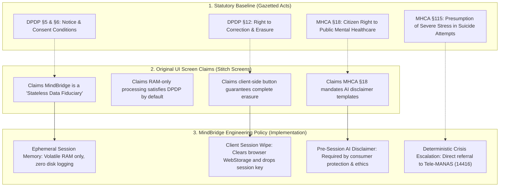

# Statutory Baseline, UI Claims Analysis & Engineering Governance: DPDP Act 2023 & MHCA 2017

## 1. Overview and Analytical Scope
This document analyzes the legal claims, statutory citations, and privacy concepts presented across the MindBridge user interface screens (specifically Screen 17: `17_clinical_safety_data_sovereignty_dpdp_india.html` and Screen 06: `06_safety_privacy_clinical_limitations.html`).

To maintain strict academic and regulatory rigor, this reference enforces an explicit three-way distinction between:
1. **Statutory Baseline:** The black-letter provisions enacted by the Parliament of India.
2. **Original UI Screen Interpretations:** The claims and framings found in the Stitch UI mockups.
3. **MindBridge Engineering Policies:** The actual software architecture, guardrails, and privacy-by-design implementations.

---

## 2. Comparative Legal & Technical Analysis

### A. Digital Personal Data Protection (DPDP) Act, 2023 Framework

#### 1. Statutory Baseline
- **Act Reference:** Digital Personal Data Protection Act, 2023 (Act No. 22 of 2023).
- **Section 5 (Notice):** Mandates that every request for consent must be accompanied or preceded by an itemized notice in clear and plain language describing the personal data to be collected and the specific purpose of processing.
- **Section 6 (Consent):** Requires consent to be free, specific, informed, unconditional, and unambiguous with a clear affirmative action.
- **Section 12 (Right to Correction and Erasure):** Gives the Data Principal the right to request erasure of their personal data unless retention is necessary for specified legal obligations.
- **Data Fiduciary Definition:** The Act defines a Data Fiduciary as any person who determines the purpose and means of processing personal data.

#### 2. Original UI Screen Interpretations (Audit Findings)
- *UI Claim:* Screen 17 asserts that MindBridge is classified as a "stateless data fiduciary" under Section 6 of the DPDP Act and is exempted from typical obligations because data resides solely in volatile memory.
- *Audit Finding (Correction):* **Unsupported.** The term *"stateless data fiduciary"* does not exist in the DPDP Act 2023. The Act does not grant statutory exemptions based solely on RAM-only or in-memory processing. An entity determining the purpose of conversational triage remains a Data Fiduciary under law regardless of storage medium.

#### 3. MindBridge Engineering Policy
- **Architectural Data Minimization:** Personal disclosures are processed strictly in volatile RAM during active sessions and are discarded upon session termination.
- **No Model Training on User Data:** User inputs are never persisted to secondary storage or utilized to fine-tune or train foundational LLMs.
- **Session Erasure Implementation:** The user-facing "Purge Session" trigger purges client-side WebStorage tokens and resets the server-side session context.
- **Audit Limitation:** While this architecture reduces breach exposure, it does not by itself prove end-to-end statutory compliance (e.g., transit logs, TLS termination proxies, telemetry). Formal compliance requires verified privacy audits.

---

### B. Mental Healthcare Act (MHCA), 2017 Framework

#### 1. Statutory Baseline
- **Act Reference:** Mental Healthcare Act, 2017 (Act No. 10 of 2017).
- **Section 18 (Right to Access Mental Health Care):** Guarantees that every person shall have a right to access mental healthcare services run or funded by the appropriate government. Outlines standards of affordability, geographical accessibility, and non-discrimination.
- **Section 115 (Presumption of Severe Stress):** Establishes a statutory presumption that any person who attempts suicide is under severe stress and shall not be prosecuted or punished under Section 309 of the Indian Penal Code. It places an affirmative duty on the government to provide care, treatment, and rehabilitation.

#### 2. Original UI Screen Interpretations (Audit Findings)
- *UI Claim:* Screen 17 and Screen 06 assert that MindBridge operates as an automated companion under MHCA Section 18 and that Section 18 statutorily mandates specific AI disclaimer language on digital interfaces.
- *Audit Finding (Correction):* **Unsupported.** MHCA Section 18 governs state duties and public mental healthcare delivery. It does not regulate conversational artificial intelligence, nor does it mandate specific AI disclaimer templates. The requirement to present conspicuous AI disclaimers arises from consumer protection principles, MeitY advisories, and clinical risk mitigation, not MHCA Section 18.
- *Section 115 Framing:* While Screen 17 correctly cites the decriminalization of suicide attempts under Section 115, this provision is a statutory shield against criminal prosecution and a mandate for government assistance; it does not confer legal clinical authorization onto digital software tools.

#### 3. MindBridge Engineering Policy
- **Explicit Non-Clinical Framing:** Prominently displays pre-session notices stating that MindBridge is an automated conversational system, not a registered psychiatrist, psychologist, or healthcare provider under MHCA 2017.
- **Deterministic Crisis Bypass:** In compliance with clinical risk protocols and the spirit of MHCA Section 115, any detection of self-harm or suicidal crisis immediately halts generative AI output and deterministically displays direct contact details for Tele-MANAS (`14416`) and KIRAN (`1800-599-0019`).

---

## 3. Mandatory Governance & Legal Verification Flags

> [!WARNING]
> ### Flag 1: RAM-Only Processing is Not a Statutory Exemption
> - **Engineering Reality:** Ephemeral in-memory processing minimizes data exposure and supports data minimization principles.
> - **Legal Caveat:** It does not exempt MindBridge from Data Fiduciary obligations (such as notice, verifiable consent, and grievance redressal mechanisms) under the DPDP Act 2023.

> [!WARNING]
> ### Flag 2: AI Disclaimers Are Not Mandated by MHCA Section 18
> - **Engineering Reality:** Conspicuous disclaimers stating "MindBridge is an AI, not a doctor" are critical to prevent unauthorized medical reliance.
> - **Legal Caveat:** These disclaimers are an engineering safety standard and consumer protection measure. Citing MHCA 2017 Section 18 as the statutory source for AI disclaimer wording is legally inaccurate.

> [!WARNING]
> ### Flag 3: MHCA Section 115 Narrow Legal Scope
> - **Engineering Reality:** Self-harm disclosures must trigger supportive, non-punitive, and immediate crisis routing.
> - **Legal Caveat:** MHCA Section 115 decriminalizes attempted suicide under Indian criminal law; it does not authorize automated software to act as a substitute for professional crisis intervention.

> [!CAUTION]
> ### Flag 4: Formal Legal Review Requirement
> - MindBridge 2.0 incorporates privacy-by-design and deterministic safety guardrails.
> - **No assertion of full legal compliance under the DPDP Act 2023 or MHCA 2017 can be made without an independent, formal evaluation conducted by certified Indian legal counsel.**
