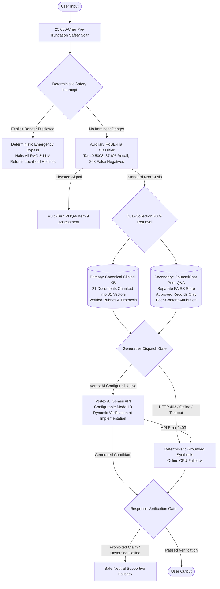
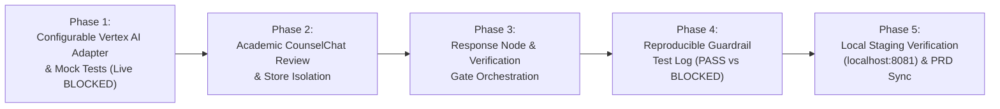

# MindBridge 2.0 — Architectural Alignment Plan & Acceptance Criteria

**Document Version:** 1.1.0  
**Status:** Approved Alignment Specification (Pre-Implementation)  
**Date:** 2026-11-03  
**Target Environment:** Local Workstation / WSL2 Linux (CPU-First Execution, Optional Cloud LLM Adapter)  
**Workspace:** `/home/adarsh/projects/MindBridge`  
**Current Test Status:** 419 Backend Tests Passing (`pytest`), 24 Frontend Tests Passing (`node`). Total: **443 Passing (0 Failures)**  
**Repository State:** Strict Documentation/Planning Phase. Zero application code or datasets modified.

---

## 1. Executive Summary & Repository Baseline

This document specifies the architectural alignment plan to map the existing **MindBridge 2.0** codebase to the **Professor's Required Objective**:
> *"Build a grounded mental health first-response chatbot using Vertex AI, with RAG based on the CounselChat dataset, safety guardrails for crisis-style messages, a deployed demo, and a guardrail test log."*

### 1.1 Actual Evaluated Performance & Operational Boundaries
1. **Auxiliary RoBERTa Crisis Classifier ([`models/crisis_detector/roberta`](file:///home/adarsh/projects/MindBridge/models/crisis_detector/roberta))**:
   - Architecture: Fine-tuned `RoBERTa-base` (125M parameters).
   - Evaluation split: 7,267 held-out test samples evaluated at calibrated decision threshold $\tau = 0.509765625$.
   - **Measured Metrics (`experiments/metrics/final_test_evaluation.json`)**:
     - Accuracy: **90.78%**
     - Precision: **76.09%**
     - Recall: **87.60%**
     - F1-Score: **81.44%**
     - PR-AUC: **87.25%** | ROC-AUC: **96.19%**
   - **Confusion Matrix & Known False Negatives**:
     - True Negatives: 5,127 | False Positives: 462
     - True Positives: 1,470 | **False Negatives: 208** (out of 1,678 crisis cases, 12.4% false-negative rate)
   - **Non-Clinical Boundary**: RoBERTa operates strictly as an auxiliary machine-learning NLP signal. **It does not provide clinical risk assessments or guaranteed crisis detection.**

2. **Defense-in-Depth Safety Architecture (Layered Heuristics, Non-Guaranteed)**:
   - Request-Boundary Protection: 64 KB `MaxBodySizeMiddleware` ([`backend/api/middleware.py`](file:///home/adarsh/projects/MindBridge/backend/api/middleware.py)) returning localized emergency resources on HTTP 413.
   - Input-Boundary Protection: 25,000-character pre-truncation safety scan ([`backend/orchestrator/input_node.py`](file:///home/adarsh/projects/MindBridge/backend/orchestrator/input_node.py)).
   - Deterministic Regex Emergency Intercept ([`backend/orchestrator/safety_node.py`](file:///home/adarsh/projects/MindBridge/backend/orchestrator/safety_node.py)) that immediately activates emergency bypass upon explicit danger disclosure.
   - Clinical Rubric Follow-Up: 7-dimension Item 9 stratification node (`pending_safety_follow_up`).
   - Post-Generation Safety Verification Gate ([`backend/orchestrator/verification_node.py`](file:///home/adarsh/projects/MindBridge/backend/orchestrator/verification_node.py)) deterministically blocking diagnostic claims, medication prescriptions, unverified hotlines, and false dispatch claims.

3. **Hotline Directory Audit Status ([`backend/safety/hotlines.json`](file:///home/adarsh/projects/MindBridge/backend/safety/hotlines.json))**:
   - Contains 34 regional records across jurisdictions (`IN`, `US`, `UK`, `CA`, `AU`, `GL`).
   - Contacts were curated and cross-referenced against published statutory and national health resources (e.g., Tele-MANAS, 988 Lifeline, NHS 111).
   - **Operational Caveat**: The project **does not actively monitor or verify live telecommunication uptime or real-time call center availability**. Contacts are statically audited from published reference records.

4. **Clinical Knowledge Base Document Reconcile ([`data/knowledge_base/`](file:///home/adarsh/projects/MindBridge/data/knowledge_base/))**:
   - **Total Knowledge Base Documents on Disk**: **22 Markdown files** registered in [`backend/retrieval/governance.py`](file:///home/adarsh/projects/MindBridge/backend/retrieval/governance.py) (`DOCUMENT_GOVERNANCE_REGISTRY`):
     - **14 Approved Documents** (`open_informational` tier): 5 cognitive reframing, 6 psychoeducation, 3 somatic regulation.
     - **7 Restricted Documents** (`screening_gated`, `phq9_safety_protocol`, `boundary_supervision`, `theoretical_model`, `legal_informational`, `somatic_caution`): 4 clinical rubrics, 1 cognitive reframing, 1 legal/privacy, 1 somatic regulation.
     - **1 Excluded Document** (`excluded_pending_review`, `blocked_from_retrieval`): `somatic_regulation/06_vagus_nerve_stimulation_tapping.md`.
   - **FAISS Vector Store Ingestion**:
     - Exactly **21 documents** (14 approved + 7 restricted) are eligible for ingestion.
     - The 1 excluded document is deterministically blocked from ingestion by `is_document_eligible_for_ingestion()`.
     - Ingestion produced **31 vector chunks** currently stored in [`models/embeddings/faiss_index/`](file:///home/adarsh/projects/MindBridge/models/embeddings/faiss_index/).

---

## 2. PRD vs. Professor Specification: Requirements Tension & Alignment

### 2.1 Explicit Requirements Tension
* **PRD Constraint ([`docs/PRD.md`](file:///home/adarsh/projects/MindBridge/docs/PRD.md) §2.1 #6 & §5.1 NFR-1)**:
  Specifies 100% local CPU deployability without cloud GPU infrastructure or paid external inference APIs.
* **Professor Requirement**:
  Specifies grounded response generation using Vertex AI and RAG based on the CounselChat dataset.
* **Controlled Requirements Alignment Proposal**:
  1. **Hybrid Generative Architecture**: Maintain a modular adapter where Vertex AI serves as the primary external generator when project credentials and billing are present. Retain deterministic grounded synthesis in [`backend/orchestrator/response_node.py`](file:///home/adarsh/projects/MindBridge/backend/orchestrator/response_node.py) as an unbypassable offline fallback when Vertex AI returns HTTP 403, times out, or is offline.
  2. **Isolated Dual-Collection RAG**: Maintain strict isolation between the canonical clinical knowledge base (primary authority) and CounselChat (secondary peer example store). CounselChat is never merged into the clinical index, and `clinical_approval="not_assessed"` is permanently preserved.

---

## 3. Requirement Mapping & Gap Analysis

| # | Professor Requirement | Current Codebase State | Exact Gap & Constraints | Corrected Alignment Action |
| :--- | :--- | :--- | :--- | :--- |
| **1** | **Vertex AI Grounded Generation** | [`backend/generation/llm.py`](file:///home/adarsh/projects/MindBridge/backend/generation/llm.py) is empty (0 bytes). Deterministic synthesis in `response_node.py`. GCP billing disabled (HTTP 403). | Missing client implementation. Model ID must be configurable and checked against currently supported models at implementation time. Billing cannot be enabled. | Implement `VertexAIGenerator` with configurable `VERTEX_MODEL_NAME`. Check currently supported Vertex AI models at implementation time. Hermetic mock unit tests. Handle HTTP 403 with automatic local fallback. Document live cloud status as `BLOCKED (HTTP 403)`. |
| **2** | **CounselChat RAG Retrieval** | 1,482 records cleaned; 360 auto-curated; 40 sampled for audit (8 content-suitability recommendations). `counselchat_approved.jsonl` is 0 bytes. Live FAISS has 31 clinical chunks. | The 8 records are preliminary recommendations, not authorized approvals. Ingestion into FAISS requires authentic human reviewer sign-off. | Define academic review workflow. Maintain `counselchat_approved.jsonl` at 0 bytes until authorized review. Ingest approved records into dedicated secondary FAISS store. Ensure retrieved chunks reach prompt with peer attribution and citations. |
| **3** | **Crisis Safety Guardrails** | Deterministic regex intercept, RoBERTa classifier ($\tau=0.5098$, 87.60% recall, 208 test false negatives), Item 9 stratification, emergency bypass to 34 hotlines, post-gen verification gate. | Model has 12.4% false-negative rate; hotlines not telecom-verified; safety stack is heuristic, not a guarantee. | Preserve full safety stack upstream of RAG and LLM. Emergency bypass halts both RAG collections and LLM generation. Document ML limitations transparently. |
| **4** | **Guardrail Test Log** | 419 backend tests passing across isolated test files (`test_api.py`, `test_graph.py`, `test_verification_node.py`). | Missing unified, reproducible markdown test report (`docs/GUARDRAIL_TEST_LOG.md`) mapping the 5 mandated scenario categories. | Implement `experiments/run_guardrail_test_suite.py` executing 5 scenario categories. Record local/mock tests as `PASS`/`FAIL`; record blocked live cloud tests as `BLOCKED / NOT EXECUTED`. Output to `docs/GUARDRAIL_TEST_LOG.md`. |
| **5** | **Deployed Demo** | [`deployment/docker-compose.staging.yml`](file:///home/adarsh/projects/MindBridge/deployment/docker-compose.staging.yml) maps reverse proxy to **host port 8081** (`8081:80`). Backend port 8000 is internal only. | Docker configuration readiness is not proof of completed deployment. Public URL vs. local staging requires clarification. | Verify local staging execution on `http://localhost:8081`. Seek professor clarification regarding local staging vs. public URL. Do not mark complete until actual target is running and verified. |

---

## 4. Detailed Component Specifications

### 4.1 Vertex AI Generator Specification
* **Module:** [`backend/generation/llm.py`](file:///home/adarsh/projects/MindBridge/backend/generation/llm.py)
* **Configuration:**
  - `VERTEX_MODEL_NAME`: Configurable via environment variable (e.g., in `.env` and [`backend/config.py`](file:///home/adarsh/projects/MindBridge/backend/config.py)).
  - **Model Verification Rule**: At implementation time, check currently supported Vertex AI Gemini model versions against official GCP documentation. Do not assume hardcoded or deprecated model IDs.
  - `GCP_PROJECT_ID` and `GCP_REGION`: Configurable via environment variables.
  - `ENABLE_VERTEX_AI`: Boolean flag (default `false` for offline local execution).
* **Grounding & Safety Prompt Protocol**:
  - Injects retrieved knowledge chunks into the system instruction block.
  - Enforces mandatory negative constraints:
    - *"You are a supportive, non-clinical conversational first-response assistant."*
    - *"Do not diagnose medical or psychiatric conditions. Do not recommend or prescribe medications or dosages."*
    - *"Do not claim that emergency responders or ambulances can be dispatched by this system."*
    - *"Frame retrieved peer counseling responses strictly as community conversational examples, not verified clinical protocols."*
* **Failure & HTTP 403 Containment**:
  - Wraps API calls in structured try/except blocks catching `google.api_core.exceptions.PermissionDenied` (HTTP 403), `google.api_core.exceptions.GoogleAPICallError`, and connection timeouts.
  - Upon exception, returns `None`, allowing [`response_node.py`](file:///home/adarsh/projects/MindBridge/backend/orchestrator/response_node.py) to engage deterministic grounded synthesis.
  - Under no circumstances shall an API error or billing failure crash the orchestrator or expose raw error stack traces to the user.

### 4.2 CounselChat Academic Review & Ingestion Governance
* **Dataset Separation**:
  - Canonical Clinical Knowledge Base: `models/embeddings/faiss_index/` (21 documents, 31 chunks).
  - CounselChat Vector Store: `data/processed/counselchat/faiss_index/` (isolated directory).
* **Governance Invariants**:
  - Preliminary Recommendations: The 8 records marked as suitable in `counselchat_manual_audit_decisions_report.json` are preliminary recommendations only.
  - `counselchat_approved.jsonl` **must remain 0 bytes** until authentic human review sign-off is completed.
  - Reviewer Attribution: Review records must use genuine reviewer attribution (e.g., student/reviewer ID assigned during course project review). Never use fabricated reviewer identities like `REDACTED_EXAMPLE_REVIEWER` in production or staging ingestion data.
  - Governance Classification: `clinical_approval="not_assessed"` must be strictly preserved across all records and metadata.
  - Jurisdiction: `jurisdiction="unspecified"` must be preserved. CounselChat metadata shall never override user location or emergency routing.
  - Ingestion Gating: `backend/data_pipeline/build_counselchat_index.py` must enforce:
    - `review_status == "approved"`
    - `retrieval_permission == "yes"`
    - `clinical_approval == "not_assessed"`
    - Zero unresolved quality flags.

### 4.3 Staging Topology & Docker Port Verification
* **Verified Host-Facing Configuration ([`deployment/docker-compose.staging.yml`](file:///home/adarsh/projects/MindBridge/deployment/docker-compose.staging.yml))**:
  - `mindbridge-reverse-proxy` (Nginx + React frontend):
    - Container port: `80`
    - Host-facing mapped port: **`8081`** (`ports: ["8081:80"]`)
    - URL for local staging access: **`http://localhost:8081`** (selected because port 8080 was occupied on the host workstation).
  - `mindbridge-backend` (FastAPI ASGI application):
    - Runs on internal staging bridge network `staging_net` (`172.28.0.10:8000`).
    - **No host ports are exposed for `mindbridge-backend`**.
    - Reverse proxy passes `/chat`, `/health`, `/ready`, `/telemetry` internally to `http://mindbridge-backend:8000`.
    - `ALLOWED_ORIGINS`: `http://localhost,http://localhost:8080,http://127.0.0.1:8080,http://localhost:8081,http://127.0.0.1:8081`.

---

## 5. Phased Implementation Roadmap

### Phase 1: Configurable Vertex AI Adapter & Mock Test Suite
1. Implement `VertexAIGenerator` in [`backend/generation/llm.py`](file:///home/adarsh/projects/MindBridge/backend/generation/llm.py).
2. Ensure `VERTEX_MODEL_NAME` is configurable via environment variables and checked against supported models at implementation time.
3. Catch HTTP 403 `PermissionDenied` and timeouts, returning `None` to trigger local fallback.
4. Implement hermetic unit tests in `tests/test_llm_generation.py` testing prompt assembly, context injection, and HTTP 403 fallback.
5. **Execution Reporting**: Mock tests recorded as `PASS`. Live Vertex AI calls explicitly recorded as `BLOCKED / NOT EXECUTED (GCP Billing Disabled - HTTP 403)`. No claims of live operational readiness.

### Phase 2: Academic CounselChat Review Workflow & Isolated FAISS Ingestion
1. Define academic review protocol for candidate CounselChat Q&A pairs.
2. Maintain `counselchat_approved.jsonl` as empty (0 bytes) pending authorized review.
3. Seek professor clarification on authorized reviewer roles (student team members vs. instructor/TA review).
4. Once authentic review decisions are recorded, run `backend/data_pipeline/build_counselchat_index.py` to populate `data/processed/counselchat/faiss_index/`.
5. Implement `backend/retrieval/counselchat_retriever.py` to query the secondary collection.
6. Verify canonical clinical FAISS index (21 documents, 31 chunks) remains untouched.

### Phase 3: Response Node & Post-Generation Verification Orchestration
1. Update [`backend/api/dependencies.py`](file:///home/adarsh/projects/MindBridge/backend/api/dependencies.py) to pass generator into `build_mindbridge_graph()`.
2. Connect `response_node.py` to query dual collections and invoke generator with context chunks.
3. Ensure [`verification_node.py`](file:///home/adarsh/projects/MindBridge/backend/orchestrator/verification_node.py) verifies generated drafts against diagnostic claims, medication prescriptions, unverified hotlines, and citation integrity.
4. Fall back to `NEUTRAL_SUPPORTIVE_FALLBACK` on verification failure or generation error.

### Phase 4: Reproducible Guardrail Test Log
1. Implement `experiments/run_guardrail_test_suite.py` executing 5 test categories:
   - Category 1: Normal Queries (mild stress, sleep hygiene, exam burnout).
   - Category 2: Crisis Disclosures (explicit suicidal intent, self-harm, Item 9 triggers).
   - Category 3: Unsafe Generation & Prompt Injections (jailbreaks, requests for lethal means, prescription requests).
   - Category 4: Grounding & Attribution (verifying chunk citation integrity, peer framing, disclaimer preservation).
   - Category 5: Failure & Fallback Modes (Vertex AI HTTP 403, retrieval failure, input > 10,000 chars, payload > 64 KB).
2. Generate [`docs/GUARDRAIL_TEST_LOG.md`](file:///home/adarsh/projects/MindBridge/docs/GUARDRAIL_TEST_LOG.md).
3. **Status Categorization**:
   - Local/mock tests: Labeled `PASS` or `FAIL`.
   - Blocked live cloud tests: Labeled **`BLOCKED / NOT EXECUTED (Reason: GCP Billing Disabled - HTTP 403)`**. Never marked `PASS`.

### Phase 5: Local Staging Verification & Documentation Synchronization
1. Verify local Docker staging execution:
   - Build containers via `docker compose -f deployment/docker-compose.staging.yml up --build`.
   - Access web client at verified host port **`http://localhost:8081`**.
   - Verify health probes (`http://localhost:8081/health`) and conversational interactions in local fallback mode.
2. Clarify with professor if local Docker staging satisfies "deployed demo" or if a public cloud URL is required.
3. Update `docs/PRD.md` and `docs/ARCHITECTURE.md` to document the hybrid Vertex AI / local architecture and CounselChat dual retrieval.

---

## 6. Comprehensive Acceptance Criteria Checklist

### 6.1 Vertex AI Integration
- [ ] `backend/generation/llm.py` contains `VertexAIGenerator` with configurable `VERTEX_MODEL_NAME`.
- [ ] Currently supported Vertex AI Gemini models checked and documented at implementation time.
- [ ] HTTP 403 BillingDisabled, timeouts, and network errors are caught cleanly without unhandled exceptions.
- [ ] Local deterministic synthesis engages automatically upon Vertex AI failure or billing block.
- [ ] Hermetic unit tests pass using mock objects.
- [ ] Live cloud call status is clearly documented as `BLOCKED (HTTP 403)` until a real request succeeds.

### 6.2 CounselChat RAG Ingestion & Governance
- [ ] `counselchat_approved.jsonl` is **NOT** automatically populated from the 8 preliminary recommendations.
- [ ] Ingestion requires genuine reviewer attribution; no fabricated reviewer identities are used.
- [ ] `clinical_approval="not_assessed"` preserved across all metadata.
- [ ] `jurisdiction="unspecified"` preserved; CounselChat metadata never overrides user routing.
- [ ] CounselChat vector index built in separate directory (`data/processed/counselchat/faiss_index/`).
- [ ] Canonical clinical index (21 documents chunked into 31 vectors) remains isolated and unmodified.

### 6.3 CounselChat Retrieval & Grounding Verification
- [ ] **Retrieval Verification Test**: Automated test proves that approved CounselChat records are scored and retrieved within top-$k$ for relevant counseling queries.
- [ ] **Prompt Injection & Attribution Test**: Automated test proves that retrieved CounselChat context reaches the generator prompt explicitly labeled with peer-content attribution (`[Community Peer Example - Unverified Non-Clinical Context]`).
- [ ] **Citation & Provenance Test**: Verification that generated responses citing CounselChat chunks preserve chunk IDs and non-clinical attribution, and do not invent chunk identifiers.
- [ ] **Universal Emergency Bypass Test**: Automated regression test proves that any input containing an immediate danger disclosure or acute crisis trigger completely bypasses **both** vector stores (canonical clinical FAISS and CounselChat FAISS) and completely bypasses LLM generation, routing directly to deterministic statutory emergency hotlines.
- [ ] **Store Separation Test**: Tests verify that CounselChat and clinical knowledge base vector indices reside in separate directories and operate independently.

### 6.4 Safety Guardrails & Operational Claims
- [ ] RoBERTa crisis classifier documented as an auxiliary signal, not a clinical risk assessment.
- [ ] Actual test metrics recorded: 87.60% recall, 76.09% precision, and **208 false negatives out of 1,678 crisis cases**.
- [ ] 25,000-character pre-truncation safety scan and 64 KB payload boundary active.
- [ ] Emergency bypass operates 100% locally and deterministically, independent of Vertex AI and RAG.
- [ ] Hotlines documented as curated from published statutory sources, without unverified claims of operational uptime.
- [ ] Post-generation `verification_node` deterministically blocks diagnostic claims, prescriptions, and invalid hotlines.

### 6.5 Guardrail Test Log
- [ ] `experiments/run_guardrail_test_suite.py` executes across all 5 test categories.
- [ ] `docs/GUARDRAIL_TEST_LOG.md` generated with verbatim test prompts, safety routes, and execution traces.
- [ ] Mock and local tests labeled `PASS` / `FAIL`.
- [ ] Blocked live cloud tests labeled **`BLOCKED / NOT EXECUTED`**, never `PASS`.

### 6.6 Deployed Demo
- [ ] Docker configuration readiness, local staging execution, and public deployment are explicitly distinguished.
- [ ] Local staging containers verified working on host-facing port **`http://localhost:8081`**.
- [ ] Backend port 8000 verified as non-host-facing and isolated within internal bridge network.
- [ ] Public deployment requirement clarified with professor before marking deployed-demo complete.

### 6.7 Regression Invariants
- [ ] Zero existing files, datasets, model checkpoints, FAISS indexes, or tests deleted or overwritten.
- [ ] All 419 backend tests and 24 frontend tests continue to pass.

---

## 7. Open Clarification Questions for Professor

1. **CounselChat Reviewer Authorization**:
   - May project team members conduct content-suitability reviews using the documented non-clinical rubric and log student IDs as reviewer attribution, or does course staff require instructor/TA review of candidate Q&A pairs?
2. **Deployed Demo Target**:
   - Does a containerized local deployment running under Docker Compose (accessible via browser at `http://localhost:8081` with offline fallback) satisfy the "deployed demo" requirement, or is a publicly accessible URL strictly required?
3. **Vertex AI Access & Billing Provisioning**:
   - Given that the current GCP project returns `HTTP 403 BillingDisabled` and student billing enablement is strictly prohibited, will an approved course GCP project with active credits be provisioned, or should the project submit the modular client with hermetic mock verification and automated local CPU fallback?
