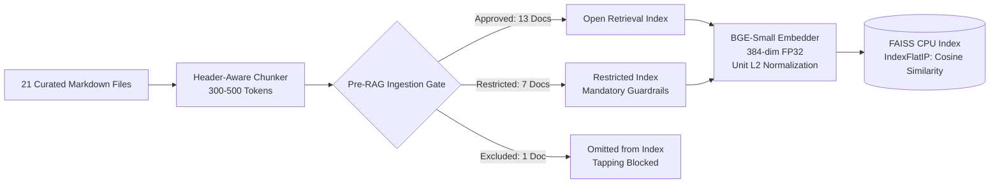

# MindBridge 2.0 — System Architecture & Workflow Specification

**Document Version:** 2.0.0  
**Status:** Approved Architectural Specification (Phase 4 Milestone)  
**Date:** 2026-11-02  
**Target Environment:** Local WSL2 Linux (16 Logical Cores, 7.57 GB RAM, CPU-Only Execution)  
**Workspace:** `/home/adarsh/projects/MindBridge`  

---

## 1. Architectural Philosophy: Controlled Graph vs Autonomous Multi-Agent Swarms

In clinical safety and mental health triage, autonomous multi-agent systems—where independent LLM agents debate, autonomously call tools, and delegate tasks to each other—introduce unacceptable failure modes:
1. **Non-Deterministic Latency:** Dynamic inter-agent loops can stall during critical crisis escalation windows.
2. **State Drift & Hallucination:** Agents passing unconstrained natural language messages risk accumulating hallucinations and losing clinical context.
3. **Unverifiable Safety Invariants:** Proving that an emergency bypass will always execute when suicidal intent is disclosed is intractable in open agent swarms.

MindBridge 2.0 firmly rejects autonomous agent swarms in favor of a **single, centrally orchestrated, deterministic state machine implemented in pure Python (`MindBridgeStateGraph` / `CompiledGraph` in `backend/orchestrator/graph.py`), conforming to LangGraph-compatible state machine interfaces (`add_node`, `add_edge`, `add_conditional_edges`, `compile`, `invoke`) without external runtime library dependencies**. Every node in the graph represents a functional, testable Python transformation over a strongly-typed shared state container (`MindBridgeState`). Transitions between nodes are governed by explicit conditional edge routers, designed to achieve predictable state transitions, bounded latency targets, and verifiable safety boundaries (subject to empirical host CPU profiling).

---

## 2. Component Decomposition & Implementation Status

To ensure strict truth-in-documentation, all system subsystems are categorized by implementation maturity:
* **Tier 1 (Implemented & Verified):** Trained model weights (`models/crisis_detector/roberta/`), curated datasets (`data/processed/`), audited documents (`data/knowledge_base/`), verified hotline registries (`backend/safety/hotlines.json`), pure-Python state machine orchestrator (`backend/orchestrator/graph.py`), FAISS vector store with BGE-small embeddings (`backend/retrieval/`), response verification gate (`backend/orchestrator/verification_node.py`), and FastAPI backend service (`backend/api/`).
* **Tier 2 (Integrated Capabilities):** Real-model inference integration (CPU RoBERTa + BGE-small-en-v1.5 + FAISS IndexFlatIP), deterministic verification, privacy middleware, and rate limiting.
* **Tier 3 (Future Work):** Operational live dial-testing, human clinical trials, multilingual NLP, and statutory regulatory compliance certifications.

### 2.1 Subsystem Decomposition Table

| Subsystem | Component Name | Description | Maturity Status |
| :--- | :--- | :--- | :--- |
| **API Layer** | `FastAPI Interface` | Asynchronous REST endpoints (`/health`, `/ready`, `/chat`) with rate limiting, payload bounds, and privacy logging. | **Tier 1 (Implemented & Verified)** |
| **Orchestrator** | `MindBridgeStateGraph` | Pure-Python deterministic state machine (LangGraph-compatible API) enforcing transitions across 6 safety states. | **Tier 1 (Implemented & Verified)** |
| **Safety Engine** | `Deterministic Regex Matcher` | High-priority pattern-matching engine detecting explicit crisis keywords and emergency triggers before truncation. | **Tier 1 (Implemented & Verified)** |
| **Safety Engine** | `RoBERTa Crisis Classifier` | Fine-tuned `roberta-base` binary classifier ($L=384$, $\tau=0.5098$) with bounded single-worker CPU execution. | **Tier 1 (Implemented & Verified)** |
| **Safety Engine** | `Audited Hotline Directory` | 34 curated emergency dispatch, crisis counseling, text, and hospital entries across 7 jurisdictions (`IN`, `US`, `UK`, `CA`, `AU`, `GL`, `UNKNOWN`). | **Tier 1 (Implemented & Verified)** |
| **Knowledge Engine** | `Audited Markdown Store` | 21 curated Markdown knowledge files classified across 3 retrieval eligibility gates (13 approved, 7 restricted, 1 excluded). | **Tier 1 (Implemented & Verified)** |
| **Knowledge Engine** | `FAISS Vector Store` | Dense vector index (`IndexFlatIP` on unit $L_2$-normalized vectors) operating over header-aware semantic chunks with cosine threshold $\ge 0.65$. | **Tier 1 (Implemented & Verified)** |
| **Knowledge Engine** | `BGE-Small Embeddings` | Dense semantic embedder (`BAAI/bge-small-en-v1.5`, 384 dimensions) running on CPU with unit $L_2$ normalization. | **Tier 1 (Implemented & Verified)** |
| **Generation Engine** | `Response Synthesis Node` | Structured non-clinical psychoeducational response generator with grounding constraint enforcement. | **Tier 1 (Implemented & Verified)** |
| **Verification Gate** | `Verification Node` | Deterministic post-generation safety gate inspecting factual grounding, medical claim avoidance, disclaimer presence, and contact fidelity. | **Tier 1 (Implemented & Verified)** |

---

## 3. LangGraph Workflow & State Schema

```mermaid
flowchart TD
    Start([User Input Received]) --> InputNode[1. Input Node\nPre-Truncation Safety Scan\nPII Masking & Chunking]
    InputNode --> SafetyNode[2. Safety Node\nDeterministic Rules + RoBERTa Screener]
    SafetyNode --> SafetyRouter{Safety Triage Router}

    SafetyRouter -->|Explicit Immediate Danger Disclosed\nState: emergency_bypass| EmergencyNode[4. Emergency Bypass Node\nPresent Direct Helpline Guidance\nUser-Initiated Calling Instructions]
    SafetyRouter -->|Screening Endorsement / Positive Item 9\nState: pending_safety_follow_up| FollowUpNode[3. Safety Follow-Up Node\nEvaluate 7 Clinical Dimensions]
    SafetyRouter -->|Elevated RoBERTa Signal p >= tau\nState: elevated_classifier_signal| FollowUpNode
    SafetyRouter -->|Classifier Timeout / Failure\nState: ml_risk_unassessed| FallbackUnassessed[Safe Non-Clinical Fallback Node\nSupportive Info + General Resources]
    SafetyRouter -->|Informational / Psychoeducation\nState: standard_conversation| PlanningNode[6. Planning Node\nFormulate Dialog Goal & Queries]

    FollowUpNode -->|Multi-Turn Evaluation Incomplete\nState: pending_safety_follow_up| FollowUpPrompt([Prompt Clarifying Assessment Question])
    FollowUpNode -->|Imminent Danger Indicated\nState: emergency_bypass| EmergencyNode
    FollowUpNode -->|Passive Wishes / Ambiguous Risk\nState: supportive_deescalation| DeescalationNode[5. Supportive De-Escalation Node\nValidation & Human Support Resources]

    PlanningNode --> RetrievalNode[7. Retrieval Node\nFAISS IndexFlatIP + BGE-Small\nEnforce Pre-RAG Gates]
    RetrievalNode --> ResponseNode[8. Response Node\nGrounded Synthesis with Guardrails]
    ResponseNode --> VerificationNode[9. Verification Node\nDeterministic Safety Validation]

    VerificationNode --> ValidationGate{Verification\nPassed?}
    ValidationGate -->|Pass| OutputSuccess([Stream Response to User])
    ValidationGate -->|Fail: Emergency State Active\n(emergency_bypass)| EmergencyNode
    ValidationGate -->|Fail: Non-Emergency State\n(Preserves Safety State)| FallbackPreserveState[Safe Fallback Preserving Safety State]

    FallbackPreserveState --> OutputSuccess
    FallbackUnassessed --> OutputSuccess
    DeescalationNode --> OutputSuccess
    FollowUpPrompt --> OutputSuccess
    EmergencyNode --> OutputEmergency([Stream Direct Emergency Guidance to User])
```

### 3.1 State Container Schema (`MindBridgeState`)

The shared state container is implemented as a Python `TypedDict` passed immutably between graph nodes:

```python
from typing import TypedDict, List, Dict, Any, Optional, Literal

# Formal System Type Schemas
JurisdictionCode = Literal["IN", "US", "UK", "CA", "AU", "GL", "UNKNOWN"]
SafetyState = Literal[
    "emergency_bypass",
    "pending_safety_follow_up",
    "supportive_deescalation",
    "standard_conversation",
    "elevated_classifier_signal",
    "ml_risk_unassessed"
]
PHQ9FollowupStatus = Literal["not_started", "in_progress", "completed", "interrupted"]

class KnowledgeChunk(TypedDict):
    chunk_id: str
    document_id: str
    title: str
    category: str
    jurisdiction: JurisdictionCode
    content: str
    score: float  # Cosine similarity score in [-1.0, 1.0]
    eligibility: Literal["approved", "restricted"]

class MindBridgeState(TypedDict):
    # Session & Conversation Context
    session_id: str
    user_id_hash: str
    messages: List[Dict[str, str]]  # Sanitized conversational history only; raw text is never persisted
    sanitized_text: str             # PII-masked user utterance entering graph state
    
    # Safety Intelligence Outputs
    deterministic_danger_flag: bool
    emergency_trigger_matched: Optional[str]
    roberta_prob: Optional[float]
    roberta_crisis_flag: bool
    phq9_item9_endorsed: bool
    phq9_followup_status: PHQ9FollowupStatus
    phq9_risk_level: Optional[Literal["imminent", "passive_unclear", "none", "unassessed"]]
    overall_safety_route: SafetyState
    
    # Dialog Planning & Knowledge Retrieval
    dialog_goal: Optional[Literal["somatic_grounding", "cognitive_reframing", "screening", "general"]]
    retrieval_queries: List[str]
    retrieved_chunks: List[KnowledgeChunk]
    jurisdiction_filter: JurisdictionCode
    
    # Generation & Verification
    draft_response: Optional[str]
    verification_passed: bool
    verification_flags: List[str]
    final_response: str
    execution_trace: List[Dict[str, Any]]
```

**Privacy Boundary & Ephemeral Input-Boundary Data Isolation:**
* **Exclusion of Raw User Text from State:** The raw, unmasked user utterance is defined strictly as temporary input-boundary data. It is ingested into ephemeral in-memory buffers within `input_node` and is **never** added to or stored in `MindBridgeState`.
* **State Ingestion Policy:** Only the scrubbed representation (`sanitized_text`) and PII-masked conversational history (`messages`) enter the graph state.
* **Checkpoint & Log Protection:** Downstream nodes, graph checkpoints, execution traces (`execution_trace`), state snapshots, and telemetry logs strictly persist sanitized data. Unmasked raw input is scoped strictly to local function variables within `input_node` and is never written to persistent disk storage, state containers, or telemetry logs. Upon leaving `input_node`, the reference count drops to zero, making it immediately eligible for reclamation by CPython's reference-counting PyMalloc allocator (noting that standard CPython does not perform cryptographic zero-wiping of physical RAM pages).

---

## 4. Safety Routing & Deterministic Overrides

### 4.1 Priority of Immediate-Danger Disclosures & Decoupling from RoBERTa
Immediate-danger disclosures (e.g., explicit statements of active suicidal crisis, intent to self-harm, or possession of lethal means) **activate the safety pathway immediately and independently of RoBERTa confidence**.
* **Universal Emergency Bypass:** Immediate-danger disclosures completely bypass query planning, FAISS vector retrieval, and response generation, directly invoking `emergency_node` with jurisdiction-specific verified hotline guidance.
* The safety engine does **not** require a high RoBERTa probability score to escalate if deterministic emergency regex patterns are matched.
* Safety escalation does **not** require every risk dimension to be present simultaneously. Any high-risk indicator or combination indicating immediate peril triggers the emergency safety escalation pathway.
* The system avoids simplistic Boolean formulas (e.g., `if intent and plan and means and timeframe`), recognizing that acute disclosures often express immediate crisis through disjoint indicators.
* **Universal Response Verification Gate:** Every non-emergency conversational response must pass through `verification_node` before presentation to the user. Unverified or unsafe drafts trigger safe fallback suppression.

### 4.2 RoBERTa Sequence Length & Safety-Aware Long-Message Processing
* **Initial Inference Setting ($L = 384$):** The fine-tuned RoBERTa model (`models/crisis_detector/roberta/`) was trained on Kaggle using a maximum sequence length of 384 tokens. To ensure exact feature geometry alignment with the training experiment, the backend inference pipeline adopts **$L = 384$** as its initial inference sequence length.
* **Earlier Design Baseline ($L = 256$):** The Phase 4 Step 3 design recommended $L = 256$ based on 94.88% full-text coverage. This remains documented as an optimization baseline for future CPU latency tuning.
* **Pre-Truncation Safety Evaluation:** Safety screening takes absolute precedence over token truncation or message length limits. Before any truncation or length-based rejection occurs, raw user input is scanned by the deterministic regex emergency engine.
* **Long Message Handling via Sliding Window:** For messages exceeding sequence limits ($L > 384$ tokens or $> 2,000$ characters):
  1. Deterministic regex rules evaluate the un-truncated raw text in its entirety before any truncation or rejection.
  2. The input processing pipeline partitions the text into overlapping chunks using a sliding window (256-token window with 64-token overlap, i.e., 192-token stride). The complete message is evaluated for safety across all chunks before any truncation or rejection.
  3. Classifier screening runs across all chunks, taking the maximum crisis probability:
     $$p_{\text{crisis}} = \max_i p_i$$
  4. This ensures that acute disclosures embedded late in lengthy messages are never discarded or masked by truncation.

### 4.3 PHQ-9 Item 9 State Machine & Multi-Turn Structured Follow-Up
When PHQ-9 Item 9 is endorsed, the system **initiates structured safety follow-up; it does NOT automatically activate emergency bypass**. The safety node evaluates risk across the exact seven clinical dimensions established in `docs/PHASE3_STEP4_1_CORRECTIONS.md`:
1. *Passive death wishes* (desire for relief or cessation without suicidal intent).
2. *Active suicidal ideation* (explicit thoughts of taking one's life).
3. *Intent* (stated commitment or determination to act).
4. *Plan* (formulated method, location, or sequence of actions).
5. *Means* (knowledge of or possession of lethal mechanisms).
6. *Access* (physical availability and proximity to lethal means).
7. *Timeframe* (immediacy or stated timeline).

*(Protective factors and emotional agitation are recorded as supplementary contextual considerations only, to inform conversational stabilization tone, but must not be presented as replacements or additional dimensions in the original seven-dimensional framework).*

**Multi-Turn State Management (`pending_safety_follow_up`):**
* Evaluating seven clinical dimensions typically requires multi-turn dialogue. While follow-up questions are being asked and answered, the graph state sets `overall_safety_route = "pending_safety_follow_up"` and `phq9_followup_status = "in_progress"`.
* The orchestrator suppresses open-domain RAG retrieval while in `pending_safety_follow_up`, keeping the focus strictly on structured, empathetic risk assessment.
* **Multi-Turn Interruption & Failure Handling:** If the follow-up dialogue is interrupted, raises an exception, or the user leaves the assessment incomplete, the system records `phq9_followup_status = "interrupted"` and `phq9_risk_level = "unassessed"`. The orchestrator shall **never** silently mark the assessment complete or classify the user as passive-risk. It maintains safe continuity by offering an empathetic continuation prompt alongside accessible human-support options (e.g., standard crisis lifelines) without triggering disruptive emergency takeover screens.

**Routing Transitions & Independent Danger Activation:**
* **Holistic Risk Assessment (Passive vs Imminent Routing):** Triage between passive/ambiguous risk and imminent peril is determined through a holistic evaluation across all seven clinical dimensions and supplementary context. Passive risk is **not** defined merely as the mechanical absence of intent, plan, means, or access. The orchestrator holistically evaluates the complete clinical picture—explicitly evaluating the stated timeframe and acute distress without relying on rigid checklists or simplistic Boolean formulas.
* **Immediate Danger Indicated:** If explicit disclosures or holistic evaluation indicate active ideation combined with actionable intent, plans, lethal means, immediate access, or an imminent timeframe (or disjoint acute indicators of immediate peril), the orchestrator transitions to `emergency_bypass` and routes to `emergency_node`, presenting direct, user-initiated crisis contact guidance.
* **Independent Activation:** Explicit immediate-danger disclosures activate this safety pathway independently of RoBERTa confidence and without requiring all seven dimensions to be present.
* **Passive / Ambiguous Risk:** When holistic evaluation indicates passive death wishes or ambiguous distress without imminent peril or compressed timeframe, the orchestrator sets `overall_safety_route = "supportive_deescalation"` and routes to `deescalation_node`, validating the user's emotional experience and offering human support and crisis resources (such as Tele-MANAS, Crisis Text Line, or 988) without triggering disruptive emergency screens.

### 4.4 Operational Safety States & Routing Transitions
The orchestrator governs transitions across six distinct, mutually exclusive operational safety states:
1. `emergency_bypass`: Triggered by explicit immediate danger disclosures or acute imminent peril. Halts open LLM/RAG generation; emits direct, user-initiated emergency contact guidance.
2. `pending_safety_follow_up`: Active during multi-turn structured safety assessment following Item 9 endorsement or ambiguous risk. Suppresses general RAG; prompts structured assessment questions.
3. `supportive_deescalation`: Triggered when assessment confirms passive ideation or chronic distress without imminent intent, means, or compressed timeframe. Delivers empathetic validation and crisis resources without emergency takeover.
4. `standard_conversation`: Default state for non-crisis informational, wellness, or psychoeducational dialogue.
5. `elevated_classifier_signal`: Triggered when RoBERTa probability $p \ge \tau$ ($0.5098$) in the absence of explicit regex matches. **An elevated RoBERTa signal alone must NEVER activate `emergency_node`.** This state initiates structured safety follow-up (`pending_safety_follow_up`). Route to emergency guidance only when explicit immediate-danger disclosure or holistic safety assessment indicates immediate danger.
6. `ml_risk_unassessed`: Triggered when RoBERTa classification encounters a timeout ($>200\text{ms}$) or runtime exception. Deterministic regex checks remain fully active. If no danger is detected, ML risk is treated as unassessed (neither high-risk nor safe); the system provides supportive non-clinical grounding with general resources.

### 4.5 PII Lifecycle, Privacy Boundaries & Redaction Limitations
* **Ingestion Lifecycle & Ephemeral Input-Boundary Data:**
  1. Raw user text is ingested strictly as temporary input-boundary data into ephemeral in-memory buffers within `input_node`. It is **never** added to or persisted in `MindBridgeState`.
  2. Pre-truncation regex scans evaluate safety patterns across the raw string before any truncation or rejection occurs.
  3. PII scrubbers mask phone numbers, emails, 12-digit Indian Aadhaar numbers, 9-digit US SSNs, and URLs.
  4. Only sanitized text (`sanitized_text`) and sanitized conversation history (`messages`) enter `MindBridgeState` and propagate to downstream nodes.
  5. The raw unmasked string reference is dropped upon `input_node` function return. CPython's PyMalloc manager reclaims the string allocation as its reference count drops to zero; memory is never written to graph checkpoints, state persistence, execution traces (`execution_trace`), or application logs. (Note: standard CPython does not zero-fill deallocated heap memory).
* **Redaction Limitations:** Regex pattern matching reliably scrubs structured numeric and pattern-based tokens. However, personal name detection relies on heuristic capitalization and salutation patterns. In the absence of machine learning Named Entity Recognition (NER), regex scrubbers have known limitations: potential false positives on capitalized common nouns and potential false negatives on uncommon names across diverse linguistic backgrounds. These limitations are explicitly acknowledged in the system's privacy risk register.

---

## 5. Dense Retrieval Pipeline Design (FAISS + BGE-Small)



### 5.1 Chunking Strategy & Pre-RAG Gates
* **Header-Aware Semantic Chunking:** Markdown documents are split along structural section headers (`##`, `###`), maintaining a target window of 300–500 tokens with 50-token semantic overlaps.
* **Pre-RAG Eligibility Routing:**
  1. **Approved for Retrieval (13 documents, 62%):** Fully eligible for general informational and psychoeducational grounding.
  2. **Restricted Retrieval (7 documents, 33%):** Validated clinical rubrics (PHQ-9, GAD-7, PSS-10), statutory guidelines, and acute red-line protocols. Eligible for retrieval **only** when accompanied by mandatory prompt guardrails (non-diagnostic disclaimers, explicit screening intent).
  3. **Excluded Pending Review (1 document, 5%):** Bilateral acupoint tapping (`06_vagus_nerve_stimulation_tapping.md`) is **strictly omitted** from the vector index pending empirical peer-reviewed evidence.

### 5.2 Embedding Normalization, Index Metric & Threshold Semantics
* **Unit $L_2$ Normalization:** All 384-dimensional dense vectors generated by `BAAI/bge-small-en-v1.5` are unit $L_2$-normalized prior to index insertion and query search:
  $$\mathbf{v}' = \frac{\mathbf{v}}{\|\mathbf{v}\|_2}$$
* **Selected Index Metric (`IndexFlatIP`):** The vector database uses FAISS Inner Product (`faiss.IndexFlatIP`). For unit-normalized vectors, the inner product is mathematically identical to cosine similarity:
  $$\langle \mathbf{u}', \mathbf{v}' \rangle = \frac{\mathbf{u} \cdot \mathbf{v}}{\|\mathbf{u}\|_2 \|\mathbf{v}\|_2} = \cos(\theta) \in [-1.0, 1.0]$$
* **Threshold Semantics:** The initial retrieval eligibility threshold is set to a baseline of $\cos(\theta) \ge 0.65$. Chunks with similarity below $0.65$ are pruned as non-relevant.
* **Relationship to Euclidean Distance (`IndexFlatL2`):** For unit-normalized vectors, squared Euclidean distance directly maps to cosine similarity via:
  $$d^2 = \|\mathbf{u}' - \mathbf{v}'\|_2^2 = 2(1 - \cos\theta)$$
  Under this relationship, the baseline similarity threshold of $\cos\theta \ge 0.65$ corresponds to an $L_2$ distance cutoff of $d \le \sqrt{2(1 - 0.65)} = \sqrt{0.70} \approx 0.8367$.
* **Proposed Status & Empirical Calibration:** The $0.65$ cosine similarity threshold is an initial engineering baseline. Final threshold calibration and index selection (`IndexFlatIP` vs `IndexHNSWFlat`) remain proposed architectural specifications requiring local empirical calibration against retrieval benchmark queries in Phase 5.

### 5.3 Hardware Memory Budgeting & Proposed Latency Targets
* **Package Dependencies (Tier 2 Proposed):** Requires `faiss-cpu` and `sentence-transformers`/`transformers` added to `pyproject.toml`.
* **Hardware Memory Footprint:**
  * Embedder Model: `BAAI/bge-small-en-v1.5` requires ~133 MB of RAM.
  * Vector Store Footprint: ~150 chunks $\times$ 384 dimensions FP32 require $<1\text{ MB}$ of RAM.
  * Total static retrieval footprint is $<150\text{ MB}$, well within WSL2 memory limits.
* **Proposed Performance Targets (Hypotheses requiring empirical validation):**
  * Embedding generation latency: Proposed target $<25\text{ms}$ per query on CPU.
  * FAISS search latency: Proposed target $<10\text{ms}$ on CPU.

---

## 6. Failure Handling & Safe Fallback Matrix

The architecture implements a comprehensive fail-closed matrix ensuring that subsystem failures degrade safely without endangering the user:

| Failure Mode | Detection Mechanism | Immediate Fallback Action | Final Output Emitted |
| :--- | :--- | :--- | :--- |
| **RoBERTa Classifier Timeout / Crash** | Execution timer ($>200\text{ms}$) or Python exception. | Maintain deterministic regex/keyword safety checks. **Do NOT automatically classify as high-risk or safe.** Set state to `ml_risk_unassessed`. | Emit gentle, neutral supportive non-clinical response with general help resources (inheriting the safeguard that breathing or somatic exercises are never unconditionally prescribed); avoid false emergency panic screen. |
| **Safety Follow-Up Interruption / Failure** | Incomplete multi-turn response, session timeout, or unhandled exception during structured assessment. | Set `phq9_followup_status = "interrupted"` and `phq9_risk_level = "unassessed"`. **Do NOT silently mark assessment complete or classify as passive-risk.** | Emit gentle supportive continuation prompt offering the option to resume structured reflection when ready, alongside verified human-support resources. |
| **FAISS Vector Store Failure** | Retrieval timeout ($>100\text{ms}$) or empty vector result. | Log retrieval exception; bypass vector context injection. | Inject static core psychoeducation guidelines from version-controlled fallbacks. Grounding or breathing exercises must **not** be presented unconditionally without verifying contextual suitability (e.g., severe panic, hyperventilation, respiratory distress, trauma triggers). |
| **LLM Generation Crash / Timeout** | API/process timeout ($>2.5\text{s}$) or malformed generation. | Abort generative streaming; log provider failure. | Emit pre-approved neutral supportive template from `backend/safety/fallbacks.py`: *"I am here with you. I am ready to support you with information or resources whenever you are ready."* |
| **Verification Gate Failure** | Post-generation safety rule violation (unauthorized medical claim, unrecognized number). | Suppress generated draft response; flag violation category. **Verification failure must preserve the actual safety state; it must NOT convert elevated classifier risk into emergency status.** | Emergency contact guidance is emitted **only** when explicit immediate-danger disclosure or holistic safety assessment indicates immediate danger (`emergency_bypass`). For all other states (including `elevated_classifier_signal` and `pending_safety_follow_up`), the system emits a safe supportive fallback that preserves the active safety state without escalating to emergency dispatch. |
| **Unknown Jurisdiction Resolution** | `jurisdiction_filter == "UNKNOWN"`. | Do **not** silently substitute another country's contacts. Global resources (`GL`, e.g., Befrienders Worldwide) must **never** be presented as substitutes for local emergency dispatch contacts. | Prompt user to clarify geographic location; provide location-independent supportive dialogue and direct to local emergency dispatch services. |

### 6.1 Fallback Content Provenance & Maintenance
* All static fallback messages are version-controlled, clinically vetted strings maintained in a dedicated module ([`backend/safety/fallbacks.py`](file:///home/adarsh/projects/MindBridge/backend/safety/fallbacks.py)).
* Fallbacks are **never** synthesized dynamically by generative LLMs or pulled from unconstrained model memory.
* Every fallback template enforces neutral supportive phrasing (*"I am here with you. I am ready to support you with information or resources whenever you are ready."*) and strictly adheres to the somatic suitability check before any grounding exercises are introduced.

### 6.2 Hotline & Jurisdiction Nuance
* **UK NHS 111 Regional Applicability:** UK NHS 111 Option 2 is a dedicated mental health triage pathway operating across NHS England and parts of Wales; applicability must be verified for the relevant region (Scotland routes mental health support via NHS 24 on 111 with distinct clinical workflows, and Northern Ireland maintains regional health and social care trust services).
* **Non-Substitution of Global Resources:** Global resources (`GL`, e.g., Befrienders Worldwide) must **never** be presented as substitutes for local emergency dispatch contacts. If jurisdiction is unknown or global, the system must direct users to local emergency dispatch services first and prompt for location clarification.
* **Truth-in-Directories:** The system strictly prohibits inventing telephone numbers, operating hours, or availability details not verified in authoritative source records.

---

## 7. Deployment Architecture & Local LLM Selection (WSL2 Host Profile)

### 7.1 Local Hardware Profile
* **Host Operating System:** Linux (WSL2 kernel on x86_64).
* **Logical CPU Cores:** 16 threads available.
* **Memory Budget:** 7.57 GB total RAM (~6.69 GB available).
* **Resource Ceiling:** Peak memory footprint must remain under $4.5\text{ GB}$ to prevent host swapping.
* **Execution Constraint:** Zero local GPU dependencies; all inference optimized for CPU.

### 7.2 Model Deployment Strategy
1. **Crisis Classifier Deployment (Phase 5 Pipeline):**
   * *Baseline:* PyTorch FP32 CPU inference using `models/crisis_detector/roberta/model.safetensors` with sequence length $L = 384$.
   * *Quantized Production:* Dynamic INT8 quantization (`onnxruntime.quantization.quantize_dynamic`) reducing model size from 476 MB to **~125 MB**, cutting memory bandwidth demands and providing vectorized CPU acceleration.
2. **Local Instruction-Tuned LLM (Unresolved Engineering Decision):**
   * The selection of the generative local LLM remains an **unresolved engineering choice**.
   * Candidate models: `Llama-3.2-3B-Instruct`, `Qwen-2.5-3B-Instruct`, `Qwen-2.5-7B-Instruct`, `Mistral-7B-Instruct-v0.3`.
   * Candidate runtimes: `llama.cpp` (4-bit GGUF quantization) or `ONNX Runtime` (INT8 quantization).
   * Resource Allocation Budget:
     * Model weights: 2.0–4.0 GB RAM.
     * KV cache & context window (2,048 tokens): ~300–500 MB RAM.
     * RoBERTa INT8 + BGE-Small: ~260 MB RAM.
     * LangGraph runtime + FAISS index: ~100 MB RAM.
     * Total estimated peak: ~2.7–4.8 GB RAM.
   * **Benchmarking Requirement:** Claiming hardware feasibility or generation throughput ($\ge 15$ tokens/sec) without empirical profiling is prohibited. Local CPU benchmarking on 16 threads in WSL2 is required in Phase 5 to select the final local LLM.

### 7.3 LLM Performance Targets & Latency Feasibility Reconciliation
* **Distinction of Latency Metrics:**
  * **Time-to-First-Token (TTFT):** Proposed target $<500\text{ms}$ (p50) / $<750\text{ms}$ (p95); hard first-token cutoff timeout is $1.5\text{s}$.
  * **Sustained Generation Throughput:** Proposed target $\ge 15\text{ tokens/second}$ on CPU across 16 threads.
  * **Total Generation Time:** Generation time is directly proportional to output length:
    $$T_{\text{gen}} = \text{TTFT} + \frac{N_{\text{tokens}}}{\text{Throughput}}$$
* **Mathematical Infeasibility of 256 Tokens within 2.5s at 15 tps:**
  * At a sustained throughput of $15\text{ tokens/second}$, generating an upper limit of $256\text{ tokens}$ requires $\frac{256}{15} \approx 17.07\text{ seconds}$ of pure decoding time, yielding a total generation time of $\approx 17.6$–$18.0\text{ seconds}$ when including TTFT.
  * Within a $2.5\text{s}$ hard generation timeout, at $15\text{ tokens/second}$ following a $500\text{ms}$ TTFT, the model can generate at most $(2.5 - 0.5) \times 15 = 30\text{ tokens}$.
  * **Do Not Claim 256 Tokens in 2.5s:** The system explicitly does **not** claim that a 256-token response can be generated within a 2.5-second timeout on CPU at 15 tokens/second.
* **Unresolved Architectural Trade-off (Phase 5 Benchmarking):**
  * All performance figures remain **proposed engineering targets requiring empirical validation**.
  * The balance between output length and latency is an unresolved engineering decision to be finalized during Phase 5 CPU benchmarking:
    * *Conversational First-Response Profile:* Enforce concise candidate generation ($\le 30$–$35$ tokens) when adhering to the strict $2.5\text{s}$ interactive timeout.
    * *Grounded Psychoeducation Synthesis Profile:* For full-length educational responses (up to 256 tokens), extend the total generation timeout budget to $18.0$–$20.0\text{s}$, relying on continuous token streaming (with TTFT $<750\text{ms}$) so the user experiences immediate conversational interactivity rather than waiting for full-message completion.
