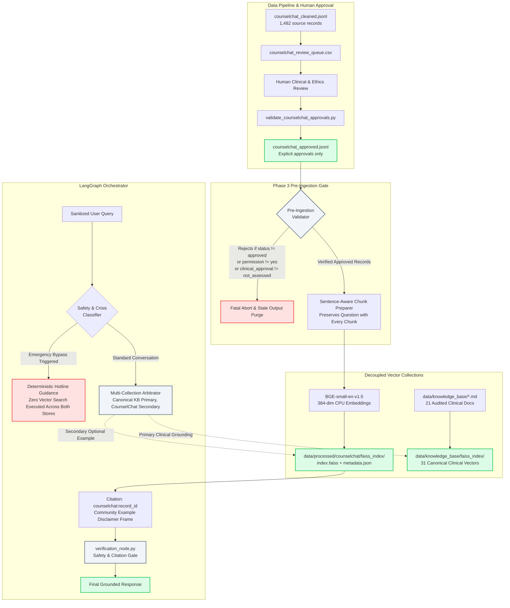
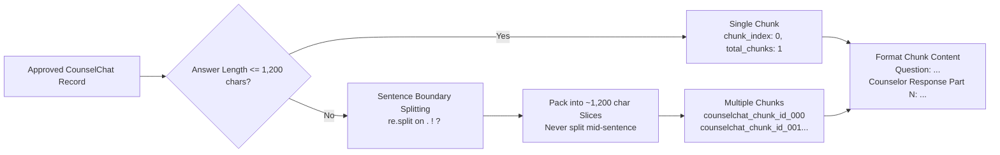
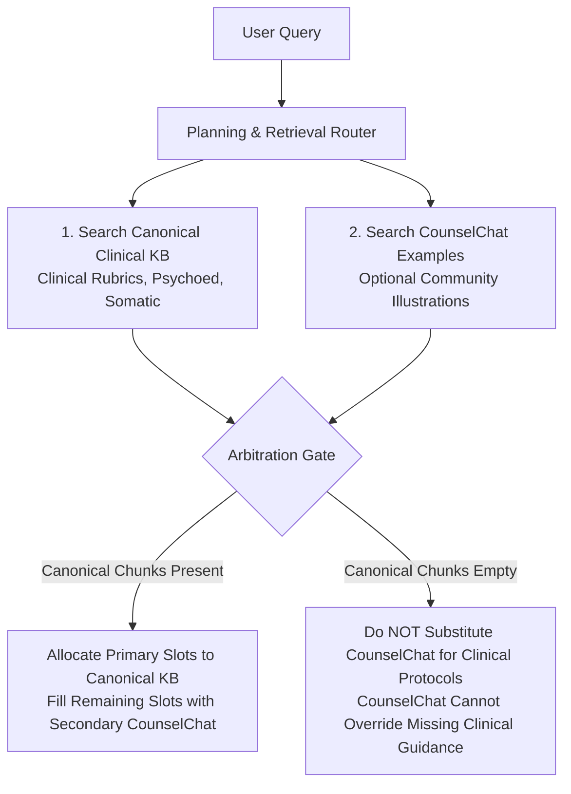
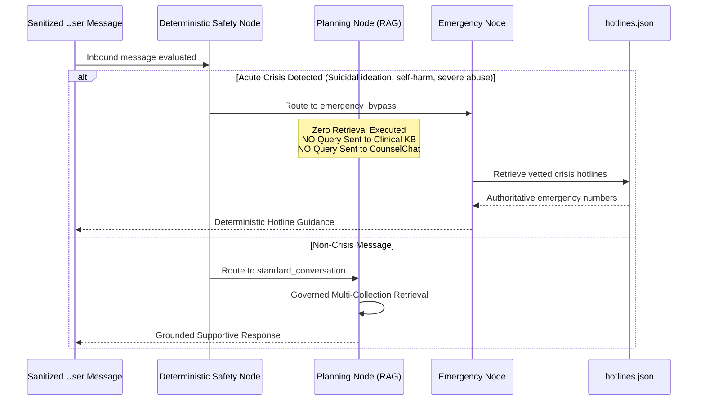

# MindBridge 2.0 — CounselChat RAG Integration Architecture
**Phase 3: Governed Knowledge Ingestion & Retrieval Design**  
*Document Version: 1.1.0 | Date: 2026-11-03 | Status: Hardened Design Specification*

---

## 1. Executive Summary & Purpose

MindBridge 2.0 employs a strict, governance-driven Retrieval-Augmented Generation (RAG) architecture. Following the completion of CounselChat dataset cleaning, automated screening, and manual sample audit workflows, this specification defines the **Phase 3 CounselChat RAG Integration Architecture**.

The primary objective is to enable validated, human-approved CounselChat Q&A records to serve as **non-clinical peer counseling examples and psychoeducational conversational illustrations** while enforcing absolute separation from the canonical clinical knowledge base (`data/knowledge_base/`).



---

## 2. Decoupled Collection Architecture & Separation

CounselChat records are **strictly decoupled** from the canonical clinical knowledge base. The system maintains two distinct vector store collections:

| Architectural Dimension | Canonical Clinical Knowledge Base | CounselChat Example Collection |
| :--- | :--- | :--- |
| **Filesystem Location** | `data/knowledge_base/faiss_index/` | `data/processed/counselchat/faiss_index/` |
| **Sole Input Source** | `data/knowledge_base/*.md` (audited) | `data/processed/counselchat/counselchat_approved.jsonl` |
| **Collection Identifier** | `canonical_clinical_kb` | `counselchat_examples` |
| **Source Provenance** | Evidence-based clinical manuals & screening rubrics | Unverified public community counseling Q&A forum |
| **Clinical Safety Level** | `screening_gated`, `phq9_safety_protocol`, `open_informational` | `informational_example_only` |
| **Clinical Approval** | Certified clinical consensus | `not_assessed` (strictly preserved governance status) |
| **Retrieval Tier** | `approved` (13 docs) / `restricted` (7 docs) | `approved` (only approved records with permission) |
| **Jurisdiction Metadata** | Explicit jurisdictional codes (`IN`, `US`, `UK`, `CA`, `AU`, `GL`) | `unspecified` by default; strictly non-authoritative |
| **Citation Tag** | Document slug (e.g. `[somatic_regulation:01...]`) | Record ID tag (e.g. `[counselchat:counselchat_0002]`) |
| **Disclaimer** | Screening & diagnostic non-assessment disclaimer | Community example disclaimer (never clinical fact) |

### Key Guarantees:
1. **Directory Isolation**: Separate index directories guarantee that CounselChat operations cannot corrupt, overwrite, or mutate the canonical clinical vector store.
2. **Independent Lifecycle**: Re-indexing or rolling back CounselChat records does not touch or re-compute embeddings for the clinical knowledge base.
3. **Audit Immutability**: The 31 vectors in `data/knowledge_base/faiss_index/` remain sealed and protected against external data drift.

---

## 3. Strict Pre-Ingestion Invariants & Validation Rules

Ingestion into the CounselChat vector store will accept records **only** from `data/processed/counselchat/counselchat_approved.jsonl` after passing the pre-ingestion validation rules implemented in `backend/retrieval/counselchat_rag_design.py`:

```python
def validate_counselchat_record_for_ingestion(record, orig_record=None) -> List[str]:
    ...
```

### Mandatory Invariant Checklist:
1. **`review_status == "approved"`**:
   Records with `pending_review`, `restricted`, `rejected`, or `provisional` status are strictly prohibited from entering retrieval.
2. **`retrieval_permission == "yes"`**:
   Approval without explicit retrieval permission is invalid and rejected.
3. **`clinical_approval == "not_assessed"`**:
   > [!IMPORTANT]
   > `clinical_approval="not_assessed"` is a **governance classification status**, NOT a safety certification. It indicates that clinical approval has not been assessed in this project. Ingestion code is strictly forbidden from converting `not_assessed` into `approved` or `clinically_approved`.
4. **Mandatory Reviewer Metadata**:
   - `reviewer`: Non-empty identifier of the authorized clinical reviewer (unmistakable placeholder `REDACTED_EXAMPLE_REVIEWER` used in tests/examples).
   - `reviewed_at`: Valid ISO date (`YYYY-MM-DD`).
   - `review_notes`: Non-empty explanation of the suitability decision.
5. **Zero Unresolved Quality Flags**:
   `quality_flags` must be an empty list (`[]`). Any record with flags (e.g. `short_answer_review`, `missing_topic_review`) is rejected.
6. **Non-Empty Content Fields**:
   Both `question_text` and `answer_text` must be non-empty, stripped strings.
7. **Exact Source Integrity Match**:
   Every record must match its counterpart in `data/processed/counselchat/counselchat_cleaned.jsonl` exactly:
   - `record_id`, `source_dataset`, `source_row_index`
   - `question_title`, `question_text`, `answer_text`
   - Normalized `topics`
8. **Rejection of Auto-Curated Records**:
   Records from `counselchat_auto_curated.jsonl` (including `PROVISIONAL_CANDIDATE`) cannot be ingested directly. They must transition through the human review queue and approval validator first.

---

## 4. Chunk Metadata Schema & Provenance

Each CounselChat vector chunk stored in `metadata.json` conforms to the `CounselChatChunkMetadata` TypedDict schema:

```json
{
  "record_id": "counselchat_0002",
  "source_dataset": "elvindavis/counselchat",
  "source_row_index": 2,
  "question": "I have secrets in my mind, and I don't know what to do with them. I don't want to tell my wife and mom because I don't want to hurt them...",
  "answer": "It sounds like keeping the secrets has become a problem for you now. There are several things to consider before you make a decision...",
  "topics": [
    "Family Conflict"
  ],
  "reviewer": "REDACTED_EXAMPLE_REVIEWER",
  "reviewed_at": "2026-11-03",
  "review_status": "approved",
  "retrieval_permission": "yes",
  "clinical_approval": "not_assessed",
  "content_hash": "e3b0c44298fc1c149afbf4c8996fb92427ae41e4649b934ca495991b7852b855",
  "collection": "counselchat_examples",
  "chunk_id": "counselchat_chunk_counselchat_0002_000",
  "chunk_index": 0,
  "total_chunks": 1,
  "title": "Keeping secrets from my family",
  "content": "Question: I have secrets in my mind...\n\nCounselor Response:\nIt sounds like keeping the secrets has become a problem...",
  "jurisdiction": "unspecified",
  "category": "peer_counseling_example",
  "retrieval_tier": "approved",
  "clinical_safety_level": "informational_example_only",
  "disclaimer": "This excerpt is from an unverified community counseling Q&A forum. It illustrates peer perspectives and conversational coping strategies, NOT clinical recommendations, diagnostic evaluations, or verified medical facts.",
  "guardrails": [
    "Unverified community counseling perspective; never a clinical recommendation.",
    "Do not copy or endorse unsafe advice merely because it was retrieved in a community example.",
    "Do not prescribe medications, medical dosages, or psychiatric diagnoses.",
    "The post-generation verification gate enforces all safety policies regardless of retrieved text."
  ]
}
```

### Governance Principles on Metadata:
- **`reviewer`**: An unmistakable placeholder (e.g., `REDACTED_EXAMPLE_REVIEWER`) must be used in all design documents and test fixtures. Never create, simulate, or imply an actual clinician's identity.
- **`jurisdiction`**: Set strictly to `"unspecified"` unless verified from reliable source metadata. CounselChat jurisdiction metadata is strictly non-authoritative and **must never override the user's actual location or emergency routing**.

---

## 5. Long-Answer Chunking Specification

To handle answers spanning diverse lengths (from ~200 characters to >3,000 characters) without losing context or truncating sentences:



### Chunking Rules:
1. **Preserve Original Question**: The full, unshortened `question_text` is prepended to **every** chunk produced from the record. This ensures each vector retains the complete situational context.
2. **Sentence Boundary Preservation**: Long answers ($> 1,200$ characters) are sliced strictly across sentence boundaries (`[.!?]\s+|\n\n+`). Sentences and words are never chopped mid-stream.
3. **Deterministic Chunk Identifiers**: Format is `counselchat_chunk_{record_id}_{chunk_index:03d}` (e.g. `counselchat_chunk_counselchat_0002_000`, `counselchat_chunk_counselchat_0002_001`).
4. **Deterministic Content Hash**: Each chunk computes its own SHA-256 hash over its full formatted `content`.
5. **Exact Provenance Inheritance**: Every chunk inherits the record's source dataset, row index, topics, reviewer, reviewed date, review status, retrieval permission, and clinical approval status.

---

## 6. Retrieval Framing & Layered Safety Boundaries

To ensure unverified community counseling responses are safely framed and never presented as clinical facts:

### 6.1 Unverified Source Framing
- CounselChat is an **unverified community counseling Q&A forum**.
- Retrieved responses are illustrative examples of peer perspectives and conversational coping styles, **not clinical recommendations or verified medical facts**.

### 6.2 Generation Layer Responsibilities
When CounselChat chunks are injected into the generator prompt:
- **Perspective Framing**: The generator must frame CounselChat advice using conditional conversational phrasing:
  > *"In public counseling discussions around similar challenges, one perspective shared was..."*
- **No Unsafe Replication**: The generator layer is strictly instructed **never to copy, adopt, or recommend unsafe advice** merely because it appeared in a retrieved CounselChat chunk.

### 6.3 Verification Layer Enforcement
The post-generation verification gate ([`verification_node.py`](file:///home/adarsh/projects/MindBridge/backend/orchestrator/verification_node.py)) acts as the final deterministic safety barrier:
- Applies all existing safety rules with **zero exemptions** for retrieved CounselChat text.
- Rejects any response containing diagnostic labeling, medication prescribing, unverified telephone contacts, or clinician impersonation.
- Requires that any `[counselchat:{record_id}]` citation tag matches an actually retrieved chunk.

---

## 7. Multi-Collection Retrieval Arbitration

When both the canonical clinical knowledge base and the CounselChat collection are active:



### Arbitration Priority Invariants:
1. **Canonical Clinical Priority**: The canonical clinical knowledge base **always** takes precedence over CounselChat examples.
2. **Secondary & Optional**: CounselChat examples are supplementary and optional; they serve only to illustrate experiential coping perspectives.
3. **No Safety Substitution**: CounselChat examples must **never** substitute for missing or withheld clinical safety guidance. If canonical clinical screening or safety rubrics are missing, CounselChat cannot be used as an alternative.
4. **Strict Budget Allocation**: Within the top-$k$ budget (e.g. 5 chunks), canonical clinical chunks receive first priority; CounselChat chunks occupy remaining slots only if the budget permits.

---

## 8. Provisional Similarity Threshold & Retrieval Benchmark Plan

### 8.1 Provisional Status of Threshold 0.70
The similarity threshold $\tau = 0.70$ is **provisional and unvalidated**. It represents an initial heuristic starting point (more conservative than the clinical KB $\tau = 0.65$), but cannot be treated as a validated clinical boundary.

### 8.2 Retrieval Benchmark Plan (Phase 4)
Before live retrieval is deployed, a formal offline benchmark must calibrate and evaluate retrieval quality:

1. **Evaluation Metrics**:
   - **Precision@k**: Proportion of retrieved CounselChat examples that are genuinely relevant to the user query's situation.
   - **Recall@k**: Proportion of known relevant counseling perspectives successfully surfaced in top-$k$.
   - **Irrelevant Retrieval Rate**: Frequency with which out-of-domain or noisy chunks are retrieved above the threshold.
   - **Abstention Quality**: Ability of the retriever to cleanly return an empty list (`[]`) when user queries do not match any approved CounselChat topic, preventing hallucinated grounding.
2. **Dataset Partitioning & Contamination Prevention**:
   > [!CAUTION]
   > Threshold tuning must **NEVER** use the final held-out evaluation set. Calibration must be conducted exclusively on a dedicated development/calibration split to prevent data contamination and optimistic evaluation bias.

---

## 9. Absolute Emergency Crisis Bypass

Under the MindBridge Safety Architecture, emergency safety bypass is **absolute and non-negotiable**:



### Absolute Bypass Invariants:
1. **Zero Queries to Either Collection**: When `overall_safety_route == "emergency_bypass"` or `deterministic_danger_flag == True`, vector search across **both** collections (Clinical KB and CounselChat) is **100% halted**.
2. **`retrieval_status = "not_attempted"`**: Neither FAISS index is loaded or queried.
3. **No CounselChat in Crisis**: CounselChat records are strictly forbidden from participating in suicide prevention, crisis response, or acute emergency guidance.
4. **Authoritative Contacts Only**: Crisis guidance is constructed exclusively from `backend/safety/hotlines.json`.

---

## 10. Operational Security & Rollback Strategy

1. **Atomic File Operations**: Vector indexing and metadata writes use `.tmp_<pid>` temporary files and `os.replace` to prevent partial or corrupted index publication.
2. **Integrity Validation**: On loading, `FAISSVectorStore.load()` calculates the SHA-256 of `index.faiss` and verifies it against stored metadata, immediately rejecting corrupted binaries.
3. **Local CPU Execution**: All embeddings and vector operations run strictly on CPU without external API calls or Vertex AI billing.
4. **Hermetic Testability**: All contract tests execute using lightweight fixtures with zero persistent index writes.

---

*Phase 3 Hardened Architecture Specification concluded. Ready for Phase 4 benchmarking upon review.*
