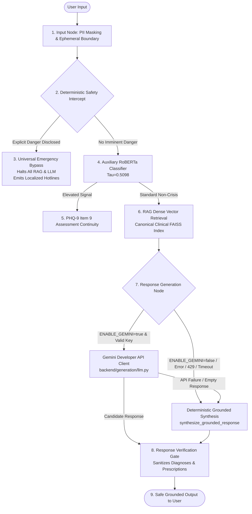

# Google AI Studio — Gemini Developer API Integration Guide

**Module:** `backend/generation/llm.py`  
**Provider:** Google AI Studio — Gemini Developer API (NOT Vertex AI)  
**Implementation Phase:** Phase 1  
**Document Version:** 1.0.0  
**Date:** 2026-11-03  

---

## 1. Architectural Overview & College Project Context

### 1.1 Provider Distinction
* **Provider:** **Google AI Studio — Gemini Developer API**.
* **CRITICAL ARCHITECTURAL DISTINCTION:** This implementation uses Google's Gemini Developer API via Google AI Studio (`google-genai` SDK). **It is NOT Google Cloud Vertex AI.**
* **Project Context & Rationale:** The original academic specification proposed Vertex AI. However, testing on the college project GCP account returned an unbypassable billing error (`HTTP 403 BILLING_DISABLED`). Because college project guidelines strictly prohibit enabling paid cloud billing or using personal credit cards, the project team adopted the **Google AI Studio Gemini Developer API** as the sanctioned cloud LLM provider for Phase 1.

### 1.2 Execution Pipeline & Safety Precedence
The Gemini generation layer is integrated directly into the MindBridge conversational state graph without bypassing any deterministic safety stages:



### 1.3 Critical Safety Rule: Emergency Bypass Independence
Emergency disclosures (imminent suicide threats, self-harm intentions, lethal means disclosures) trigger **Universal Emergency Bypass** in `deterministic_safety_node`. The graph immediately routes to `emergency_node`, completely bypassing:
1. Gemini API calls
2. Canonical clinical FAISS vector retrieval
3. Any secondary community Q&A retrieval

Under no circumstances is cloud LLM generation executed during an emergency triage event.

---

## 2. Configuration & Secrets Management

All Gemini integration parameters are configured via environment variables.

### 2.1 Required Environment Variables

| Variable | Type | Default | Description |
| :--- | :--- | :--- | :--- |
| `ENABLE_GEMINI` | boolean | `false` | Master toggle. Must be explicitly set to `true` to enable Gemini generation. |
| `GEMINI_API_KEY` | string | `""` | Google AI Studio API key. Obtained from [Google AI Studio](https://aistudio.google.com/). |
| `GEMINI_MODEL` | string | `gemini-2.5-flash` | Configurable model identifier (e.g. `gemini-2.5-flash`, `gemini-1.5-flash`). |
| `GEMINI_REQUEST_TIMEOUT` | float | `10.0` | Maximum network request timeout in seconds before falling back to local synthesis. |

### 2.2 Security Invariants
* **Zero Hardcoded Secrets:** No API keys, tokens, or credentials are hardcoded in source code, tests, configuration templates, or Git tracking.
* **Logging Redaction:** The Gemini client never logs API keys. Exceptions and HTTP errors are classified and sanitized before logging.
* **Frontend Isolation:** `GEMINI_API_KEY` is restricted exclusively to the backend Python runtime. It is never exposed to Vite, React, or frontend client bundles.
* **`.env` Ignored:** Real `.env` files are excluded by `.gitignore`.

---

## 3. Local Setup Instructions

### 3.1 Initial Setup (Default Offline Mode)
By default, MindBridge operates 100% locally on CPU without external API calls:
```bash
# Verify environment dependencies
uv sync

# Run the test suite (100% hermetic, zero API keys required)
PYTHONPATH=. uv run pytest tests/test_llm_generation.py -v
```

### 3.2 Enabling Gemini Developer API (Optional Live Mode)
To activate live Gemini generation for testing or demonstration:
1. Obtain an API key from [Google AI Studio](https://aistudio.google.com/).
2. Create or update your local `.env` file (never commit this file):
   ```bash
   ENABLE_GEMINI=true
   GEMINI_API_KEY=your_actual_api_key_here
   GEMINI_MODEL=gemini-2.5-flash
   GEMINI_REQUEST_TIMEOUT=10.0
   ```
3. Start the backend:
   ```bash
   PYTHONPATH=. uv run uvicorn backend.api.app:app --host 0.0.0.0 --port 8000 --reload
   ```
4. Verify readiness status:
   ```bash
   curl http://localhost:8000/ready
   ```
   The response will show `"gemini_generator": true` when correctly configured and enabled.

---

## 4. Grounded Prompt Engineering & Safety Boundaries

The prompt assembly function ([`build_grounding_prompt`](file:///home/adarsh/projects/MindBridge/backend/generation/llm.py)) strictly enforces MindBridge's clinical and governance boundaries:

1. **Non-Clinical Role:** The model is instructed: *"You are an AI conversational first-response assistant, NOT a doctor, licensed therapist, psychiatrist, or medical professional."*
2. **No Diagnostic Claims:** Prompt explicitly forbids assigning clinical diagnoses or interpreting symptoms as mental disorders.
3. **No Medication or Dosage Advice:** Strict prohibition against mentioning or evaluating psychiatric medications.
4. **No Dispatch Claims:** Forbids claims of emergency responder dispatch or automated calling.
5. **Community Q&A vs. Approved Educational Content:**
   - Approved protocols from the clinical knowledge base are labeled `Approved Educational / Clinical Protocol`.
   - Community Q&A items (e.g., CounselChat) are explicitly labeled: `Unverified Community Q&A (Peer Perspective — Non-Clinical, Illustrative Only)`.
6. **Citation Integrity:** The prompt commands the model to use ONLY the exact titles or Chunk IDs provided in the context, preventing fabricated citation identifiers.

---

## 5. Controlled Failure Containment & Local Fallback

If the Gemini Developer API is unavailable or encounters an error, the system traps the condition and engages the local deterministic grounded fallback:

| Condition | Error Code | System Action | Result to User |
| :--- | :--- | :--- | :--- |
| `ENABLE_GEMINI=false` | `GEMINI_DISABLED` | Local deterministic synthesis in `response_node.py` | Grounded educational response from local KB |
| Missing `GEMINI_API_KEY` | `MISSING_API_KEY` | Local deterministic synthesis in `response_node.py` | Grounded educational response from local KB |
| Missing `GEMINI_MODEL` | `MISSING_MODEL` | Local deterministic synthesis in `response_node.py` | Grounded educational response from local KB |
| HTTP 401 / 403 / Invalid Key | `AUTH_FAILURE` | Logs masked warning, local deterministic synthesis | Grounded educational response from local KB |
| HTTP 429 Quota Exceeded | `QUOTA_EXCEEDED` | Logs rate-limit telemetry, local deterministic synthesis | Grounded educational response from local KB |
| Network Timeout (> 10s) | `TIMEOUT` | Traps timeout, local deterministic synthesis | Grounded educational response from local KB |
| Empty / Malformed Text | `EMPTY_RESPONSE` | Local deterministic synthesis | Grounded educational response from local KB |
| Prohibited Clinical Claim | `PROHIBITED_CLAIM_SUPPRESSED` | Replaced by `NEUTRAL_SUPPORTIVE_FALLBACK` | Safe neutral supportive fallback |

In all failure scenarios:
- The conversation graph never crashes.
- Verification gate ([`verification_node.py`](file:///home/adarsh/projects/MindBridge/backend/orchestrator/verification_node.py)) audits the final output.
- The user is never falsely classified as non-crisis due to generation failure.
- No internal stack traces, API keys, or error messages reach the frontend.

---

## 6. Known Free-Tier Quota & Availability Limitations

When using Google AI Studio free-tier API keys, developers should be aware of statutory rate boundaries:
* **Request Quota:** The free tier typically enforces a rate limit (e.g., 15 requests per minute / 1,500 requests per day depending on the model).
* **Quota Exhaustion (HTTP 429):** Rapid successive user messages may exhaust free-tier quotas. MindBridge handles this gracefully by automatically switching to local CPU grounded synthesis without interrupting the user's session.
* **Cold Starts & Network Latency:** Network requests to Google AI Studio typically require 500ms to 2,000ms. If network latency exceeds `GEMINI_REQUEST_TIMEOUT` (10s), the local fallback triggers immediately.

---

## 7. Automated Hermetic Testing

The integration includes 15 focused tests in [`tests/test_llm_generation.py`](file:///home/adarsh/projects/MindBridge/tests/test_llm_generation.py). All tests are hermetic and run with mock objects without network access or live API keys.

To run the Gemini test suite:
```bash
PYTHONPATH=. uv run pytest tests/test_llm_generation.py -v
```

### Verification Note
* **No live Gemini API request was performed during implementation or testing.**
* All tests verify behavior using mock objects and synthetic network/error injection.
* Live requests shall only be conducted when authorized with an approved Google AI Studio API key.
