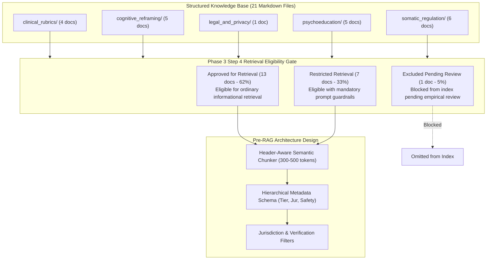
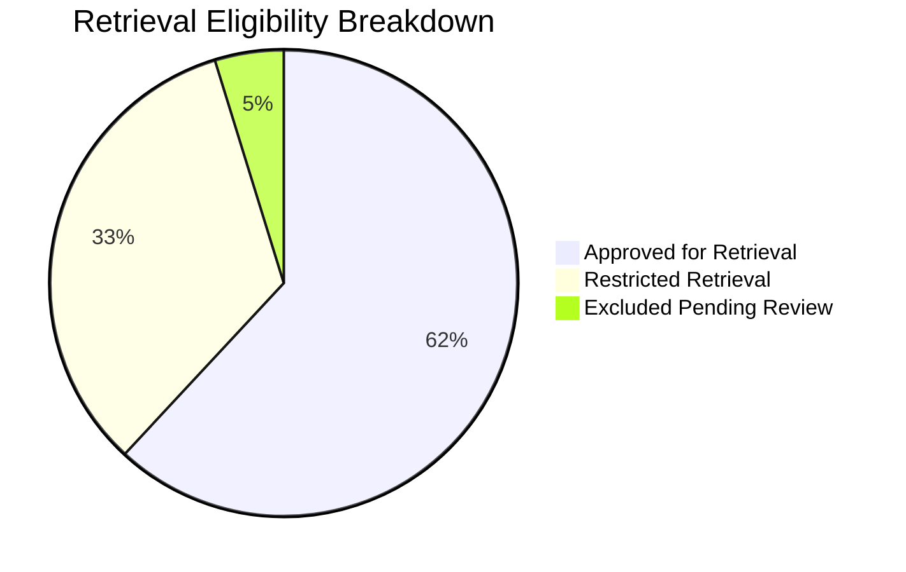
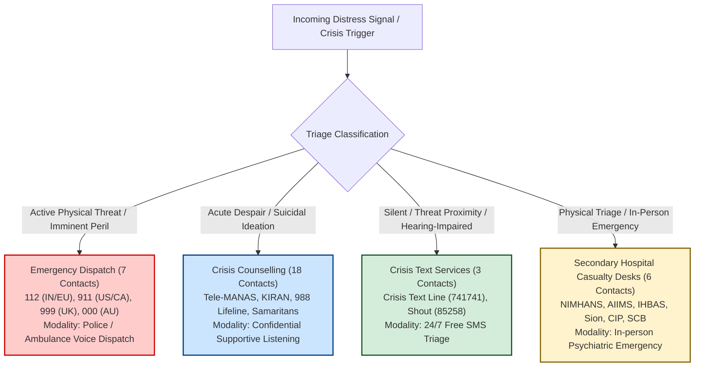
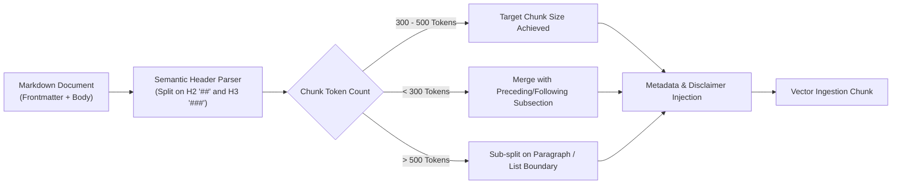

# MindBridge 2.0 — Phase 3, Step 4: Knowledge Base Finalization Audit

**Audit Date:** 2026-11-01  
**Project:** MindBridge 2.0 (CSE473 Agentic AI First-Response Architecture)  
**Workspace:** `/home/adarsh/projects/MindBridge`  
**Target Knowledge Directory:** `data/knowledge_base/` (21 Markdown Documents)  
**Target Safety Configuration:** `backend/safety/hotlines.json` (34 Emergency Contacts)  
**Audit Purpose:** Comprehensive pre-RAG ingestion evaluation, clinical triage categorization, hotline separation verification, and RAG preparation schema design.

---

## 1. Executive Summary

This finalization audit concludes Phase 3 by evaluating all structured knowledge base assets and safety hotlines extracted from the MindBridge Stitch UI screens. It prepares the knowledge base for a future Dense Vector Retrieval-Augmented Generation (RAG) pipeline without creating embeddings, running vector indexes, or downloading language models.



> [!NOTE]
> **Engineering Eligibility vs Clinical Validation:**  
> Classification as `approved for retrieval` denotes that a document has fulfilled engineering and architectural prerequisites (structural schema validity, explicit boundary disclaimers, and non-clinical framing) suitable for retrieval-augmented generation. It reflects **system ingestion eligibility**, not independent clinical validation or therapeutic endorsement.

---

## 2. Task 1 & 2 — Document Inventory & Retrieval Eligibility

All 21 Markdown files under `data/knowledge_base/` were audited for provenance, institutional attribution, disclaimers, and retrieval safety.

### 2.1 Retrieval Classification Definitions
- **`approved`**: Approved for ordinary informational retrieval. Content that is structurally valid, evidence-informed, and contains explicit disclaimers qualifying it for general conversational grounding.
- **`restricted`**: Validated screening scales, clinical red lines, or statutory analyses that **must not enter open-ended conversational generation** without mandatory guardrails (e.g. non-diagnostic disclaimers, explicit query-intent triggers, physical safety cautions, or risk stratification).
- **`excluded pending review`**: Unverified alternative therapies or claims lacking neurobiological consensus. Must remain excluded from the retrieval index until empirical evidence and clinical review requirements are fulfilled.

### 2.2 Comprehensive Document Inventory & Eligibility Table

| Document ID | Title | Cat. | Jur. | Source Organization | Source URL | Verification Status | Eligibility | Key Reason for Classification |
| :--- | :--- | :---: | :---: | :--- | :---: | :---: | :---: | :--- |
| `clinical_rubrics:01_gad7_anxiety_screening_overview` | GAD-7 (Generalized Anxiety Scale 7-Item) Overview | `clinical_rubrics` | `GL` | Spitzer et al. (2006) / Primary Care | `null` | `independently_verified` | **`restricted`** | Validated screening rubric, but must NEVER be used to auto-diagnose. Requires mandatory non-diagnostic prompt guardrail. |
| `clinical_rubrics:02_phq9_mood_screening_overview` | PHQ-9 (Patient Health Questionnaire 9-Item) Overview | `clinical_rubrics` | `GL` | Kroenke et al. (2001) / Primary Care | `null` | `independently_verified` | **`restricted`** | Validated screening rubric containing Item 9. Must never be used as a standalone suicide-risk assessment or auto-diagnosis. Positive Item 9 triggers immediate safety follow-up stratifying passive wishes vs active intent/plan/means; imminent risk triggers emergency bypass, while unclear risk prioritizes supportive human assistance. |
| `clinical_rubrics:03_pss10_stress_scale_overview` | PSS-10 (Perceived Stress Scale 10-Item) Overview | `clinical_rubrics` | `GL` | Cohen et al. (1983) | `null` | `independently_verified` | **`restricted`** | Psychometric stress assessment. Restricted to informational queries to prevent misrepresenting stress as clinical pathology. |
| `clinical_rubrics:04_nimhans_triage_boundaries` | NIMHANS Digital Triage Framework & Clinical Red Lines | `clinical_rubrics` | `IN` | NIMHANS Bengaluru & MoHFW | `https://telemanas.mohfw.gov.in` | `partially_verified` | **`restricted`** | Defines clinical boundaries and red lines. Restricted to agent system prompt grounding and safety validation, not casual chit-chat. |
| `cognitive_reframing:01_thought_court_catastrophizing` | Cognitive Restructuring for Catastrophic Loops (Thought Court) | `cognitive_reframing` | `GL` | American Psychological Association (APA Div 12) | `null` | `partially_verified` | **`approved`** | Evidence-informed CBT cognitive restructuring for catastrophic thoughts. Approved for ordinary informational retrieval. |
| `cognitive_reframing:02_cbt_worry_postponement` | De-escalating Racing Thoughts at Night: The CBT Worry Log | `cognitive_reframing` | `IN` | CBT Frameworks (Borkovec model) | `null` | `partially_verified` | **`approved`** | Evidence-informed behavioral worry scheduling. Approved for ordinary informational retrieval during nighttime rumination. |
| `cognitive_reframing:03_behavioral_activation_inertia` | Behavioral Activation for Depressive Inertia | `cognitive_reframing` | `GL` | APA Division 12 Handbook | `null` | `partially_verified` | **`approved`** | Structured behavioral activation micro-tasking. Approved for supportive informational guidance against inertia. |
| `cognitive_reframing:04_polyvagal_social_engagement` | The Social Engagement Framing: Theoretical Model for Grounding | `cognitive_reframing` | `GL` | Psychoeducational Somatic Frameworks (Adapted from S04) | `null` | `partially_verified` | **`restricted`** | Theoretical and metaphorical framework. Must be qualified in prompt ("metaphorical self-reflection, not established neuroanatomy"). |
| `cognitive_reframing:05_values_clarification_act` | Values Clarification & Micro-Commitments | `cognitive_reframing` | `GL` | Acceptance & Commitment Therapy (ACT) Matrix | `null` | `partially_verified` | **`approved`** | ACT reflective matrix for burnout. Approved for general reflective coping retrieval. |
| `legal_and_privacy:dpdp_and_mhca_statutory_reference` | DPDP Act 2023 & MHCA 2017: Statutory Baseline & Architecture | `legal_and_privacy` | `IN` | Gazette of India & MindBridge Architecture | `null` | `partially_verified` | **`restricted`** | Regulatory analysis. Retrieve only upon explicit user questions regarding privacy/data sovereignty; must append legal disclaimer. |
| `psychoeducation:01_exam_anxiety_resilience_india` | Navigating Competitive Exam Anxiety: Familial Stakes & Panic | `psychoeducation` | `IN` | Clinical Adolescent Practice / Indian Context | `null` | `partially_verified` | **`approved`** | Culturally tailored psychoeducation for Indian exam pressures (JEE, NEET, UPSC). Approved for informational coping retrieval. |
| `psychoeducation:02_tech_workplace_burnout` | Burnout in India's Tech Corridors: Off-Clock Autonomy | `psychoeducation` | `IN` | Occupational Health Psychology | `null` | `partially_verified` | **`approved`** | Occupational health psychoeducation on boundary setting and digital detachment. Approved for informational coping retrieval. |
| `psychoeducation:03_cultural_family_boundaries` | Cultural Dimensions of Family Boundaries | `psychoeducation` | `IN` | Indian Interpersonal Counseling Frameworks | `null` | `partially_verified` | **`approved`** | Culturally sensitive interpersonal boundary communication in collectivist settings. Approved for informational retrieval. |
| `psychoeducation:04_stimulus_control_insomnia_cbti` | Stimulus Control Therapy for Insomnia (CBT-I) | `psychoeducation` | `GL` | Stanford Sleep Center / AASM (Bootzin Protocol) | `null` | `partially_verified` | **`approved`** | Gold-standard non-pharmacological sleep behavioral conditioning. Approved for ordinary informational retrieval. |
| `psychoeducation:05_circadian_sleep_hygiene` | Circadian Sleep Hygiene Checklist | `psychoeducation` | `IN` | Chronobiology & Behavioral Sleep Guidelines | `null` | `partially_verified` | **`approved`** | Practical lifestyle and sleep hygiene checklist. Approved for general educational retrieval. |
| `somatic_regulation:01_box_breathing_4_4_4_4` | Box Breathing (4-4-4-4 Parasympathetic Reset) | `somatic_regulation` | `GL` | Autonomic Regulation Frameworks | `null` | `partially_verified` | **`approved`** | Standard equal-ratio paced respiration. Approved for ordinary informational stress de-escalation retrieval. |
| `somatic_regulation:02_pranayama_4_7_8_vagus` | 4-7-8 Paced Breathing & Pranayama: Optional Somatic Coping | `somatic_regulation` | `IN` | Integrative Medicine & Yogic Pacing (Adapted from S18) | `null` | `partially_verified` | **`restricted`** | Involves 7-second breath retention. Can cause dizziness in sensitive individuals; requires seated-only caution and optional hold caveat. |
| `somatic_regulation:03_sensory_grounding_5_4_3_2_1` | 5-4-3-2-1 Sensory Orientation & Somatic Grounding | `somatic_regulation` | `GL` | Somatic Trauma & De-escalation Protocol | `null` | `partially_verified` | **`approved`** | Universal sensory orientation tool. Approved for ordinary informational grounding retrieval. |
| `somatic_regulation:04_progressive_muscle_relaxation` | Progressive Muscle Relaxation (PMR) Protocol | `somatic_regulation` | `GL` | Jacobson (1938) / Mayo Clinic / Harvard Health | `null` | `partially_verified` | **`approved`** | Systematic tension-release protocol. Approved for somatic relaxation retrieval (with physical injury contraindication note). |
| `somatic_regulation:05_physiological_sigh` | The Physiological Sigh: Controlled Cyclic Respiration | `somatic_regulation` | `GL` | Stanford Neurobiology (Balban et al., 2023) | `null` | `partially_verified` | **`approved`** | Evaluated cyclic sighing technique for transient arousal reduction. Approved when accompanied by unforced pacing guidance. |
| `somatic_regulation:06_vagus_nerve_stimulation_tapping` | Bilateral Somatic Tapping & Tactile Grounding: Non-Clinical | `somatic_regulation` | `GL` | Adapted from S04 UI (Unverified 'Mayo Clinic' badge) | `null` | `unverified` | **`excluded pending review`** | Unverified alternative therapy claim. Linking cutaneous touch to vagus stimulation or trauma recovery lacks scientific proof. |

---

## 3. Analysis of Restricted & Excluded Content



### 3.1 Excluded Pending Review Document: Bilateral Somatic Tapping
- **Document:** `somatic_regulation:06_vagus_nerve_stimulation_tapping`
- **Current Status:** **`excluded pending review`**
- **Reason for Exclusion:** The original Stitch screen presented this technique with an unverified "Mayo Clinic PM&R" badge, claiming that cutaneous acupoint tapping stimulates the vagus nerve and is "verified for trauma recovery." While rhythmic butterfly tapping can serve as a harmless subjective distraction, asserting physiological vagus nerve stimulation via cutaneous acupoints is an unverified alternative medicine claim that lacks neurobiological consensus.
- **RAG Policy:** **Blocked from Ingestion.** This document must not be embedded or ingested into the FAISS vector index to prevent the LLM from generating unverified claims regarding acupoint vagal stimulation.
- **Reconsideration Criteria & Evidence Requirements:**
  Before this document can be reconsidered for retrieval eligibility, the following empirical standards must be satisfied:
  1. *Peer-Reviewed Evidence:* Independent, replicable clinical trials published in indexed journals demonstrating measurable autonomic vagal modulation (e.g. ECG-measured high-frequency HRV changes) directly attributable to cutaneous tapping points.
  2. *Institutional Recognition:* Formal recognition of the practice as an evidence-supported clinical therapy by authoritative psychiatric or psychological associations (e.g., APA, NICE, ICMR).
  3. *Independent Clinical Review:* Evaluation by a licensed clinical psychologist or psychiatrist confirming that the instructional copy does not encourage avoidance of evidence-based trauma therapies (e.g., TF-CBT, EMDR).
  4. *Safety & Contraindication Mapping:* Formal risk assessment detailing contraindications for populations prone to sensory overload or somatic flashbacks.

### 3.2 Restricted Documents & Mandatory Safety Protocols

The 7 restricted documents are permitted in the knowledge base, but **must not enter ordinary conversational retrieval** without specific guardrails:

#### 1. PHQ-9 Item 9 Structured Safety Protocol (`clinical_rubrics:02_phq9_mood_screening_overview`)
> [!CRITICAL]
> ### PHQ-9 Item 9 Clinical Routing Policy
> - **Never a Standalone Suicide Assessment:** The PHQ-9 must **never** be used as a standalone suicide-risk assessment instrument.
> - **Immediate Direct Safety Follow-up:** Any positive endorsement of Item 9 (*"Thoughts that you would be better off dead, or of hurting yourself in some way"*) must trigger immediate, direct safety follow-up.
> - **Do Not Auto-Equate with Imminent Suicide:** A positive Item 9 endorsement must **not** be automatically equated with imminent suicide risk. The system must stratify risk across:
>   1. *Passive death wishes* (e.g., exhaustion, wishing to not wake up, desire for relief without intent).
>   2. *Nonsuicidal self-injury / self-harm thoughts*.
>   3. *Active suicidal ideation*.
>   4. *Explicit intent*.
>   5. *Specific plan*.
>   6. *Access to lethal means*.
>   7. *Imminent timeframe*.
> - **Deterministic Safety Routing:**
>   - *Imminent Peril Indicated (Intent + Plan + Means + Immediate Timeframe):* Immediately bypass ordinary RAG generation and deterministically present emergency crisis guidance (Tele-MANAS, 988, 112).
>   - *Ambiguous or Passive Risk:* Prioritize compassionate, supportive follow-up, offer confidential human crisis assistance (e.g. Tele-MANAS, Crisis Text Line), and avoid punitive escalation or unsolicited police dispatch.

#### 2. Other Psychometric Screening Rubrics (`clinical_rubrics:01_gad7`, `03_pss10`)
- *Risk:* An LLM retrieving full scale items may attempt to calculate a score and deliver an uncertified medical diagnosis.
- *Guardrail:* Gated behind explicit user intent (e.g., user asks: "What questions are on the GAD-7?"). The prompt template injects a hard system constraint:
  > *"MANDATORY: You are providing informational screening details. You cannot and must not evaluate the user's responses as a clinical diagnosis."*

#### 3. Clinical Boundaries & Red Lines (`clinical_rubrics:04_nimhans_triage_boundaries`)
- *Risk:* Providing operational triage formulas directly to a distressed user can cause confusion or anxiety regarding psychiatric admission.
- *Guardrail:* Reserved for agent supervisor prompts and fallback routing logic; excluded from general empathetic dialogue retrieval.

#### 4. Statutory Reference (`legal_and_privacy:dpdp_and_mhca_statutory_reference`)
- *Risk:* Delivering statutory analysis may be misconstrued as professional legal advice.
- *Guardrail:* Gated behind legal/privacy queries. Injects mandatory legal disclaimer: *"This is an architectural summary, not formal legal counsel."*

#### 5. 4-7-8 Paced Respiration (`somatic_regulation:02_pranayama_4_7_8_vagus`)
- *Risk:* A 7-second breath hold can induce lightheadedness, dizziness, or air hunger in individuals with asthma or panic hyperventilation.
- *Guardrail:* Chunks must include the prompt instruction: *"Ensure the user is safely seated; instruct them to discontinue if dizzy; note that the breath retention is optional."*

#### 6. Polyvagal Social Engagement Framing (`cognitive_reframing:04_polyvagal_social_engagement`)
- *Risk:* Presenting disputed polyvagal cranial nerve anatomy as medical fact.
- *Guardrail:* Chunks must carry metadata requiring the LLM to present the concept strictly as a *"reflective psychoeducational model"* rather than anatomical proof.

---

## 4. Task 3 — Hotline Resource Separation & Triage Boundaries

Audited against `backend/safety/hotlines.json` (34 entries across 6 jurisdictions).



### 4.1 Strict Separation of Contact Categories

| Category | Count | Primary Modality | Target Scenario | Clinical & Safety Boundary |
| :--- | :---: | :---: | :--- | :--- |
| **Emergency Dispatch** | 7 | Voice (Telephony) | Active suicide in progress, physical violence, medical collapse, life-threatening peril. | **Not interchangeable with crisis hotlines.** Dispatch triggers police, fire, or public ambulance response. Non-consensual police dispatch can escalate distress; use only for acute physical life peril. |
| **Crisis Counselling** | 18 | Voice (Toll-Free) & Web | Acute emotional overload, suicidal ideation, despair, panic, loneliness, depression. | Dedicated psychological first aid and emotional de-escalation by trained counsellors. Confidential, non-carceral listening services. |
| **Crisis Text Services** | 3 | SMS (Shortcode) | High ambient danger (e.g. abuser in room), youth preferring text, speech impairment. | Crucial alternative when voice calls are unsafe or impossible. Standard carrier rates or zero-rated shortcodes. |
| **Secondary Hospital Casualty Desks** | 6 | Voice (Landline) & In-Person | Severe psychiatric decompensation requiring immediate hospital admission. | **Not national toll-free lines.** Hospital casualty PBX exchanges in specific Indian cities (Bengaluru, Delhi, Mumbai, Ranchi, Cuttack). For physical emergency transit only. |

### 4.2 Preserved Operational Availability Warning
Every single entry in `backend/safety/hotlines.json` maintains:
```json
"uptime_verification": "unverified_operational_availability",
"operational_notes": "... (Operational availability has not been independently tested.)"
```
MindBridge does not conduct automated telephony pings or guarantee live operator availability.

---

## 5. Task 4 — Pre-RAG Architecture & Schema Design

This section specifies the technical requirements for the upcoming Phase 4 RAG pipeline.

### 5.1 Document-to-Chunk Strategy



1. **Header-Aware Semantic Splitting:**  
   Chunks must not be split arbitrarily by character count. Documents are parsed hierarchically using markdown headers (`##` and `###`), preserving cohesive operational steps and clinical cautions within the same chunk.
2. **Chunk Size & Overlap:**
   - **Target Chunk Size:** 300 to 500 tokens (calibrated for BGE-small / BGE-base embedding models with 512-token context windows).
   - **Overlap:** 50 tokens or 1 complete sentence across section boundaries to maintain context continuity.
3. **Context & Disclaimer Propagation:**  
   Every chunk inherits the document title, category, jurisdiction, and the `clinical_limitations_and_disclaimer`. Chunks from `restricted` documents automatically receive the `guardrail_required: true` flag.

### 5.2 Chunk Metadata Schema

The vector storage schema must conform to the following JSON specification:

```json
{
  "$schema": "http://json-schema.org/draft-07/schema#",
  "title": "MindBridgeRAGChunkMetadata",
  "type": "object",
  "required": [
    "chunk_id",
    "document_id",
    "section_header",
    "category",
    "jurisdiction",
    "verification_status",
    "retrieval_tier",
    "source_citation",
    "clinical_safety_level",
    "disclaimer_text",
    "content_hash"
  ],
  "properties": {
    "chunk_id": {
      "type": "string",
      "description": "Unique deterministic identifier, e.g. somatic_regulation:01_box_breathing:c01"
    },
    "document_id": {
      "type": "string",
      "description": "Parent document identifier"
    },
    "section_header": {
      "type": "string",
      "description": "Immediate markdown heading under which text resides"
    },
    "category": {
      "type": "string",
      "enum": ["somatic_regulation", "cognitive_reframing", "psychoeducation", "clinical_rubrics", "legal_and_privacy"]
    },
    "jurisdiction": {
      "type": "string",
      "enum": ["IN", "GL", "US", "UK", "CA", "AU"]
    },
    "verification_status": {
      "type": "string",
      "enum": ["independently_verified", "partially_verified", "unverified"]
    },
    "retrieval_tier": {
      "type": "string",
      "enum": ["approved", "restricted", "excluded_pending_review"]
    },
    "clinical_safety_level": {
      "type": "string",
      "enum": ["informational_coping", "screening_only", "crisis_override", "legal_policy"]
    },
    "guardrails": {
      "type": "array",
      "items": { "type": "string" },
      "description": "Mandatory prompt constraints injected when this chunk is retrieved"
    },
    "source_citation": {
      "type": "string",
      "description": "Structured citation string for LLM response grounding"
    },
    "source_url": {
      "type": ["string", "null"],
      "description": "Verified source URL or null"
    },
    "url_source_type": {
      "type": ["string", "null"],
      "enum": ["source_screen", "editorial_enrichment", null]
    },
    "disclaimer_text": {
      "type": "string",
      "description": "Clinical or legal boundary statement"
    },
    "content_hash": {
      "type": "string",
      "description": "SHA-256 hash of the chunk raw text"
    }
  }
}
```

### 5.3 Source Citation Structure

To prevent the LLM from fabricating medical claims or hallucinating broken URLs, the generator prompt must enforce structured inline citations:

```markdown
**Template:**
> [!NOTE]
> Resource grounded in: **{source_organization}** ({document_title})
> *Notice:* {disclaimer_text}
```

- If `source_url` is `null`, the LLM must **not** output a hyperlink.
- If `source_url` is present and verified (`source_screen`), it may be formatted as `[Official Source]({source_url})`.

### 5.4 Jurisdiction Filtering Rules

During conversational retrieval, user session context carries an active `user_jurisdiction` tag (defaulting to `IN` for India deployments):

$$\text{Filter Predicate} = (\text{chunk.jurisdiction} == \text{user\_jurisdiction}) \lor (\text{chunk.jurisdiction} == \text{"GL"})$$

- A user in Bengaluru (`IN`) receives Indian resources (`IN`) and Global frameworks (`GL`).
- A user in India is **strictly filtered** from receiving UK NHS 111 or US 988 lifelines.
- Emergency dispatch numbers (112 vs 911 vs 999 vs 000) are resolved deterministically from `backend/safety/hotlines.json`, never from vector similarity search.

### 5.5 Verification-Status & Tier Filtering

The vector retriever executes a strict tier gate prior to similarity ranking:

$$\text{Search Space} = \begin{cases} 
\text{Chunks where } \text{retrieval\_tier} == \text{"approved"} & \text{Default Conversational Queries} \\
\text{Chunks where } \text{retrieval\_tier} \in \{\text{"approved"}, \text{"restricted"}\} & \text{Explicit Assessment / Policy Intent} \\
\emptyset & \text{Excluded Chunks (Never Ingested)}
\end{cases}$$

### 5.6 Duplicate Detection Strategy

1. **Exact Duplicate Prevention:** Every chunk computes a SHA-256 digest of normalized text. Chunks with identical hashes are dropped at indexing time.
2. **Semantic Near-Duplicate Detection:** During offline index construction, pairwise cosine similarity between embeddings is computed:
   $$\text{Cosine Similarity}(v_i, v_j) > 0.92 \implies \text{Flagged as Semantic Near-Duplicate}$$
   Near-duplicates are consolidated into a single authoritative chunk to prevent redundant vector matches.

### 5.7 Versioning and Incremental Update Strategy

1. **Semantic Knowledge Base Version:** The knowledge base is versioned as `v1.1.0`.
2. **Manifest-Driven Ingestion:** The index builder references `data/knowledge_base/manifest.json`. If a document's SHA-256 hash has not changed, its existing vector embeddings are preserved. Only modified or newly added files trigger re-chunking and re-embedding, saving compute and ensuring reproducibility.

---

## 6. Missing Source Information & Unresolved Dependencies

1. **Missing Official URLs:**
   - `in-ambulance-102` (National Ambulance Service, India) — `official_url: null`
   - `in-kiran` (KIRAN Rehabilitation Helpline, DEPwD, India) — `official_url: null`
   - `ca-emergency-911` (Emergency 911, Canada) — `official_url: null`
   - 19 of the 21 Markdown files have `original_source_url: null` because original Stitch UI screens contained decorative badges rather than hyperlinks to peer-reviewed publications.
2. **Operational Telephony Availability:**
   - None of the 34 emergency contacts have undergone live telephony pinging, queue load testing, or uptime monitoring.
3. **Formal Legal Audit:**
   - Statutory analyses in `dpdp_and_mhca_statutory_reference.md` reflect engineering privacy-by-design principles; formal legal opinions by certified Indian legal counsel remain unexecuted.

---

## 7. Remaining Risks & Mitigations

| Risk | Impact | Pre-RAG Mitigation Strategy |
| :--- | :---: | :--- |
| **LLM attempts self-diagnosis via screening rubrics** | **Critical** | GAD-7, PHQ-9, and PSS-10 classified as `restricted`. Retrieval gated behind explicit user queries; mandatory non-diagnostic prompt injection. |
| **PHQ-9 Item 9 misrouted or equated to imminent suicide** | **Critical** | Item 9 response triggers direct safety follow-up stratifying passive death wishes vs active intent/plan/means. Imminent danger bypasses RAG to emergency hotlines; unclear risk prioritizes supportive human assistance. |
| **LLM dispenses incorrect emergency contact** | **Critical** | Hotlines are completely decoupled from vector similarity search. Emergency routing is handled deterministically via `hotlines.json` and Regex/Rule filters. |
| **User experiences hyperventilation/dizziness during breathing** | **Moderate** | 4-7-8 Pranayama classified as `restricted`. Chunk metadata mandates seated-only and discontinue-if-dizzy warnings. |
| **LLM asserts unverified alternative medicine claims** | **High** | Acupoint tapping (`06_vagus_nerve_stimulation_tapping`) classified as `excluded pending review` and blocked from the vector index. |
| **LLM provides hallucinated legal advice** | **Moderate** | DPDP/MHCA statutory reference classified as `restricted`. Injects mandatory disclaimer: *"Informational engineering reference, not legal advice."* |

---

## 8. Final Readiness Assessment

The Phase 3 knowledge base and hotline assets have achieved **Pre-RAG Ingestion Readiness**:

1. **Structural Integrity:** 21 Markdown documents and 1 JSON hotline registry cleanly separated, schema-validated, and free of syntax errors.
2. **Clinical Boundaries:** Non-diagnostic boundaries for screening scales are firmly established; structured safety stratification for PHQ-9 Item 9 is enforced; speculative biological claims have been qualified or removed.
3. **Safety Separation:** Emergency dispatch, crisis counselling, text lines, and regional hospital landlines are rigorously decoupled.
4. **Ingestion Clearance:**
   - **13 documents** are approved for ordinary informational retrieval.
   - **7 documents** are approved for restricted, guarded retrieval.
   - **1 document** is excluded pending review and blocked from vector indexing.

Phase 3 is complete. The repository is ready for Phase 4 (Dataset curation & tokenizer setup) upon user approval.
