# MindBridge 2.0 — Phase 3, Step 4.1: Final Retrieval Safety Corrections

**Document:** `docs/PHASE3_STEP4_1_CORRECTIONS.md`  
**Date:** 2026-11-01  
**Project:** MindBridge 2.0  
**Workspace:** `/home/adarsh/projects/MindBridge`  
**Status:** Complete — Awaiting User Review  

---

## 1. Executive Summary

This correction addendum implements targeted safety refinements identified in the Phase 3 Step 4 knowledge-base audit. Specifically, it establishes a clinical safety routing protocol for PHQ-9 Item 9, updates the classification and reconsideration requirements for excluded alternative therapy content, refines terminology regarding retrieval approvals to prevent unsubstantiated clinical claims, and re-validates the complete 21-document knowledge inventory and 34-hotline directory.

---

## 2. Key Corrections Implemented

```mermaid
flowchart TD
    subgraph PHQ9["1. PHQ-9 Item 9 Safety Stratification"]
        P9_In["Positive Endorsement of Item 9\n('Thoughts of being better off dead or hurting oneself')"]
        P9_Gate{"Direct Safety Follow-Up\n(Not a Standalone Suicide Assessment)"}
        P9_Strat["Stratify Risk Across 7 Dimensions:\n1. Passive death wish\n2. Self-harm / NSSI thoughts\n3. Active suicidal ideation\n4. Explicit intent\n5. Specific plan\n6. Access to means\n7. Imminent timeframe"]
        P9_Imm["Imminent Danger Indicated\n(Intent + Plan + Means + Immediate Timeframe)"]
        P9_Unc["Passive / Ambiguous Risk\n(Relief desire, no plan/means/intent)"]
        P9_ImmRoute["Deterministic Crisis Bypass:\nHalt RAG; Output Tele-MANAS (14416) / 988 / 112"]
        P9_UncRoute["Supportive Human Assistance:\nDe-escalation; Offer Crisis Counselling & Text Lines"]

        P9_In --> P9_Gate --> P9_Strat
        P9_Strat --> P9_Imm --> P9_ImmRoute
        P9_Strat --> P9_Unc --> P9_UncRoute
    end

    subgraph Exclusion["2. Excluded Pending Review Reclassification"]
        Tap["06_vagus_nerve_stimulation_tapping.md\nStatus: 'excluded pending review'"]
        Block["Blocked from FAISS Vector Index"]
        Recon["Reconsideration Prerequisites:\n1. Peer-reviewed RCTs of vagal activation\n2. Institutional recognition (APA/NICE/ICMR)\n3. Clinical psychologist review\n4. Contraindication risk mapping"]
        Tap --> Block
        Block -.->|Requires| Recon
    end

    subgraph Terminology["3. Retrieval Approval Terminology Refinement"]
        Old["'Clinically safe' / 'Clinically approved'"]
        New["'Approved for retrieval' / 'Engineering eligibility'"]
        Dist["Explicit distinction between technical schema\nreadiness and independent clinical validation"]
        Old -->|Replaced by| New --> Dist
    end
```



### 2.1 PHQ-9 Item 9 Safety Routing Protocol

- **Standalone Assessment Bar:** The PHQ-9 is explicitly designated as an informational depression screening rubric, **never** a standalone suicide-risk assessment instrument.
- **Immediate Direct Safety Follow-up:** Endorsement of Item 9 (*"Thoughts that you would be better off dead, or of hurting yourself in some way"*) triggers mandatory safety follow-up.
- **Nuanced Risk Stratification:** The system **does not automatically equate a positive Item 9 response with imminent suicide risk**. Instead, it distinguishes seven distinct clinical dimensions:
  1. *Passive death wishes* (e.g. desire for relief or escape from exhaustion without intent).
  2. *Nonsuicidal self-injury / self-harm thoughts*.
  3. *Active suicidal ideation*.
  4. *Explicit intent*.
  5. *Specific plan*.
  6. *Access to lethal means*.
  7. *Imminent timeframe*.
- **Deterministic Routing Action:**
  - *If imminent danger is indicated (Intent + Plan + Means + Imminent Timeframe):* Immediately bypass ordinary RAG text generation and present emergency crisis guidance deterministically (Tele-MANAS `14416`, 988, or `112`).
  - *If risk is unclear, ambiguous, or passive:* Prioritize compassionate, supportive conversational follow-up, offer confidential human crisis assistance (e.g. Tele-MANAS, Crisis Text Line), and avoid inappropriate police dispatch or punitive escalation.
- **Files Updated:**
  - `data/knowledge_base/clinical_rubrics/02_phq9_mood_screening_overview.md` (frontmatter disclaimer, summary, limitations, and safety protocol).
  - `docs/PHASE3_KNOWLEDGE_BASE_AUDIT.md` (table reason, Section 3.2 item 1, and Section 7 risks table).

### 2.2 Reclassification of Excluded Content

- **Status Change:** The bilateral somatic tapping document (`somatic_regulation/06_vagus_nerve_stimulation_tapping.md`) is now classified as **`excluded pending review`** (formerly "permanently excluded").
- **Ingestion Status:** The document remains **strictly blocked** from the vector retrieval index.
- **Reconsideration Prerequisites:** The audit report (`docs/PHASE3_KNOWLEDGE_BASE_AUDIT.md`, Section 3.1) now explicitly documents the 4 empirical prerequisites needed before reconsideration:
  1. *Peer-Reviewed Evidence:* Independent, replicable clinical trials published in indexed journals demonstrating measurable autonomic vagal modulation (e.g. ECG-measured high-frequency HRV changes) directly attributable to cutaneous tapping points.
  2. *Institutional Recognition:* Formal recognition of the practice as an evidence-supported clinical therapy by authoritative psychiatric or psychological associations (e.g., APA, NICE, ICMR).
  3. *Independent Clinical Review:* Evaluation by a licensed clinical psychologist or psychiatrist confirming that the instructional copy does not encourage avoidance of evidence-based trauma therapies (e.g., TF-CBT, EMDR).
  4. *Safety & Contraindication Mapping:* Formal risk assessment detailing contraindications for populations prone to sensory overload or somatic flashbacks.

### 2.3 Retrieval Approval Terminology Refinement

- **Removal of Unsubstantiated Claims:** The phrases "clinically safe" and "clinically approved" have been replaced across the documentation with **"approved for retrieval"** and **"engineering eligibility for retrieval"**.
- **Clear Conceptual Separation:**
  - *Engineering Eligibility:* Confirms that a document has met technical and architectural criteria (header-aware chunkability, required frontmatter schema, explicit boundary disclaimers, non-clinical framing, and deterministic safety bypass metadata).
  - *Clinical Validation:* Represents external, independent verification by accredited psychiatric and clinical trial bodies. MindBridge does not claim independent clinical validation for extracted UI content.

---

## 3. Final Knowledge Inventory & Eligibility Status

All 21 documents maintain exactly one mutually exclusive retrieval eligibility classification:

| Directory / Category | Document ID | Assigned Retrieval Eligibility |
| :--- | :--- | :---: |
| `clinical_rubrics` | `01_gad7_anxiety_screening_overview` | **`restricted`** |
| `clinical_rubrics` | `02_phq9_mood_screening_overview` | **`restricted`** |
| `clinical_rubrics` | `03_pss10_stress_scale_overview` | **`restricted`** |
| `clinical_rubrics` | `04_nimhans_triage_boundaries` | **`restricted`** |
| `cognitive_reframing` | `01_thought_court_catastrophizing` | **`approved`** |
| `cognitive_reframing` | `02_cbt_worry_postponement` | **`approved`** |
| `cognitive_reframing` | `03_behavioral_activation_inertia` | **`approved`** |
| `cognitive_reframing` | `04_polyvagal_social_engagement` | **`restricted`** |
| `cognitive_reframing` | `05_values_clarification_act` | **`approved`** |
| `legal_and_privacy` | `dpdp_and_mhca_statutory_reference` | **`restricted`** |
| `psychoeducation` | `01_exam_anxiety_resilience_india` | **`approved`** |
| `psychoeducation` | `02_tech_workplace_burnout` | **`approved`** |
| `psychoeducation` | `03_cultural_family_boundaries` | **`approved`** |
| `psychoeducation` | `04_stimulus_control_insomnia_cbti` | **`approved`** |
| `psychoeducation` | `05_circadian_sleep_hygiene` | **`approved`** |
| `somatic_regulation` | `01_box_breathing_4_4_4_4` | **`approved`** |
| `somatic_regulation` | `02_pranayama_4_7_8_vagus` | **`restricted`** |
| `somatic_regulation` | `03_sensory_grounding_5_4_3_2_1` | **`approved`** |
| `somatic_regulation` | `04_progressive_muscle_relaxation` | **`approved`** |
| `somatic_regulation` | `05_physiological_sigh` | **`approved`** |
| `somatic_regulation` | `06_vagus_nerve_stimulation_tapping` | **`excluded pending review`** |

### Summary Statistics
- **`approved` for ordinary informational retrieval:** **13 documents (62%)**
- **`restricted` retrieval (gated with mandatory guardrails):** **7 documents (33%)**
- **`excluded pending review` (blocked from vector index):** **1 document (5%)**
- **Total Documents Audited:** **21**

---

## 4. Hotline Registry Integrity Check

Audited against `backend/safety/hotlines.json`:
- **Total Registered Contacts:** 34 entries across 6 jurisdictions (`IN`: 12, `US`: 5, `UK`: 4, `CA`: 5, `AU`: 4, `GL`: 4).
- **Category Separation Maintained:**
  - Emergency Dispatch (7)
  - Crisis Counselling (18)
  - Crisis Text Services (3)
  - Secondary Hospital Casualty Desks (6)
- **Jurisdiction Rules:** Strictly maintained to prevent cross-border hotline confusion.
- **Availability Disclaimer:** All 34 entries preserve `uptime_verification: "unverified_operational_availability"`.

---

## 5. Unresolved Risks & Dependencies

| Area | Nature of Risk | Current Mitigation | Unresolved Dependency |
| :--- | :--- | :--- | :--- |
| **PHQ-9 Follow-up Logic** | Semantic misinterpretation of passive death wishes as imminent intent | Stratification protocol defined in document metadata and RAG system prompts | Requires unit testing with crisis annotation dataset in Phase 4 |
| **Hotline Operational Telephony** | Phone numbers may change, face high queue drops, or experience outages | All entries flagged as `unverified_operational_availability` with clear caveats | Needs live telephony heartbeat monitoring in production |
| **Missing Official URLs** | 3 emergency entries lack official URLs (`in-ambulance-102`, `in-kiran`, `ca-emergency-911`) | URLs set to `null`; LLM prompt prohibited from generating unverified links | Manual verification against official government registries |
| **Statutory Compliance** | Interpretation of DPDP Act 2023 and MHCA 2017 may evolve | Documented as engineering architecture policies, not formal legal opinions | Formal legal review by qualified Indian legal counsel |

---

## 6. Git Status & Compliance

- **Embeddings / Models:** Zero embeddings created; zero models downloaded.
- **Frontend Assets:** Windows frontend (`/mnt/c/Users/adars/MindBridge`) remains untouched.
- **Package Management:** Zero external packages installed.
- **Git Status:**
  ```bash
  $ git status --short
  ?? .env.example
  ?? .gitignore
  ?? README.md
  ?? backend/
  ?? data/
  ?? docs/
  ?? pyproject.toml
  ?? tests/
  ?? uv.lock
  ```
  Zero files staged; zero commits made; working tree remains on branch `main`.

---

## 7. Next Step

Phase 3 Step 4.1 corrections are complete. We stop here and await your review before moving to Phase 4.
