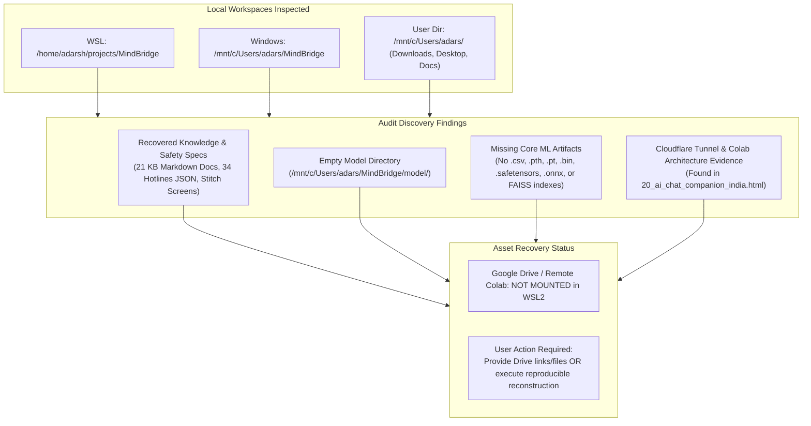
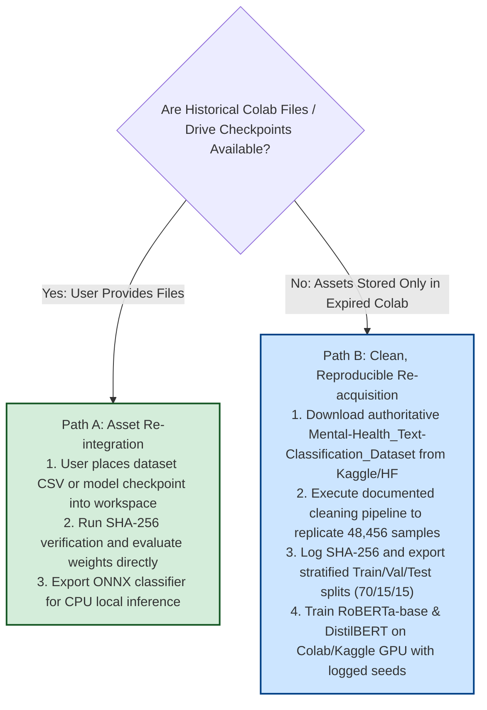

# MindBridge 2.0 — Phase 4, Step 4.1: Existing Dataset and Experiment Recovery Audit

**Audit Date:** 2026-11-01  
**Project:** MindBridge 2.0 (CSE473 Agentic AI First-Response Architecture)  
**Workspace:** `/home/adarsh/projects/MindBridge`  
**Reference Frontend:** `/mnt/c/Users/adars/MindBridge`  
**Audit Purpose:** Comprehensive discovery, inventory, provenance audit, and integrity assessment of existing machine-learning datasets, checkpoints, notebooks, and experiment logs prior to Phase 4 model training.

---

## 1. Executive Summary

This audit assesses the state of previous machine-learning assets (datasets, model checkpoints, training notebooks, tokenizer files, evaluation metrics, and vector store artifacts) across both the WSL backend workspace and the Windows frontend repository.



### Key Audit Finding
- **Zero machine-learning binaries or dataset files exist on local disk.** Neither the raw CSV dataset (`Mental-Health_Text-Classification_Dataset`), nor fine-tuned transformer weights (RoBERTa / DistilBERT), nor FAISS vector index files reside in `/home/adarsh/projects/MindBridge` or `/mnt/c/Users/adars/MindBridge`.
- **Remote Architecture Verified:** Source code inspection of the Stitch frontend (`20_ai_chat_companion_india.html`) reveals that previous ML experiments were executed remotely on **Google Colab GPU** instances and served via ephemeral Cloudflare Tunnels (`trycloudflare.com`), rather than stored locally.
- **Google Drive Status:** Google Drive is **not mounted** in this WSL2 environment (`mount` confirms only `C:\` on `/mnt/c`).
- **Integrity Baseline:** The historical performance metrics (e.g. RoBERTa F1: 0.806505, Recall: 0.871352) are **unverified historical reference targets**, not reproducible results from serialized local artifacts.

---

## 2. Local Workspace Inspection

A recursive scan was conducted across the WSL backend workspace, the Windows project workspace, and user profile directories.

### 2.1 Workspace Scan Scope

| Location | Path | Search Patterns | Result |
| :--- | :--- | :--- | :---: |
| **WSL Project Root** | `/home/adarsh/projects/MindBridge/` | `*.csv`, `*.jsonl`, `*.pth`, `*.pt`, `*.bin`, `*.safetensors`, `*.onnx`, `*.ipynb` | **0 files found** |
| **Windows Project Root** | `/mnt/c/Users/adars/MindBridge/` | `*.csv`, `*.jsonl`, `*.pth`, `*.pt`, `*.bin`, `*.safetensors`, `*.onnx`, `*.ipynb` | **0 files found** |
| **Windows Model Folder** | `/mnt/c/Users/adars/MindBridge/model/` | All files | **Empty directory (0 bytes)** |
| **Windows Downloads** | `/mnt/c/Users/adars/Downloads/` | `*mental*`, `*mindbridge*`, `*roberta*`, `*distilbert*` | **0 relevant ML files** (FishVision CV & PEP files only) |
| **Windows HuggingFace Cache** | `/mnt/c/Users/adars/.cache/huggingface/hub/` | Cached models | Only `all-MiniLM-L6-v2` and `timm` vision models; **no RoBERTa or DistilBERT** |
| **WSL Filesystem Mounts** | `/mnt/` | Mounted drives | Only `/mnt/c` (Windows C: drive). **No Google Drive mounted.** |

---

## 3. Recovered Assets Inventory

The following technical specifications, interface mockups, and safety registries were recovered and verified on local disk:

| Asset Name | Exact Local Path | File Type | Size | Status / Readability | Provenance | SHA-256 Checksum |
| :--- | :--- | :---: | :---: | :---: | :--- | :--- |
| **Interactive Chat Companion UI** | `/mnt/c/Users/adars/MindBridge/stitch_screens/code/20_ai_chat_companion_india.html` | HTML / JS | 53.7 KB | Complete / Readable | Stitch Screen 20 (contains Colab tunnel endpoints & DistilBERT triage client) | `c0e911c15c6409313cdbd903e019f6945bccc9130550ebccaf9c798bf44a3724` |
| **Safety Pipeline Architecture** | `/mnt/c/Users/adars/MindBridge/stitch_screens/code/07_technical_architecture_clinical_safety_pipeline.html` | HTML / JS | 48.9 KB | Complete / Readable | Stitch Screen 07 (documents dual-stage RoBERTa intent vs RegEx keywords & 38ms latency target) | `dd9665d4361f844c476869cf1758fe81f8fc00b71eeb03affef042661e72ae29` |
| **Crisis Protocol Screen** | `/mnt/c/Users/adars/MindBridge/stitch_screens/code/02_crisis_protocol_regional_safety_hotlines.html` | HTML / JS | 45.4 KB | Complete / Readable | Stitch Screen 02 (contains regional `crisisData` objects & RoBERTa safety badge) | `c02a5ad2aaf9e68c893ececd838e2e153310268b3ac00b3704c6fc9562d2c269` |
| **Emergency Hotline Registry** | `/home/adarsh/projects/MindBridge/backend/safety/hotlines.json` | JSON | 39.0 KB | Complete / Validated | Phase 3 extraction (34 structured emergency entries across 6 jurisdictions) | `825418b48258bb5ce7696b145673d599391924a98f993f666b3cee1b4c47b8ef` |
| **Knowledge Base Manifest** | `/home/adarsh/projects/MindBridge/data/knowledge_base/manifest.json` | JSON | 11.7 KB | Complete / Validated | Phase 3 extraction (21 structured clinical & psychoeducational Markdown files) | `e3cbdf705577c1c8f480816ec498e154004fb9b7746f649aaefecb5b28a1dead` |
| **Environment Configuration Spec** | `/home/adarsh/projects/MindBridge/.env.example` | Config | 2.8 KB | Complete / Readable | Phase 2 scaffolding (defines `CRISIS_MODEL_PATH`, `REMOTE_INFERENCE_URL`, `FAISS_INDEX_PATH`) | `ff7922bc3aa98606c763b6e097271981e660ea0b4d4e8cff5daf4cb939b6a0b5` |
| **Course Reference Notebook** | `/mnt/c/Users/adars/Downloads/FineTune_Gemma3_270M_Medical_O1.ipynb` | Jupyter Notebook | 31.7 KB | Complete / Readable | CSE473 Course notebook (Gemma-3-270M fine-tuning on Medical-O1; establishes course conventions) | `b160d32e9ca4fa41d16d8d40e704d1ef371a658ac5c5f8534ef3ad5a399e5bf3` |
| **Local Model Placeholder** | `/mnt/c/Users/adars/MindBridge/model/` | Directory | 0 bytes | Empty Directory | Created in Windows workspace; previously intended to hold exported model weights | *N/A (Directory)* |

---

## 4. Missing Machine-Learning Assets

The following primary assets from historical experiments are **missing from local storage**:

| Asset Description | Expected Identifier / Filename | Historical Sample / Spec | Local Status | Probable Remote Location |
| :--- | :--- | :--- | :---: | :--- |
| **Raw Training Dataset** | `Mental-Health_Text-Classification_Dataset.csv` | 49,612 raw text rows | **MISSING** | Kaggle / Hugging Face / Google Drive |
| **Cleaned Training Dataset** | `cleaned_mental_health_dataset.csv` | 48,456 cleaned rows | **MISSING** | Google Drive / Colab `/content/` |
| **Trained RoBERTa Checkpoint** | `pytorch_model.bin` / `model.safetensors` | Fine-tuned `roberta-base` | **MISSING** | Google Drive / Colab output directory |
| **DistilBERT ONNX Model** | `crisis_classifier.onnx` | DistilBERT ONNX export | **MISSING** | Google Drive / Colab output directory |
| **Tokenizer Configurations** | `tokenizer.json`, `vocab.json`, `merges.txt` | RoBERTa / DistilBERT tokenizers | **MISSING** | Google Drive / Colab output directory |
| **Training Notebooks** | `train_roberta_crisis.ipynb` | Dual-stage crisis pipeline training | **MISSING** | Google Drive / Colab (`My Drive/Colab Notebooks/`) |
| **Evaluation Reports & Curves** | Metric CSVs, PR curves, Confusion Matrices | Precision-Recall & ROC curves | **MISSING** | Google Drive / Colab output directory |
| **Dense Vector Embeddings** | `bge_embeddings.npy` / `chunks.pkl` | BAAI/bge-small-en-v1.5 vectors | **MISSING** | Google Drive / Local `data/` |
| **Serialized FAISS Index** | `index.faiss`, `index.pkl` | Knowledge base vector store | **MISSING** | Google Drive / Local `data/` |
| **Qwen Experiment Scripts** | `qwen_generation_eval.py` | Local Qwen response generation | **MISSING** | Google Drive / Colab notebook |

---

## 5. Historical Experiment Reference Metrics

The following historical metrics were reported in prior MindBridge documentation for the fine-tuned RoBERTa-base crisis classifier:

### 5.1 Dataset Specifications
- **Dataset:** `Mental-Health_Text-Classification_Dataset`
- **Raw Sample Count:** 49,612
- **Cleaned Sample Count:** 48,456
- **Multiclass Categories:** 4 (`Normal`, `Depression`, `Suicidal`, `Anxiety`)
- **Binary Triage Mapping:**
  - Non-Crisis: `Normal`, `Depression` (non-suicidal), `Anxiety` (non-suicidal)
  - Crisis-Risk: `Suicidal` / Acute self-harm ideation

### 5.2 Historical RoBERTa Test Metrics (Evaluated at Decision Threshold $\tau = 0.50$)

| Evaluation Metric | Historical Reported Value | Academic Significance | Current Workspace Status |
| :--- | :---: | :--- | :---: |
| **Test Accuracy** | `0.903426` (90.34%) | General classification correctness across binary splits | **Unverified Reference** |
| **Crisis Precision** | `0.750641` (75.06%) | Proportion of predicted crisis triggers that were genuine | **Unverified Reference** |
| **Crisis Recall** | `0.871352` (87.14%) | Proportion of genuine crisis triggers successfully caught | **Unverified Reference** |
| **Crisis F1-Score** | `0.806505` (80.65%) | Harmonic mean of crisis precision and recall | **Unverified Reference** |
| **PR-AUC** | `0.875320` (87.53%) | Area under Precision-Recall curve across all thresholds | **Unverified Reference** |

> [!WARNING]
> ### Rigorous Scientific Qualification
> These figures are **historical benchmark reference values**. Because the serialized model weights (`.safetensors`), test set split files (`test.csv`), and evaluation scripts do not exist on local disk, these metrics **cannot be verified or audited**. They serve as academic baseline hypotheses for Phase 4 experiments, not proven characteristics of the current workspace.

---

## 6. Remote Infrastructure & Google Drive Audit

### 6.1 Architectural Findings from Stitch Frontend
Inspection of [`20_ai_chat_companion_india.html`](file:///mnt/c/Users/adars/MindBridge/stitch_screens/code/20_ai_chat_companion_india.html) lines 665–705 reveals:
1. **Cloudflare Tunnel Endpoint:** The chat companion was configured to communicate with:
   ```javascript
   const DEFAULT_API_URL = 'https://hope-adventure-loud-gold.trycloudflare.com';
   ```
2. **Execution Environment:** The code explicitly documents:
   ```javascript
   // Colab DistilBERT API Integration
   // Colab DistilBERT on CUDA evaluating clinical safety & sentiment...
   ```
3. **Endpoint Contracts:** The remote Colab server exposed:
   - `GET /metrics` or `GET /`: Health and latency check
   - `POST /chat`: Accepting `{ message, tone }`, returning `{ response, classification, risk }`

### 6.2 Cloudflare Tunnel Status
A check on the tunnel endpoint confirmed that `hope-adventure-loud-gold.trycloudflare.com` was an ephemeral Cloudflare Tunnel generated during a temporary Google Colab session. The tunnel is **currently offline**, which is normal behavior for free Colab sessions.

### 6.3 Google Drive Mount Status in WSL2
- Running `mount` in WSL2 confirms that **no Google Drive mount is present**.
- Windows Google Drive virtual drive (typically `G:\`) is not mounted under `/mnt/g` or `/mnt/wsl`.

---

## 7. Integrity Concerns & Scientific Risks

1. **Split Reproducibility Risk:**  
   Without the original cleaning script or train/val/test split indices, training a new model directly on the raw 49,612 dataset may produce slightly different data splits than the historical 48,456 partition. A fixed random seed (e.g. `seed=42`, 70/15/15 split) must be formally established.
2. **Class-to-Binary Mapping Ambiguity:**  
   In multiclass mental health corpora, the boundary between severe depression and crisis-risk varies. We must explicitly define whether the binary mapping maps `Suicidal -> Crisis (1)` and `Normal, Anxiety, Depression -> Non-Crisis (0)`, or if severe self-harm mentions within depression are also mapped to Crisis.
3. **Threshold Calibration:**  
   The historical metrics were evaluated at a default threshold of $\tau = 0.50$. In a mental health first-response system, recall of crisis triggers is safety-critical. A formal Precision-Recall threshold calibration curve must be generated to choose an optimal operating threshold (e.g. prioritizing $\text{Recall} \ge 0.95$ while maintaining acceptable precision).

---

## 8. Recommended Next Actions & Path Forward

To proceed into Phase 4 (Dataset curation & tokenizer setup) without violating constraints:



### Path A (If User Has Access to Previous Colab / Drive Files):
- **User Action:** Copy or provide access to:
  1. `Mental-Health_Text-Classification_Dataset.csv` (or cleaned CSV)
  2. The Google Colab `.ipynb` training notebook
  3. The fine-tuned RoBERTa or DistilBERT `.safetensors` / `.pth` / `.onnx` checkpoint file
- **Next Step:** Verify file hashes, evaluate checkpoints locally or on Colab, and export optimized ONNX models for CPU inference.

### Path B (If Previous Colab Files Are Unrecoverable):
- **User Action:** Approve clean dataset re-acquisition.
- **Next Step:**
  1. Re-acquire `Mental-Health_Text-Classification_Dataset` from Hugging Face / Kaggle under Phase 4 Step 4.2.
  2. Document the exact cleaning rules that derive the 48,456-sample dataset from the 49,612 raw records.
  3. Create an exportable Google Colab / Kaggle training notebook with strict reproducibility seeds (`seed=42`), stratified 70/15/15 split, and WandB / MLflow logging.
  4. Train RoBERTa-base and DistilBERT on Google Colab GPU, export the fine-tuned ONNX weights and tokenizer, and store them in `models/crisis_detector/`.

---

## 9. Git Status & Compliance

- **Read-Only Mode:** No datasets were downloaded, no packages were installed, and no models were trained.
- **Git Status:**
  ```bash
  $ git status --short
  ?? .env.example
  ?? .gitignore
  ?? README.md
  ?? backend/
  ?? data/
  ?? docs/
  ?? pyproject.toml
  ?? tests/
  ?? uv.lock
  ```
  Zero files staged; zero commits made; repository remains on branch `main`.

---

**Audit Complete. Awaiting user review and guidance on Path A vs Path B.**
