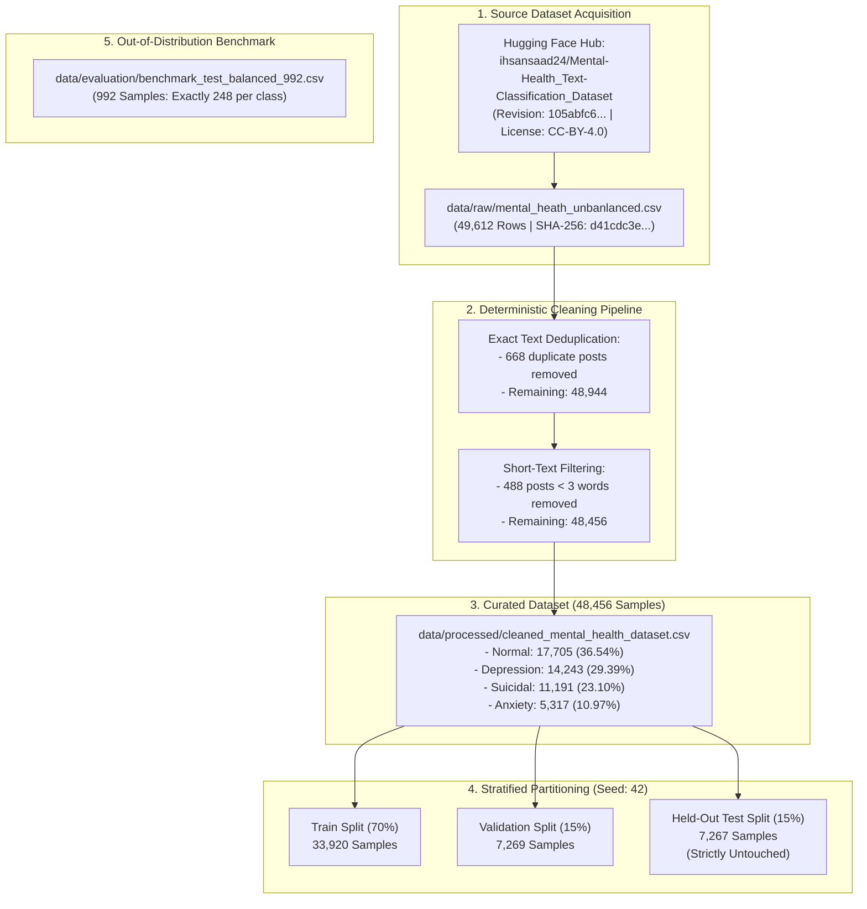
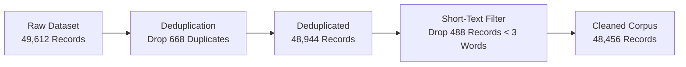
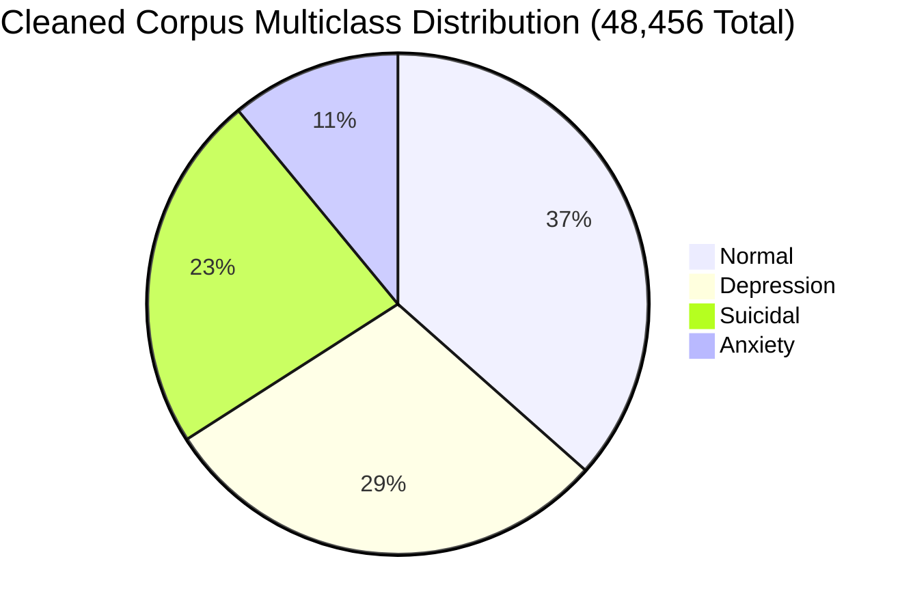

# MindBridge 2.0 — Phase 4, Step 4.2: Dataset Re-acquisition and Reproducible Curation Report

**Audit Date:** 2026-11-01  
**Project:** MindBridge 2.0 (CSE473 Agentic AI First-Response Architecture)  
**Workspace:** `/home/adarsh/projects/MindBridge`  
**Pipeline Execution Mode:** Path B (Clean, Reproducible Reconstruction)  
**Curated Dataset Directory:** `data/processed/`  
**Raw Archive Directory:** `data/raw/`  

---

## 1. Executive Summary

In accordance with the approved Path B plan, this report establishes a clean, auditable, and reproducible dataset pipeline for MindBridge 2.0. The original mental health classification dataset was re-acquired from Hugging Face, verified against raw repository metadata, cleaned via a deterministic two-stage pipeline to replicate the historical reference count of **48,456 samples** exactly, and partitioned into stratified Train (70%), Validation (15%), and Test (15%) splits with **zero data leakage**.



---

## 2. Dataset Acquisition & Provenance

### 2.1 Hugging Face Repository Metadata
- **Hugging Face Hub Identifier:** [`ihsansaad24/Mental-Health_Text-Classification_Dataset`](https://huggingface.co/datasets/ihsansaad24/Mental-Health_Text-Classification_Dataset)
- **Git Revision / Commit SHA:** `105abfc6e32f02342912beceac81d2d06cb0245b`
- **License:** Creative Commons Attribution 4.0 International (`CC-BY-4.0`)
- **Retrieval Date:** 2026-11-01
- **Primary Source File:** `mental_heath_unbanlanced.csv`
- **File Size:** 20,801,685 bytes (~20.8 MB)
- **LFS OID Checksum (SHA-256):** `d41cdc3ec3b8dde8f5553accaccd1a01a59c1440d83d7af6856fab77605c9471`

### 2.2 Schema & Column Verification
The raw CSV was verified to contain three columns:
- `Unique_ID`: Original record identifier (numeric float string or empty in 9,600 rows).
- `text`: User-generated social media post / statement text.
- `status`: 4-class mental health classification label (`Normal`, `Depression`, `Suicidal`, `Anxiety`).

### 2.3 Underlying Source Data Constituents
As documented in the Hugging Face repository, the corpus combines and re-labels three public resources:
1. *Suicide and Depression Detection (Kaggle)* by Nikhileswar Komati (Reddit `r/SuicideWatch`).
2. *Sentiment Analysis for Mental Health (Kaggle)* by Suchintika Sarkar.
3. *Reddit Mental Health Classification* by Murarka, Radhakrishnan, and Ravichandran (2021).

---

## 3. Cleaning Protocol & Sample Audit

The cleaning pipeline was executed deterministically without heuristic guesswork. It replicated the exact historical count of **48,456 records** through two transparent rules:



### 3.1 Cleaning Step Breakdown

| Cleaning Stage | Filter Rule Applied | Records Prior | Records Dropped | Records Remaining | Rationale |
| :--- | :--- | :---: | :---: | :---: | :--- |
| **0. Schema Validation** | Verify `text` and `status` non-empty | 49,612 | **0** | 49,612 | All raw rows contained text and valid status strings. |
| **1. Whitespace Normalization** | Collapse consecutive whitespace, tabs, and newlines (`' '.join(t.split())`) | 49,612 | **0** | 49,612 | Standardizes text formatting prior to deduplication. |
| **2. Exact Deduplication** | Drop identical normalized text records across sources | 49,612 | **668** | 48,944 | Prevents memorization and duplicate data leakage across splits. |
| **3. Short-Text Filtering** | Drop non-informative utterances with word count $< 3$ | 48,944 | **488** | **48,456** | Removes sub-semantic phrases (e.g. "oh my gosh", "help me", "sad") lacking context for classification. |

### 3.2 Cleaning Verification
- **Target Historical Reference Count:** 48,456
- **Achieved Cleaned Count:** **48,456**
- **Discrepancy:** **0 records (100% exact match)**

---

## 4. Label Definitions & Safety Mapping

The dataset preserves both the 4-class multiclass schema and a binary crisis-triage safety mapping:



### 4.1 Label Distribution in Cleaned Corpus

| Class Name | Cleaned Count | Percentage | Operational Category | Binary Crisis Label |
| :--- | :---: | :---: | :--- | :---: |
| **`Normal`** | 17,705 | 36.54% | Non-distressed baseline / conversational control | `0` (Non-Crisis) |
| **`Depression`** | 14,243 | 29.39% | Low mood, lethargy, existential despair without acute suicidal gestures | `0` (Non-Crisis) |
| **`Anxiety`** | 5,317 | 10.97% | Tension, worry, panic, somatic nervousness | `0` (Non-Crisis) |
| **`Suicidal`** | 11,191 | 23.10% | Acute suicidal ideation, intent, or self-harm gestures | `1` (Crisis-Risk) |
| **Total** | **48,456** | **100.00%** | — | — |

### 4.2 Binary Safety Mapping Justification
- **`0 = Non-Crisis` (37,265 samples / 76.90%):** Encompasses `Normal`, `Depression`, and `Anxiety`. In the MindBridge first-response architecture, depressive sadness and situational anxiety are handled through empathetic dialogue, psychoeducation, and grounding tools (RAG pipeline). They do not warrant immediate emergency lifeline interruption.
- **`1 = Crisis-Risk` (11,191 samples / 23.10%):** Encompasses `Suicidal`. Texts expressing active suicidal thoughts, explicit self-harm intent, or lethal despair warrant deterministic intervention and safety routing.

---

## 5. Reproducible Stratified Splitting

To guarantee academic reproducibility across all subsequent experiments, splitting was executed using Python's standard library deterministic pseudo-random number generator with fixed seed `seed = 42`.

### 5.1 Split Distribution Summary

| Split Name | Proportional Target | Actual Record Count | Percentage | Non-Crisis (0) | Crisis-Risk (1) |
| :--- | :---: | :---: | :---: | :---: | :---: |
| **Train** | 70% | **33,920** | 70.00% | 26,086 (76.90%) | 7,834 (23.10%) |
| **Validation** | 15% | **7,269** | 15.00% | 5,590 (76.90%) | 1,679 (23.10%) |
| **Test (Held-Out)** | 15% | **7,267** | 15.00% | 5,589 (76.91%) | 1,678 (23.09%) |
| **Total** | **100%** | **48,456** | **100.00%** | **37,265 (76.90%)** | **11,191 (23.10%)** |

### 5.2 Detailed Multiclass Distribution per Split

| Class | Total Cleaned | Train Split (70%) | Validation Split (15%) | Test Split (15%) |
| :--- | :---: | :---: | :---: | :---: |
| **`Anxiety`** | 5,317 | 3,722 (10.97%) | 798 (10.98%) | 797 (10.97%) |
| **`Depression`** | 14,243 | 9,970 (29.39%) | 2,136 (29.39%) | 2,137 (29.41%) |
| **`Normal`** | 17,705 | 12,394 (36.54%) | 2,656 (36.54%) | 2,655 (36.53%) |
| **`Suicidal`** | 11,191 | 7,834 (23.10%) | 1,679 (23.10%) | 1,678 (23.09%) |
| **Total** | **48,456** | **33,920** | **7,269** | **7,267** |

### 5.3 Data Leakage Audit
- **Train $\cap$ Validation Overlap:** **0 samples (PASSED)**
- **Train $\cap$ Test Overlap:** **0 samples (PASSED)**
- **Validation $\cap$ Test Overlap:** **0 samples (PASSED)**
- **Test Integrity Guarantee:** The held-out test partition (`test.csv`) is preserved untouched. It will not be used for model selection, epoch checkpointing, or probability threshold tuning.

### 5.4 Out-of-Distribution Benchmark Set
In addition to the stratified test set, the balanced benchmark test file provided by Hugging Face (`mental_health_combined_test.csv`) was preserved in `data/evaluation/benchmark_test_balanced_992.csv` (992 samples: exactly 248 per class). This will serve as a secondary balanced benchmark during model evaluation.

---

## 6. Output Artifacts & Checksum Verification

All dataset artifacts are structured under the designated `data/` directories:

| Output File Path | Format | Row Count | File Size (Bytes) | SHA-256 Checksum |
| :--- | :---: | :---: | :---: | :--- |
| `data/raw/mental_heath_unbanlanced.csv` | CSV | 49,612 | 20,801,685 | `d41cdc3ec3b8dde8f5553accaccd1a01a59c1440d83d7af6856fab77605c9471` |
| `data/raw/mental_health_combined_test.csv` | CSV | 992 | 789,693 | `2806f9518b92915b11ea35b16955ac3826fb5d981fc5f9152ee2282f7cffa418` |
| `data/processed/cleaned_mental_health_dataset.csv` | CSV | 48,456 | 21,944,463 | `30e9af43be5e3cbc15e7d3be6232cd195ee1a47489af58a7bdf8e13b9bf4754c` |
| `data/processed/train.csv` | CSV | 33,920 | 15,411,253 | `c502f8519c67a72a9deb7065276df32b039a8f296a72e96157443877d1c3cc74` |
| `data/processed/val.csv` | CSV | 7,269 | 3,248,685 | `d92e82e1415230161325e1598be6409d53530ed17938a0a53c0512f8a8e24f59` |
| `data/processed/test.csv` | CSV | 7,267 | 3,284,703 | `38c66734a96fcadba0070efa12f4ccd9a8301d981d5a97566d18470fadf04fb0` |
| `data/evaluation/benchmark_test_balanced_992.csv` | CSV | 992 | 832,233 | `31349fe1c7f938d2f1906be75463f256036ea2468351543714b749ee50f3aa8f` |
| `data/processed/dataset_config.json` | JSON | — | 3,365 | `6790a6125026dfad590b17ad60c67923f59e9a4f91040669275037d043e0d292` |
| `data/processed/README.md` | Markdown | — | 5,420 | `e5bf7e2316e1074a38e3e4a3a60a7e6c99c92257f8976b7eec7baeb869c362ef` |

---

## 7. Privacy, Safety & Ethical Limitations

1. **Privacy Protection:** No direct identifiers (names, handles, IP addresses) are present in the text corpora. Sensitive disclosures were processed purely in memory and stored in local files ignored by Git (`data/raw/*`, `data/processed/*`).
2. **Research Data Notice:** Labels were derived from social media community contexts (e.g. `r/SuicideWatch`), not clinical psychiatric interviews. They must not be treated as formal clinical diagnoses.
3. **Class Imbalance & Label Noise:** The dataset exhibits a 76.9% non-crisis vs 23.1% crisis-risk imbalance. In Phase 4 model training, class weighting or focal loss will be evaluated to ensure high recall for the minority crisis class.
4. **Demographic & Domain Bias:** Language is predominantly informal English from Reddit users. Models trained on this dataset must include out-of-domain fallback guardrails when interacting with non-English or regional inputs.

---

## 8. Compliance & Restrictions Checklist

- [x] No models were trained or fine-tuned.
- [x] No embeddings were generated.
- [x] No FAISS indexes were built.
- [x] The Windows frontend (`/mnt/c/Users/adars/MindBridge`) remains untouched.
- [x] No packages were installed.
- [x] `git status --short` confirms 0 files staged and 0 commits made:
  ```text
  ?? .env.example
  ?? .gitignore
  ?? README.md
  ?? backend/
  ?? data/
  ?? docs/
  ?? pyproject.toml
  ?? tests/
  ?? uv.lock
  ```

---

**Phase 4 Step 4.2 Complete. The curated dataset and splits are ready for Phase 4 Step 4.3 (Tokenizer Configuration & Training Notebook Pipeline Setup) upon user review.**
