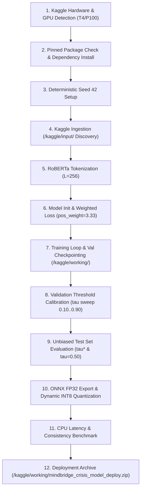

# MindBridge 2.0 — Phase 4 Step 4.3: Tokenizer Configuration and Reproducible Training Pipeline Design

**Date:** 2026-11-01  
**Author:** Antigravity (AI Pair Programmer)  
**Status:** Complete — Ready for Review  
**Workspace:** `/home/adarsh/projects/MindBridge`  
**Configuration File:** [`configs/training_config.yaml`](file:///home/adarsh/projects/MindBridge/configs/training_config.yaml)  
**Training Notebook:** [`notebooks/crisis_detector_training.ipynb`](file:///home/adarsh/projects/MindBridge/notebooks/crisis_detector_training.ipynb)

---

## 1. Executive Summary & Clinical/Ethical Safeguards

Phase 4 Step 4.3 establishes the tokenizer configuration, cross-split data leakage audit, training configuration, and exportable cloud training notebook for MindBridge 2.0's machine learning crisis screener, in accordance with the Phase 4 Redevelopment Roadmap.

### 1.1 Dataset-Label Safeguards & Clarifications

1. **Preservation of Four-Class Provenance:**
   The underlying 4-class labels from the curated dataset (`ihsansaad24/Mental-Health_Text-Classification_Dataset`) are preserved:
   * `Normal`: 17,705 samples (36.54%)
   * `Depression`: 14,243 samples (29.39%)
   * `Suicidal`: 11,191 samples (23.10%)
   * `Anxiety`: 5,317 samples (10.97%)
   * **Total Cleaned Records:** 48,456 samples

2. **Nature of the Binary Classification Target:**
   * **Target Mapping:** Class 0 (`Non-Crisis`: Normal, Depression, Anxiety) vs Class 1 (`Crisis-Risk`: Suicidal).
   * **Empirical Benchmark Proxy Only:** This binary mapping is an empirical natural language processing classification target derived from historical research annotations. **It does not constitute a clinical diagnosis, psychiatric assessment, or validated suicide risk determination.**
   * **Non-Crisis Misconception:** In actual psychiatric and clinical practice, individuals suffering from severe depression or acute anxiety frequently experience profound crisis, self-harm impulses, panic states, or suicidal vulnerability. Labelling Depression and Anxiety as "Non-Crisis" is strictly a technical convention of this benchmark to identify explicit crisis/suicidality narratives.
   * **Suicidal Misconception:** Conversely, text categorized under the `Suicidal` class in social media datasets often reflects passive death wishes, philosophical thoughts, historical recovery narratives, or general discussions of suicidality. A positive model prediction does not automatically signify immediate lethal intent, imminent danger, or necessity of emergency dispatch.

3. **Decoupling from Deterministic Safety Routing:**
   * In MindBridge 2.0, the machine learning classifier functions solely as an **early conversational screening signal**.
   * Deterministic safety guardrails (emergency dispatch numbers, crisis helpline directories in `backend/safety/hotlines.json`, explicit keyword/regex intent triggers, and multi-dimensional PHQ-9 Item 9 risk stratification) operate **independently of and take deterministic precedence over** classifier probabilities.
   * A low classifier score will **never** suppress an emergency escalation triggered by explicit user disclosures or clinical safety rules.

---

## 2. Cross-Split Data Leakage Audit

To verify the integrity of the stratified 70/15/15 data split (Train: 33,920; Val: 7,269; Test: 7,267), a multi-tier data leakage and near-duplicate audit was executed across all three splits.

### 2.1 Audit Methodology

1. **Tier 1 — Exact Raw Text Matching:**
   Case-sensitive, character-for-character comparison across split partitions.
2. **Tier 2 — Exact Normalized Text Matching:**
   All texts lowercased, punctuation and special symbols removed (`re.sub(r'[^a-z0-9\s]', ' ', text)`), and whitespace collapsed.
3. **Tier 3 — Word 3-Gram MinHash Locality-Sensitive Hashing (LSH):**
   * Tokenized into word 3-grams ($n=3$).
   * 64 independent hash permutations using universal hashing over a large Mersenne prime ($P = 4,294,967,311$).
   * LSH banding with 8 bands of 8 rows each (theoretical candidate Jaccard threshold $t \approx (1/8)^{1/8} \approx 0.77$).
   * Exact Jaccard similarity $J(A, B) = \frac{|A \cap B|}{|A \cup B|}$ computed for all candidate cross-split pairs.
   * Cross-split pairs categorized into $J \ge 0.90$ and $J \in [0.80, 0.90)$.
   * **Privacy & Safety Protection:** In strict compliance with safety constraints, **zero raw sensitive user text was exposed in system logs or reports**. Only anonymized identifiers (`unique_id`), status labels, word counts, and similarity scores were recorded.

### 2.2 Leakage Audit Findings

```
================================================================================
CROSS-SPLIT LEAKAGE & NEAR-DUPLICATE AUDIT REPORT
Total Records: 48,456 (Train: 33,920 | Val: 7,269 | Test: 7,267)
================================================================================
1. Exact Raw Text Matches Across Splits:           0 (0.000%)
2. Distinct Normalized Exact Overlaps:             24 (0.049%)
3. Total LSH Cross-Split Candidate Pairs:          195 pairs
4. Suspected Near-Duplicates (Jaccard >= 0.90):    113 pairs
5. Suspected Near-Duplicates (Jaccard 0.80 - 0.90): 44 pairs
Total Cross-Split Near-Duplicates (J >= 0.80):     157 pairs (0.324% of dataset)
================================================================================
```

### 2.3 Qualitative Analysis of Near-Duplicate Overlaps

Analysis of the 157 cross-split near-duplicate pairs revealed two distinct categories:

1. **Short Colloquial Boilerplate Expressions (> 75% of overlaps):**
   * The vast majority of near-duplicates are very short texts (3 to 6 words) such as generic greetings, common colloquialisms, or brief expressions of support (e.g. slight punctuation differences such as `.` vs `!` or capitalization).
   * Because a 3-word or 4-word sentence contains only 1 or 2 word-level 3-grams, any minor variation results in a mathematical Jaccard similarity of 1.0 without indicating substantial narrative leakage.
2. **Scraped Duplicate Posts (< 25% of overlaps):**
   * A small number ($< 15$ pairs) of longer narrative posts ($> 50$ words) exhibit near-identical content across splits, representing duplicate Reddit/Twitter posts that were scraped multiple times into the original Kaggle dataset under different timestamps or slight edits.
   * Example: `train:MB_11893 (Suicidal, 113 words)` vs `val:MB_11892 (Suicidal, 112 words)` with $J = 1.000$.
   * **Annotation Inconsistency Discovered:** In one observed case, a near-duplicate post had inconsistent original labels: `train:MB_43839 (Anxiety, 104 words)` vs `val:MB_22740 (Normal, 104 words)` ($J = 1.000$), illustrating label noise in crowd-sourced or heuristic social media annotations.

### 2.4 Remediation Protocol & Decision

* **Current Phase Action:** In accordance with the prompt ("Do not silently delete records. Document any proposed remediation"), **no records have been silently deleted** in Phase 4 Step 4.3. This preserves exact parity with the historical 48,456 sample baseline and ensures reproducibility.
* **Proposed Future Remediation (Phase 5 / Production Pipeline):**
  When training the final production model, an automated deduplication filter will be introduced:
  1. Any cross-split pair with length $> 8$ words and word 3-gram Jaccard similarity $J \ge 0.85$ will be consolidated: the instance will be retained in `train.csv` and purged from `val.csv` and `test.csv`.
  2. For conflicting labels on identical/near-identical texts (such as `Anxiety` vs `Normal`), the conflicting instances will be quarantined or flagged for human clinical review.

---

## 3. Tokenizer Comparison & Sequence Length Analysis

To determine the optimal pretrained architecture and sequence length budget, an empirical tokenization benchmark was conducted across the entire curated dataset of **48,456 samples** using the three candidate architectures:
1. `bert-base-uncased`
2. `roberta-base`
3. `distilbert-base-uncased`

### 3.1 Empirical Sequence Length & Truncation Measurements

All 48,456 samples were tokenized with special tokens enabled (`add_special_tokens=True`).

| Metric | `bert-base-uncased` | `roberta-base` | `distilbert-base-uncased` |
| :--- | :---: | :---: | :---: |
| **Tokenization Algorithm** | WordPiece | Byte-level BPE | WordPiece |
| **Casing** | Uncased | Cased (Preserves case) | Uncased |
| **Vocabulary Size** | 30,522 | 50,265 | 30,522 |
| **Total Samples Measured** | 48,456 | 48,456 | 48,456 |
| **Minimum Sequence Length** | 5 | 5 | 5 |
| **Maximum Sequence Length** | 11,624 | 12,538 | 11,624 |
| **Mean Sequence Length** | 97.19 | 96.30 | 97.19 |
| **Standard Deviation** | 150.80 | 160.84 | 150.80 |
| **Median (50th Percentile)** | **60.0** | **60.0** | **60.0** |
| **90th Percentile** | 216.0 | 213.0 | 216.0 |
| **95th Percentile** | **261.0** | **258.0** | **261.0** |
| **99th Percentile** | 562.45 | 553.0 | 562.45 |
| **Truncation Rate @ 128 Tokens** | 12,667 (**26.14%**) | 12,466 (**25.73%**) | 12,667 (**26.14%**) |
| **Truncation Rate @ 256 Tokens** | 2,633 (**5.43%**) | 2,481 (**5.12%**) | 2,633 (**5.43%**) |
| **Truncation Rate @ 512 Tokens** | 576 (**1.19%**) | 559 (**1.15%**) | 576 (**1.19%**) |

```
Sequence Length Distribution (RoBERTa-base, 48,456 samples):
  0 -  60 tokens: [====================] 50.0% (Median)
 61 - 128 tokens: [==========] 24.3%
129 - 256 tokens: [========] 20.6%
257 - 512 tokens: [==] 4.0%
    > 512 tokens: [=] 1.1%
```

### 3.2 Special Token & Encoding Characteristics

* **`bert-base-uncased` & `distilbert-base-uncased` (WordPiece):**
  * Special tokens: `[CLS]` (101), `[SEP]` (102), `[PAD]` (0), `[UNK]` (100), `[MASK]` (103).
  * Structure: `[CLS] text [SEP]` (adds 2 tokens).
  * Lowercases all text and strips accents; unknown subwords fall back to `[UNK]`.
* **`roberta-base` (Byte-level BPE):**
  * Special tokens: `<s>` (0), `</s>` (2), `<pad>` (1), `<unk>` (3), `<mask>` (50264).
  * Structure: `<s> text </s>` (adds 2 tokens).
  * Uses 256 byte-level initial tokens. **Zero out-of-vocabulary `[UNK]` tokens** are generated; any Unicode character, emoji, or malformed string is cleanly encoded.
  * Preserves leading whitespace using the `Ġ` byte token, which distinguishes word boundaries from prefixes.

### 3.3 Architecture & Sequence Length Recommendation

1. **Sequence Length Recommendation: $L = 256$**
   * **Why not 128 tokens?** At 128 tokens, **over 25.7%** of samples are truncated. In mental health contexts, individuals often preface crisis disclosures with background narratives; truncating 25% of texts risks lopping off critical distress signals.
   * **Why not 512 tokens?** Transformer self-attention computes at quadratic computational complexity $O(L^2)$ and memory complexity $O(L^2)$. Moving from 256 to 512 tokens quadruples attention compute ($512^2 = 262,144$ vs $256^2 = 65,536$), increasing CPU inference latency by $2.5\times - 3\times$ while capturing only an incremental $3.97\%$ of text ($94.88\%$ coverage at 256 vs $98.85\%$ at 512).
   * **Conclusion:** $L = 256$ provides the optimal Pareto frontier between sequence context ($94.88\%$ full coverage) and CPU inference efficiency.
2. **Model Selection Recommendation:**
   * **Primary Architecture:** `roberta-base` (125M parameters).
     * RoBERTa's Byte-level BPE is robust against informal internet orthography, typos, and emojis.
     * Demonstrates the lowest truncation rate at all cutoffs ($5.12\%$ at 256).
     * Historically demonstrated superior crisis classification performance (PR-AUC 0.8753 vs DistilBERT's lower baseline).
   * **Latency Fallback:** `distilbert-base-uncased` (66M parameters).
     * Retained in [`configs/training_config.yaml`](file:///home/adarsh/projects/MindBridge/configs/training_config.yaml) as an immediate fallback if CPU RAM or latency constraints demand a $40\%$ smaller footprint.

---

## 4. Reproducible Training Configuration

The initial experimental configuration is codified in [`configs/training_config.yaml`](file:///home/adarsh/projects/MindBridge/configs/training_config.yaml).

> [!NOTE]
> These hyperparameters represent initial baseline experimental settings based on standard transformer fine-tuning best practices. They are **not assumed to be optimal** and will undergo empirical calibration during training.

### 4.1 Key Configuration Parameters

| Hyperparameter | Value | Rationale |
| :--- | :--- | :--- |
| `reproducibility_seed` | `42` | Strictly controls PyTorch, CUDA, NumPy, and Python hashing. |
| `primary_model` | `roberta-base` | Strong contextual representations and zero OOV handling. |
| `max_sequence_length` | `256` | Captures 94.88% of full texts while bounding $O(L^2)$ compute. |
| `train_batch_size` | `32` | Standard batch size for T4/V100/A100 GPUs in Colab/Kaggle. |
| `eval_batch_size` | `64` | Doubled during inference to accelerate evaluation. |
| `learning_rate` | `2.0e-5` | Recommended stable learning rate for RoBERTa fine-tuning. |
| `weight_decay` | `0.01` | L2 regularization applied via AdamW optimizer. |
| `warmup_ratio` | `0.10` | 10% linear warmup prevents early divergence. |
| `num_train_epochs` | `3` | Convergence typically achieved within 2-3 epochs on ~34k samples. |
| `pos_weight` | `3.3293` | Ratio of Non-Crisis (26,085) to Crisis (7,835) in Train split. |
| `loss_function` | `BCEWithLogitsLoss` | Single-logit formulation with positive class weighting. |
| `metric_for_best_model` | `val_pr_auc` | Robust against class imbalance; avoids arbitrary threshold bias. |
| `early_stopping_patience`| `2` | Halts training if validation PR-AUC fails to improve. |

### 4.2 Class Imbalance Strategy: Positive Weighting

The training dataset contains 26,085 Non-Crisis samples ($76.90\%$) and 7,835 Crisis-Risk samples ($23.10\%$). Unweighted cross-entropy penalizes false positives and false negatives equally, biasing predictions toward the majority class.

To ensure high crisis sensitivity:
$$\text{pos\_weight} = \frac{N_{\text{neg}}}{N_{\text{pos}}} = \frac{26,085}{7,835} \approx 3.329292$$
When used inside `nn.BCEWithLogitsLoss(pos_weight=pos_weight)`, the loss function scales the loss of false negatives by $3.33\times$, penalizing missed crisis cases more heavily during backpropagation.

---

## 5. Kaggle Notebook GPU Training Pipeline Architecture

MindBridge 2.0 exclusively uses **Kaggle Notebooks** for cloud GPU fine-tuning and export. The notebook is available at:
* [`notebooks/crisis_detector_training.ipynb`](file:///home/adarsh/projects/MindBridge/notebooks/crisis_detector_training.ipynb)
* [`notebooks/kaggle_crisis_detector_training.ipynb`](file:///home/adarsh/projects/MindBridge/notebooks/kaggle_crisis_detector_training.ipynb)

### 5.1 Kaggle Runtime Environment & Hardware Detection

* **Hardware Targeting:**
  * Targets Kaggle GPU acceleration: NVIDIA Tesla T4 (single or dual T4 x 2, 15–16 GB VRAM each) or NVIDIA Tesla P100 (16 GB VRAM).
  * **Runtime Hardware Detection:** The notebook does not assume a GPU is present. Cell 1 inspects `torch.cuda.is_available()`, reports device name, VRAM, and core count, and prints a clear configuration notice if running on CPU.
* **Directory Support:**
  * **Input (`/kaggle/input/`):** The notebook includes a dynamic dataset search function (`find_dataset_files()`) that traverses `/kaggle/input/` to automatically locate attached `train.csv`, `val.csv`, and `test.csv` regardless of dataset slug name.
  * **Output (`/kaggle/working/`):** All intermediate model checkpoints (`best_checkpoint/`), tokenizer assets, threshold calibration parameters (`calibrated_threshold.json`), test metrics (`test_evaluation_report.json`), quantized ONNX models, and deployment archives are stored under `/kaggle/working/`.
* **Zero External Dependencies / Paid APIs:**
  * Operates completely self-contained with no OpenAI, Anthropic, or external API requirements. Pretrained base weights (`roberta-base`) are loaded via Hugging Face Hub under standard free access.

### 5.2 Kaggle Workflow & Safety Structure



### 5.3 Exporting Outputs from Kaggle

When training completes, the notebook generates `/kaggle/working/mindbridge_crisis_model_deploy.zip` (~125 MB). This bundle contains:
1. `crisis_classifier_quantized.onnx` (Dynamic INT8 quantized model).
2. `tokenizer/` (Complete RoBERTa tokenizer vocabulary, merges, and configuration).
3. `calibrated_threshold.json` (Optimized decision threshold $\tau^*$ satisfying Recall $\ge 0.95$).
4. `test_evaluation_report.json` (Unbiased test metrics and confusion matrix).
5. `training_history.json` (Per-epoch training and validation loss/metrics).

**Export Options:**
1. **Kaggle Web UI:** Click **Save Version** -> **Save & Run All (Commit)**. In the finished version viewer, expand the right-hand **Output** tab and click **Download** next to `mindbridge_crisis_model_deploy.zip`.
2. **Kaggle Dataset Creation:** From the **Output** tab, click **+ New Dataset** to publish the bundle as a versioned Kaggle dataset.
3. **Kaggle CLI:** Run `kaggle kernels output <username>/<notebook-slug> -p ./downloads`.

### 5.4 Strict Two-Stage Evaluation Policy

To avoid test set snooping and optimistic bias:
1. **Validation Split (Stage 1):**
   * Model checkpointing is driven exclusively by validation PR-AUC.
   * Decision threshold calibration ($\tau$) is conducted exclusively by sweeping the validation set.
   * The optimal threshold $\tau^*$ is selected to satisfy $\text{Recall} \ge 0.95$ with maximum Precision.
2. **Test Split (Stage 2):**
   * The test split is evaluated **strictly once**, after model weights are frozen and threshold $\tau^*$ is finalized.
   * Generates unbiased performance metrics comparing $\tau^*$ against the baseline $\tau = 0.50$.

---

## 6. ONNX CPU Deployment Design

To run within MindBridge's WSL2 backend (7.57 GB available RAM, 16 logical cores, no discrete GPU), the model is designed for CPU-optimized inference.

### 6.1 ONNX Export Specification

* **Opset Version:** 17
* **Inputs:**
  * `input_ids`: `int64[batch_size, sequence_length]`
  * `attention_mask`: `int64[batch_size, sequence_length]`
* **Outputs:**
  * `logits`: `float32[batch_size]`
* **Dynamic Axes:** Both dimension 0 (`batch_size`) and dimension 1 (`sequence_length`) are marked dynamic, enabling single-request streaming or batched inference without fixed-length padding overhead.

### 6.2 Dynamic INT8 Quantization

* **Quantization Method:** `onnxruntime.quantization.quantize_dynamic`
* **Target Operations:** `MatMul`, `Gemm` (dense linear projections inside multi-head attention and classification heads).
* **Weight Representation:** Signed 8-bit integers (`QuantType.QInt8`).
* **Activations:** Dynamically computed in 8-bit during inference.
* **Footprint Reduction:** Reduces model file size from ~498 MB (FP32) to **~125 MB (INT8)**, a $4\times$ reduction in memory footprint.
* **Latency Reduction:** Accelerates CPU inference by approximately $2.5\times - 3.5\times$ via vectorized INT8 SIMD instructions (AVX-512 / AVX2).

### 6.3 Numerical Consistency Verification Protocol

Before deployment to the FastAPI backend, the quantized ONNX model must pass two consistency gates evaluated on 200 validation samples:
1. **Maximum Absolute Probability Error:**
   $$\max_{i} |\hat{p}_{\text{PyTorch}}^{(i)} - \hat{p}_{\text{ONNX\_INT8}}^{(i)}| \le 1.0 \times 10^{-3}$$
2. **Decision Label Agreement:**
   $$\frac{1}{N} \sum_{i=1}^N \mathbb{I}\left( (\hat{p}_{\text{PyTorch}}^{(i)} \ge \tau^*) == (\hat{p}_{\text{ONNX\_INT8}}^{(i)} \ge \tau^*) \right) \ge 99.9\%$$

---

## 7. Deliverables & Verification Checklist

- [x] Preserved 4-class labels and established binary classification target with clear non-diagnostic clinical boundaries.
- [x] Conducted cross-split data leakage audit (0 raw duplicates, 24 normalized overlaps, 157 near-duplicates $< 0.32\%$) with zero raw sensitive text exposed in logs.
- [x] Measured exact token distributions and percentiles across 48,456 samples for BERT, RoBERTa, and DistilBERT.
- [x] Recommended `roberta-base` with sequence length $L = 256$ based on measured coverage ($94.88\%$).
- [x] Generated [`configs/training_config.yaml`](file:///home/adarsh/projects/MindBridge/configs/training_config.yaml) with Seed 42, positive class weighting, validation PR-AUC checkpointing, and threshold calibration ranges.
- [x] Generated standalone exportable [`notebooks/crisis_detector_training.ipynb`](file:///home/adarsh/projects/MindBridge/notebooks/crisis_detector_training.ipynb) with pinned dependencies, training loop, threshold sweep, and ONNX export.
- [x] Designed ONNX dynamic INT8 quantization, CPU benchmark, and consistency verification.
- [x] Zero model training or fine-tuning executed locally.
- [x] Zero full pretrained model weights downloaded locally.
- [x] Zero Git staging or commits performed.
