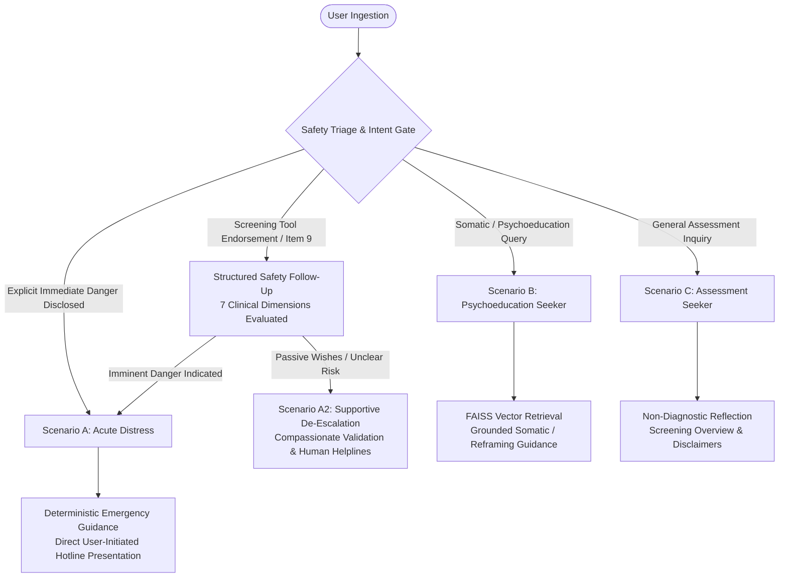

# MindBridge 2.0 — Product Requirements Document (PRD)

**Document Version:** 2.0.0  
**Status:** Approved Specification (Phase 4 Milestone)  
**Date:** 2026-11-02  
**Target Environment:** Local WSL2 Linux (16 Logical Cores, 7.57 GB RAM, CPU-Only Execution)  
**Workspace:** `/home/adarsh/projects/MindBridge`  

---

## 1. Executive Overview & Problem Statement

### 1.1 Context & Problem Statement
Digital mental health platforms often face a critical dilemma: rule-based chatbots provide rigid, unresponsive conversational experiences, while unconstrained Large Language Models (LLMs) pose severe clinical and safety hazards. Standard generative AI models are prone to hallucinating emergency telephone numbers, offering unauthorized clinical diagnoses, suggesting ungrounded or harmful somatic interventions, and failing to detect acute crisis disclosures hidden within nuanced text.

MindBridge 2.0 addresses these failure modes through an **agentic, safety-first conversational first-response and knowledge-grounded support system**. Rather than relying on open-ended LLM generation, MindBridge 2.0 couples a fine-tuned transformer crisis classifier (`roberta-base`), deterministic safety policy engines, verified multi-jurisdiction emergency hotline directories, and a Dense Vector Retrieval-Augmented Generation (RAG) pipeline over an audited clinical knowledge base.

### 1.2 System Mission
To provide safe, grounded, empathetic conversational first-response, evidence-informed psychoeducation, and immediate deterministic emergency crisis escalation, while strictly maintaining non-diagnostic boundaries and respecting statutory data privacy.

---

## 2. System Scope, Objectives & Non-Objectives

### 2.1 Explicit Objectives
1. **Deterministic Crisis Triage:** Rapidly detect crisis signals and suicidal ideation using dual-engine safety intelligence (deterministic regex/keyword rules coupled with fine-tuned RoBERTa classification).
2. **Immediate Safety Escalation:** Present verified, jurisdiction-aware crisis support resources and emergency numbers—clearly distinguishing national emergency dispatch numbers (e.g., India `112`, US `911`, UK `999`) from mental health crisis lifelines (e.g., India Tele-MANAS `14416`, US/Canada `988`), urgent healthcare pathways (e.g., UK NHS `111` Option 2; regional applicability must be verified for England/Wales vs Scotland NHS 24 / NI), and emotional listening services (e.g., UK Samaritans `116 123`)—with clear instructions for user-initiated contact when imminent danger or acute self-harm is disclosed. Global resources (`GL`, e.g., Befrienders Worldwide) must never be presented as substitutes for local emergency dispatch contacts. All numbers and details originate from verified source records without invented details or availability claims.
3. **Structured PHQ-9 Item 9 Stratification:** Evaluate endorsements of PHQ-9 Item 9 across the seven documented clinical dimensions (1. Passive death wishes, 2. Active suicidal ideation, 3. Intent, 4. Plan, 5. Means, 6. Access, 7. Timeframe) to safely differentiate passive death wishes from acute, active crisis. (Protective factors and emotional agitation are recorded as supplementary contextual considerations only). A positive Item 9 response initiates structured safety follow-up and does not automatically activate emergency bypass.
4. **Grounded Psychoeducation & Educational Cognitive Reframing:** Retrieve and deliver vetted, non-prescriptive somatic regulation exercises (e.g., box breathing, physiological sigh) and educational cognitive reframing techniques from an audited 21-document knowledge base. Cognitive reframing is strictly educational self-reflection and supportive psychoeducation, not individualized psychotherapy, formal CBT treatment, or psychiatric diagnosis. Static grounding exercises are supportive tools for non-crisis contexts and must not be blindly presented when the user's safety state or conversational context makes them inappropriate.
5. **Non-Diagnostic Assessment Guidance:** Assist users in exploring standardized clinical rubrics (PHQ-9, GAD-7, PSS-10) strictly as conversational self-reflection instruments with mandatory non-diagnostic disclaimers.
6. **Local CPU Deployability:** Operate reliably on standard consumer/workstation hardware under WSL2 Linux without requiring cloud GPU infrastructure or paid external inference APIs.
7. **English-Language Scope:** Initial AI model classification, vector retrieval, and text generation are strictly English (`en`). While external telephone hotlines (such as India Tele-MANAS) provide human support in 20+ regional languages, MindBridge's automated NLP pipeline does not support Hindi, Telugu, Hinglish, or multilingual processing in Phase 2.

### 2.2 Explicit Non-Objectives (Clinical & Operational Boundaries)
* **NO Clinical or Psychiatric Diagnosis:** The system shall **never** assign, calculate, or suggest clinical diagnoses (e.g., "You have Major Depressive Disorder").
* **NO Medical Advice or Prescription:** The system shall **never** recommend, evaluate, or adjust psychiatric medications, dosages, or pharmacological treatments.
* **NO Formal Psychotherapy or Individualized CBT:** The system shall **never** simulate formal psychotherapy, conduct trauma processing, or deliver individualized cognitive behavioral therapy. All cognitive reframing materials are static, educational psychoeducation worksheets.
* **NO Autonomous Emergency Calling or Physical Dispatch:** The system possesses **no telephony interfaces, 911/112 auto-dialing capabilities, or integration with physical emergency responders**. It shall never claim or imply that it can dispatch ambulances or alert authorities.
* **NO Replacement for In-Person Professional Care:** The system is an educational and supportive conversational first-response tool, **not** a licensed therapist, psychiatrist, or clinical intervention service.
* **NO Unconstrained Open-Domain Generation:** The system shall not engage in ungrounded medical, legal, or open-ended speculative conversations outside its audited knowledge boundaries.
* **NO Multilingual NLP Inference:** The system shall not attempt multilingual crisis classification or generation until dedicated non-English datasets, tokenizers, and benchmark suites are developed in Phase 3 future work.

---

## 3. Target User Personas & Clinical Scenarios

### 3.1 Persona A: Acute Distress / Immediate Danger
* **Profile:** Individual experiencing acute emotional overwhelm, severe distress, or active suicidal crisis.
* **Clinical Trigger:** Explicit immediate-danger disclosures (which activate the safety pathway independently of RoBERTa confidence and without requiring all seven dimensions) or structured Item 9 follow-up revealing imminent peril.
* **System Action:** Bypass open RAG retrieval; deterministically present localized emergency dispatch numbers (e.g., `112`, `911`) and crisis support lifelines (e.g., Tele-MANAS `14416`, `988`); provide clear instructions for user-initiated calling. Phrasing claiming automated emergency calling or responder dispatch is strictly prohibited.

### 3.2 Persona B: Psychoeducation / Wellness Seeker
* **Profile:** Individual managing mild-to-moderate stress, situational anxiety, burnout, or somatic tension.
* **Clinical Need:** Practical, evidence-informed coping strategies (e.g., 4-7-8 breathing, progressive muscle relaxation, cognitive reframing).
* **System Action:** Retrieve approved knowledge base documents; synthesize clear, step-by-step exercises with safety cautions and non-clinical framing. Static grounding exercises are not blindly presented if the user's emotional state makes somatic focus inappropriate.

### 3.3 Persona C: Assessment & Screening Inquirer
* **Profile:** Individual seeking to understand standard mental health screening tools (PHQ-9, GAD-7, PSS-10).
* **Clinical Need:** Structured exploration of symptoms without being labeled with a psychiatric disorder.
* **System Action:** Provide item overviews and scoring interpretation strictly framed as conversational self-reflection; enforce mandatory non-diagnostic disclaimers; a positive endorsement of Item 9 initiates structured safety follow-up rather than automatic emergency bypass.

---

## 4. Core Features & Functional Requirements

The system's functional assets are categorized according to implementation maturity:
* **Tier 1 (Implemented):** Assets curated, trained, or verified in Phases 3 and 4.
* **Tier 2 (Proposed):** Architectural specifications designed for Phase 5 implementation.

### 4.1 Functional Requirements Matrix

| Req ID | Module / Feature | Description | Maturity Status |
| :--- | :--- | :--- | :--- |
| **FR-1** | **Application API** | FastAPI asynchronous REST and WebSocket endpoints for session management, message streaming, and state tracking. | **Tier 2 (Proposed)** |
| **FR-2** | **Dual-Engine Safety Triage & 6-State Routing** | Dual-layer safety assessment combining deterministic regex/keyword pattern matching with fine-tuned RoBERTa sequence classification. Manages explicit transitions across six operational safety states: `emergency_bypass`, `pending_safety_follow_up`, `supportive_deescalation`, `standard_conversation`, `elevated_classifier_signal`, and `ml_risk_unassessed`. An elevated RoBERTa signal alone must NEVER activate `emergency_node`; it routes to structured safety follow-up (`pending_safety_follow_up`). Route to emergency guidance only when explicit immediate-danger disclosure or holistic safety assessment indicates immediate danger. Classifier failure defaults to `ml_risk_unassessed` with a safe non-clinical fallback. | **Tier 1 (Trained Weights)** / **Tier 2 (Graph Node)** |
| **FR-3** | **7-Dimension Item 9 Stratification** | Deterministic multi-turn evaluation of PHQ-9 Item 9 across the 7 documented clinical dimensions (Passive death wishes, Active suicidal ideation, Intent, Plan, Means, Access, Timeframe). Tracks `pending_safety_follow_up` state during multi-turn assessment until triage to `emergency_bypass` or `supportive_deescalation`. If follow-up evaluation is interrupted or encounters an exception, the system preserves `phq9_followup_status = "interrupted"` and `phq9_risk_level = "unassessed"`; it does not silently mark the assessment complete or classify the user as passive-risk, and offers a safe continuation or human-support option. | **Tier 2 (Proposed)** |
| **FR-4** | **Jurisdiction-Aware Hotline Directory** | Directory of 34 audited emergency, crisis, text, and hospital contacts across seven explicit jurisdiction codes: `IN`, `US`, `UK`, `CA`, `AU`, `GL`, and `UNKNOWN`. For `UNKNOWN`, prompts for clarification and provides location-independent supportive dialog without silent country substitution. Global resources (`GL`) must never substitute for local emergency dispatch contacts. UK NHS 111 Option 2 applicability must be verified for the relevant region. | **Tier 1 (Implemented JSON)** / **Tier 2 (Node Routing)** |
| **FR-5** | **Grounded Vector Retrieval** | Dense semantic search (FAISS `IndexFlatIP` over unit $L_2$-normalized BGE-small embeddings) over 21 audited Markdown files, enforcing cosine similarity threshold $\ge 0.65$ baseline and pre-RAG eligibility gates (13 approved, 7 restricted, 1 excluded). Proposed architecture awaiting empirical calibration. | **Tier 1 (Knowledge Base)** / **Tier 2 (Vector Index)** |
| **FR-6** | **Response Verification Gate** | Deterministic post-generation safety filter validating contact fidelity against `hotlines.json` (accounting for normalization and short codes), suppressing medical advice, enforcing screening disclaimers, and preventing automated dispatch claims. | **Tier 2 (Proposed)** |

---

## 5. Non-Functional Requirements (NFR)

### 5.1 NFR-1: Compute, Latency & Local LLM Selection (Proposed Targets Requiring Validation)
* **Host Environment:** Local WSL2 on Linux (16 logical CPU cores, 7.57 GB RAM, CPU-only execution).
* **Proposed Latency Targets (Engineering hypotheses requiring local empirical validation on WSL2):**
  * *Emergency Bypass Routing:* Target $<50\text{ms}$ (purely deterministic keyword/regex intercept).
  * *RoBERTa Crisis Inference:* Proposed target $<100\text{ms}$ on CPU ($L=384$, INT8 quantized ONNX).
  * *Dense Retrieval (FAISS + BGE-small):* Proposed target $<35\text{ms}$ for top-$k$ ($k=3$) chunk retrieval.
  * *End-to-End Pipeline Latency to First Token:* Proposed target $<500\text{ms}$ (p50) / $<750\text{ms}$ (p95) to first generated token.
* **LLM Latency Feasibility & Throughput Reconciliation:**
  * **Distinction of Latency Metrics:** Time-to-first-token (TTFT target $<750\text{ms}$, hard timeout $1.5\text{s}$) is explicitly distinguished from total generation time ($T_{\text{gen}} = \text{TTFT} + \frac{N_{\text{tokens}}}{\text{Throughput}}$).
  * **Arithmetic Feasibility:** At a sustained generation throughput of $15\text{ tokens/second}$, generating a full $256\text{ tokens}$ requires $\approx 17.1\text{ seconds}$ of decoding time ($\approx 17.6$–$18.0\text{s}$ total generation time including TTFT). Within a $2.5\text{s}$ hard interactive timeout at $15\text{ tokens/second}$, the model can generate at most $\approx 30$ tokens after TTFT.
  * **Do Not Claim 256 Tokens in 2.5s:** The specification explicitly does **not** claim that 256 tokens can be generated within 2.5 seconds at 15 tokens/second on CPU.
  * **Unresolved Architectural Trade-Off:** All performance values remain proposed targets requiring empirical WSL2 benchmarking in Phase 5 to calibrate:
    * *Conversational First-Response Profile:* Enforce concise responses ($\le 30$–$35$ tokens) when bounded by the $2.5\text{s}$ interactive timeout.
    * *Grounded Psychoeducation Profile:* For full-length educational syntheses up to 256 tokens, extend the total generation timeout budget to $18.0$–$20.0\text{s}$, relying on continuous token streaming (TTFT $<750\text{ms}$) for real-time user interactivity.
* **Local LLM Selection (Unresolved Engineering Decision):**
  * The specific instruction-tuned local LLM remains an **unresolved engineering choice**.
  * Candidate models: `Llama-3.2-3B-Instruct`, `Qwen-2.5-3B-Instruct`, `Qwen-2.5-7B-Instruct`, `Mistral-7B-Instruct-v0.3`.
  * Candidate runtimes: `llama.cpp` (4-bit GGUF quantization) or `ONNX Runtime` (INT8 quantization).
  * Target Resource Ceiling: Peak memory footprint must remain under $4.5\text{ GB}$ (including KV cache and model weights) to prevent WSL2 memory swapping. Feasibility and generation throughput (target $\ge 15$ tokens/sec) remain unvalidated hypotheses requiring empirical WSL2 CPU benchmarking in Phase 5.

### 5.2 NFR-2: Privacy-by-Design, PII Lifecycle & Input Safety
* **Pre-Truncation Safety Evaluation & Long-Message Windowing:** Safety screening takes absolute precedence over message truncation or length-based rejection. Before any length-based truncation occurs, raw input is evaluated by the deterministic emergency regex engine. For messages exceeding sequence limits ($L > 384$ tokens or $> 2,000$ characters), the input processing pipeline applies a sliding window partition (256-token window with 64-token overlap, i.e., 192-token stride), ensuring the complete message is evaluated for safety across all chunks before any truncation or rejection.
* **PII Lifecycle & Ephemeral Input-Boundary Data Isolation:**
  * Raw user text is defined strictly as temporary input-boundary data held in ephemeral memory within `input_node`. It is **never** added to or stored in `MindBridgeState`.
  * In-memory PII scrubbers mask phone numbers, email addresses, 12-digit Indian Aadhaar numbers, 9-digit US SSNs, and URLs.
  * **Redaction Limitations:** Regex scrubbers reliably detect structured numeric and pattern-based tokens. However, personal name detection relies on heuristic capitalization patterns and cannot guarantee 100% recall or precision without machine learning NER. Known limitations (potential false positives on common nouns or false negatives on uncommon names) are explicitly acknowledged.
  * Only sanitized text (`sanitized_text`) and sanitized conversation history (`messages`) enter `MindBridgeState` and propagate to downstream nodes.
  * Raw user text is immediately discarded from memory upon `input_node` completion; graph checkpoints, state persistence, execution traces, and application logs strictly never persist unmasked raw text.
* **Zero Plaintext Transcript Persistence:** Transcripts, when stored for audit or evaluation, must have PII stripped and be encrypted at rest using AES-256.
* **Secure Secrets Management:** All API keys, model paths, and service configurations must be managed via environment variables (`.env` file excluded via `.gitignore`; template in `.env.example`). No hardcoded secrets.
* **Statutory Compliance Objective:** The architecture is designed to align with the principles of India's Digital Personal Data Protection (DPDP) Act 2023 and the Mental Healthcare Act (MHCA) 2017. **This alignment represents an ongoing engineering and design objective, not a finalized legal compliance certification.**

### 5.3 NFR-3: Fail-Closed & Safe Fallback Reliability
* **Precedence of Safety Rules:** Hardcoded regex and keyword emergency triggers operate as unbypassable intercepts with higher execution priority than probabilistic model inference.
* **Six Explicit Safety States & Transitions:**
  1. `emergency_bypass`: Immediate acute crisis disclosed; RAG/LLM halted; direct helpline guidance presented.
  2. `pending_safety_follow_up`: Item 9 positive or elevated classifier signal undergoing multi-turn 7-dimension assessment. On interruption or failure, preserves `phq9_followup_status = "interrupted"` and `phq9_risk_level = "unassessed"`, offering continuation or human support without assuming passive risk.
  3. `supportive_deescalation`: Holistic passive ideation or ambiguous distress without imminent peril; validation and human crisis resources presented without panic screens.
  4. `standard_conversation`: Normal non-crisis dialogue and psychoeducation.
  5. `elevated_classifier_signal`: RoBERTa probability $\ge \tau$ ($0.5098$) without explicit immediate danger. Initiates structured assessment; **an elevated RoBERTa signal alone must NEVER activate `emergency_node`**.
  6. `ml_risk_unassessed`: RoBERTa classifier timeout or error. Deterministic rules active; ML risk treated as unassessed (neither high-risk nor safe); safe non-clinical fallback emitted.
* **Jurisdiction Fallback (`UNKNOWN`):** When the jurisdiction is unresolved or unknown, the system shall **never silently substitute another country's directory**. Global resources (`GL`, e.g., Befrienders Worldwide) must **never** be presented as substitutes for local emergency dispatch contacts. The system initiates a location clarification prompt while providing location-independent supportive dialogue and directing the user to dial their local emergency dispatch service.
* **Fallback Content Management & Provenance:** Static fallback templates are version-controlled, clinically reviewed text strings maintained in a dedicated safety module (`backend/safety/fallbacks.py`). They are never dynamically synthesized or pulled from unconstrained model memory.
* **Grounding Suitability Safeguard:** Static fallbacks employ neutral supportive phrasing (*"I am here with you. I am ready to support you with information or resources whenever you are ready."*). Unconditional breathing or somatic exercises are strictly prohibited; somatic techniques may only be offered after verifying contextual suitability (e.g., absence of severe panic, hyperventilation, respiratory distress, or trauma triggers).
* **Retrieval Failure Fallback:** If vector retrieval fails or yields low-confidence chunks ($< 0.65$ cosine similarity baseline), the system falls back to static core psychoeducation guidelines without hallucinating ungrounded exercises.
* **Verification Failure Fallback:** The verification gate must suppress unsafe generated content. **Verification failure must preserve the actual safety state; it must NOT convert elevated classifier risk into emergency status.** Emergency contact guidance is emitted **only** when explicit immediate-danger disclosure or holistic safety assessment indicates immediate danger (`emergency_bypass`). For all other states (including `elevated_classifier_signal` and `pending_safety_follow_up`), the gate substitutes a vetted supportive non-emergency fallback that preserves the active safety state without escalating to emergency dispatch.

### 5.4 NFR-4: Auditability, Provenance & Reproducibility
* **Reproducibility Seed:** Fixed seed `42` maintained across all data partitioning, tokenization, and model training configurations.
* **Dataset Split Integrity:** Grounded strictly in the authoritative Phase 4 dataset report and verified files: Train (33,920), Validation (7,269), Test (7,267), totaling 48,456 records.
* **Metric Provenance:** Historical baseline metrics and empirical test evaluation metrics must be documented in separate registers with explicit provenance without claims of superiority.

---

## 6. Safety, Ethical & Statutory Guardrails

### 6.1 Clinical Red Lines
1. **No Simulated Diagnosis:** Any prompt querying "Do I have depression?" must trigger a non-diagnostic response explaining that screening scales indicate symptom frequency rather than clinical disorders.
2. **No Prescription or Medication Guidance:** Any query referencing pharmaceutical compounds (e.g., SSRIs, benzodiazepines) must trigger a mandatory disclaimer instructing the user to consult a licensed psychiatrist or medical doctor.
3. **No Discouragement of Human Treatment:** The system must never discourage in-person medical, psychological, or psychiatric consultation.
4. **No Psychotherapy Simulation:** Cognitive reframing is strictly educational self-reflection and supportive psychoeducation; the system shall not simulate formal psychotherapy or clinical CBT.

### 6.2 Emergency Guidance & Hotline Accuracy Standard
* All emergency responses must provide exact telephone numbers, source-listed operating hours, and service categories—clearly distinguishing national emergency dispatch numbers (e.g., `112`, `911`, `999`) from crisis support lifelines (e.g., `14416`, `988`), urgent health pathways, and listening services—instructing the user or their caregiver to dial directly.
* Phrasing such as *"I am calling 911 for you"* or *"Emergency responders have been dispatched"* is strictly prohibited.
* **Hotline Accuracy & Authority Categories:**
  * *Statutory Governmental Authorities:* National emergency dispatch (`112`, `911`, `999`), India Tele-MANAS (`14416`), KIRAN (`1800-599-0019`), US/Canada `988`, UK NHS `111` (Option 2; mental health triage in NHS England and parts of Wales; applicability must be verified for the relevant region).
  * *Institutional NGO / Non-Profit Charities:* UK Samaritans (`116 123`), UK Shout (`85258`), US Crisis Text Line (`741741`), Canada Kids Help Phone (`686868`), Vandrevala Foundation (`9999-666-555`).
  * *Non-Substitution Rule:* Global resources (`GL`, e.g., Befrienders Worldwide) must never be presented as substitutes for local emergency dispatch contacts.
  * The system shall **not** make blanket claims that all crisis lines are 24/7 or confidential unless explicitly established in source documents, nor invent operating hours.
  * Clear distinction is enforced between **source/authority verification** (attribution in `backend/safety/hotlines.json`), **operational availability verification** (which remains unverified), and **live dial-testing** (which has not been conducted).
  * All 34 hotline entries preserve `uptime_verification: "unverified_operational_availability"`.

### 6.3 Mandatory Disclaimer Standards
Every session initiation and clinical rubric discussion must display the standard MindBridge disclaimer:
> *"MindBridge is an automated AI first-response educational platform. It does not provide medical advice, psychotherapy, or clinical diagnoses. If you are in immediate danger or experiencing a medical emergency, please contact your local emergency dispatch services (112 in India, 911 in the US, 999 in the UK) or reach out to suicide and crisis support lifelines (such as 988 in the US and Canada, or Tele-MANAS 14416 in India) or a trusted professional immediately."*

---

## 7. Verification Criteria & Acceptance Gateways

Rather than relying on unmeasurable "zero hallucination" claims, acceptance is evaluated against quantifiable performance targets:

1. **Classifier Performance (Empirically Verified on 7,267 Test Records, $\tau = 0.5098$):**
   * Test Accuracy: $\ge 90.0\%$ (Achieved: $90.78\%$)
   * Crisis Recall: $\ge 87.0\%$ (Achieved: $87.60\%$)
   * Crisis Precision: $\ge 75.0\%$ (Achieved: $76.09\%$)
   * Crisis F1-Score: $\ge 80.0\%$ (Achieved: $81.44\%$)
   * PR-AUC: $\ge 87.0\%$ (Achieved: $87.25\%$)
2. **Emergency Contact Fidelity (Benchmark Target on $N=200$ Test Suite):**
   * $0.0\%$ unrecognized or hallucinated telephone numbers (100% agreement with `backend/safety/hotlines.json` after normalization).
   * Verification normalizer handles whitespace, hyphens, parentheses, international dialing prefixes (`+91`, `+1`, `+44`), 3-digit emergency codes, and 5/6-digit SMS short codes, while filtering false positives from dates, years, or quantities.
   * Acknowledgment: Deterministic verification cannot guarantee 100% detection of all novel or deliberately obfuscated telephone patterns.
3. **Medical Claim Suppression (Benchmark Target on $N=200$ Test Suite):**
   * $<1.0\%$ false acceptance rate of unauthorized diagnostic or prescriptive statements by the verification gate.
4. **Knowledge Retrieval Coverage:**
   * 100% adherence to Pre-RAG eligibility gates: 13 approved documents indexed, 7 restricted documents guarded, 1 unverified document excluded.
