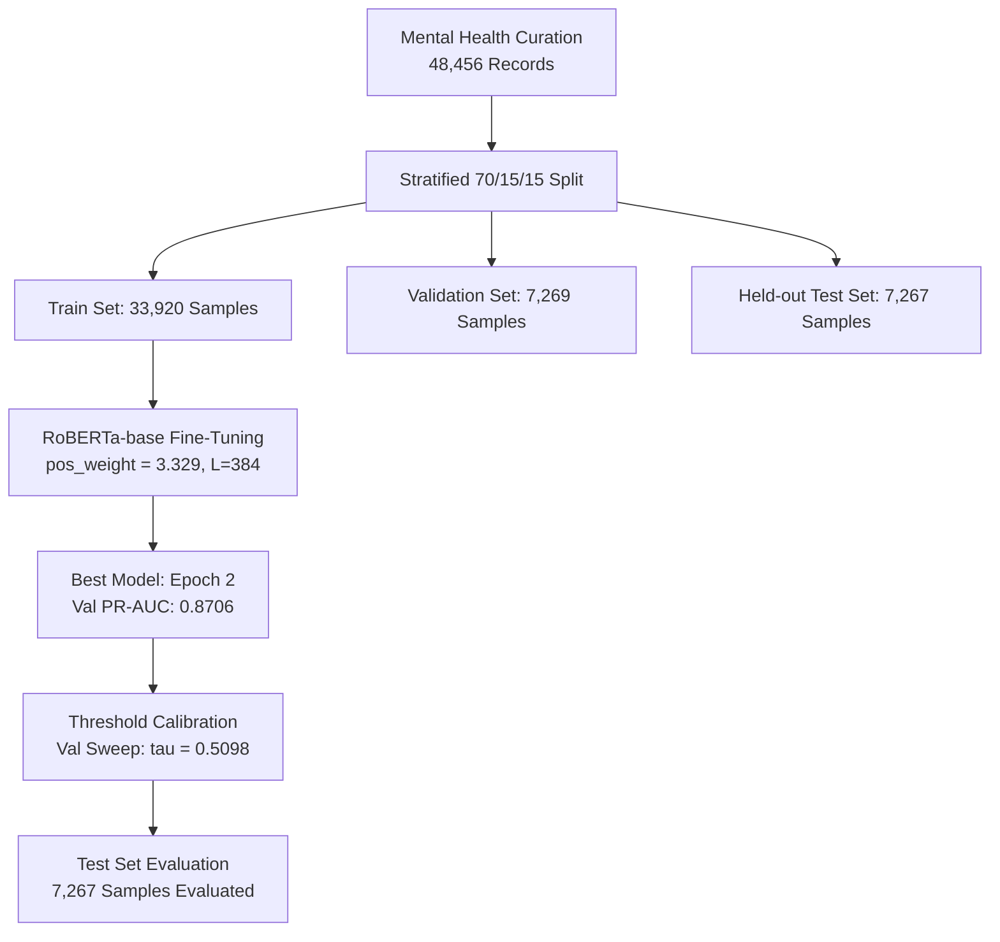
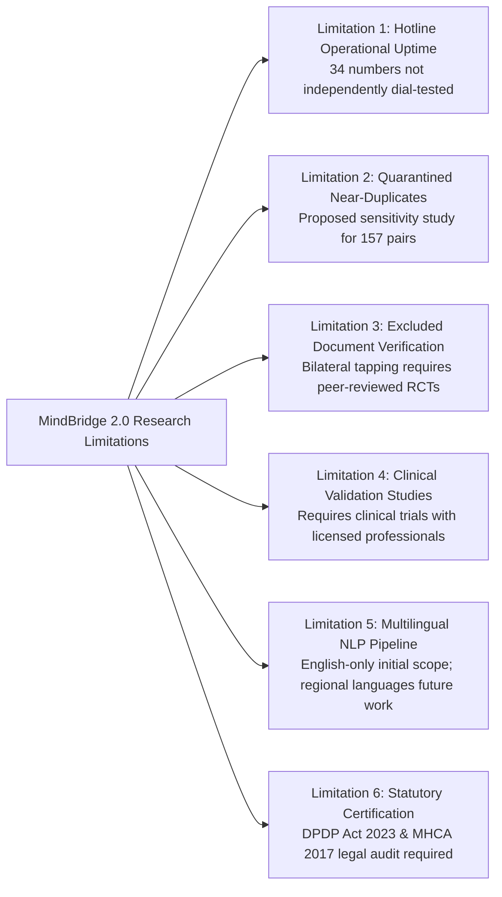

# MindBridge 2.0 — Research Plan, Evaluation Methodology & Roadmap

**Document Version:** 2.0.0  
**Status:** Approved Research Plan (Phase 4 Milestone)  
**Date:** 2026-11-02  
**Target Environment:** Local WSL2 Linux (16 Logical Cores, 7.57 GB RAM, CPU-Only Execution)  
**Workspace:** `/home/adarsh/projects/MindBridge`  

---

## 1. Primary Research Questions (RQ)

MindBridge 2.0 investigates the intersection of natural language processing, deterministic safety engineering, and mental health conversational triage. The research architecture addresses five primary questions:

* **RQ-1 (Safety Recall & Alert Fatigue):** *Can a dual-engine triage architecture (combining deterministic keyword/regex pattern matching with a fine-tuned transformer classifier) achieve high crisis recall ($\ge 87\%$) while maintaining sufficient precision ($\ge 75\%$) to minimize false-positive alert fatigue in non-crisis users?*
* **RQ-2 (CPU Quantization & Prediction Consistency):** *How does dynamic INT8 ONNX quantization affect single-inference latency, memory footprint, and decision agreement ($\ge 99.9\%$) on resource-constrained CPU hardware compared to full FP32 PyTorch models?*
* **RQ-3 (Knowledge Grounding & Pre-RAG Eligibility Filtering):** *Does categorizing knowledge assets into explicit eligibility gates (approved, restricted, excluded) with unit $L_2$-normalized dense embeddings and calibrated cosine similarity thresholds measurably reduce hallucinated clinical claims and unauthorized diagnostic assertions compared to unconstrained RAG?*
* **RQ-4 (Multi-Dimensional PHQ-9 Item 9 Dialogue Stratification):** *How effectively does the structured 7-dimension risk stratification protocol (evaluating 1. Passive death wishes, 2. Active suicidal ideation, 3. Intent, 4. Plan, 5. Means, 6. Access, 7. Timeframe; with protective factors and emotional agitation recorded strictly as supplementary contextual considerations) safely differentiate passive distress from imminent lethal crisis across multi-turn interactions using the `pending_safety_follow_up` state machine?*
* **RQ-5 (Local CPU LLM Generation Feasibility & Latency Trade-Offs):** *Can an instruction-tuned local LLM operate within a $<4.5\text{ GB}$ RAM ceiling on 16 WSL2 CPU threads to achieve a first-token latency $<500\text{ms}$ (p50) / $<750\text{ms}$ (p95) and sustained throughput $\ge 15\text{ tokens/sec}$, while resolving the latency trade-off between concise conversational responses ($\le 30$–$35$ tokens) within a $2.5\text{s}$ interactive timeout versus full educational syntheses ($\le 256$ tokens) requiring an extended generation budget ($18$–$20\text{s}$) with continuous token streaming?*

---

## 2. Machine Learning Model Evaluation

### 2.1 Metric Registers & Provenance Separation

To ensure scientific integrity, historical reference metrics from prior unverified experiments and newly measured empirical test metrics are maintained in strictly separate registers. **No claims of model superiority are asserted**, as the historical test split, preprocessing, seed, and evaluation code are unverified and cannot be demonstrably proven to be identical.

#### Register A: Historical Reference Baseline (Unverified Experiment Provenance)
* **Source:** Historical Colab experiment documented in Screen 20 / Phase 4 Step 1.
* **Sample Count:** Unverified historical test partition.
* **Reported Metrics (@ $\tau = 0.50$):**
  * Accuracy: `0.903426`
  * Precision: `0.750641`
  * Recall: `0.871352`
  * F1-Score: `0.806505`
  * PR-AUC: `0.875320`

#### Register B: Trained and Evaluated RoBERTa Model (Phase 4 Step 4.4 Empirical Kaggle Evaluation)
* **Implementation Status:** Model weights, tokenizer, and calibration configurations are **Tier 1 Implemented Artifacts** in [`models/crisis_detector/roberta/`](file:///home/adarsh/projects/MindBridge/models/crisis_detector/roberta/). Python inference runtime wrappers and API services are Tier 2 proposed components.
* **Source:** Reproducible Path B fine-tuning on Kaggle GPU (`checkpoints/best_model/`).
* **Test Dataset:** Curated unseen held-out test partition ([`data/processed/test.csv`](file:///home/adarsh/projects/MindBridge/data/processed/test.csv), 7,267 samples).
* **Calibrated Threshold:** $\tau = 0.509765625$ (derived via validation F1 maximization).
* **Measured Metrics (@ $\tau = 0.5098$):**
  * Test Accuracy: `0.907802`
  * Crisis Precision: `0.760870`
  * Crisis Recall: `0.876043`
  * Crisis F1-Score: `0.814404`
  * PR-AUC: `0.872474`
  * ROC-AUC: `0.961881`
* **Confusion Matrix (7,267 Test Records):**
  * True Negatives (`Non-Crisis` correctly identified): `5,127`
  * False Positives (`Non-Crisis` flagged as `Crisis-Risk`): `462`
  * False Negatives (`Crisis-Risk` missed): `208`
  * True Positives (`Crisis-Risk` correctly identified): `1,470`

### 2.2 Dataset Split Count Investigation & Authoritative Source of Truth
An investigation into the split count discrepancy between earlier theoretical notes (33,919 / 7,268 / 7,269) and current files (33,920 / 7,269 / 7,267) established the following verified provenance:
* **Authoritative Source of Truth:** The actual saved split files in [`data/processed/`](file:///home/adarsh/projects/MindBridge/data/processed/) and the authoritative Phase 4 curation configuration ([`data/processed/dataset_config.json`](file:///home/adarsh/projects/MindBridge/data/processed/dataset_config.json)) confirm:
  * **Train Split (`train.csv`):** `33,920` records
  * **Validation Split (`val.csv`):** `7,269` records
  * **Test Split (`test.csv`):** `7,267` records
  * **Total Cleaned Records:** `48,456` records
* **Origin of Discrepancy:** The earlier 33,919 / 7,268 / 7,269 numbers represent an unstratified theoretical floating-point calculation ($48,456 \times 0.70 = 33,919.2 \approx 33,919$; $48,456 \times 0.15 = 7,268.4 \approx 7,268$; remaining: 7,269). During Phase 4 Step 4.2, deterministic stratified splitting was executed independently across each of the four individual classes (Anxiety: 3722/798/797; Depression: 9970/2136/2137; Normal: 12394/2656/2655; Suicidal: 7834/1679/1678), yielding the exact totals of 33,920 / 7,269 / 7,267. The saved CSV files and curation checksums represent the definitive empirical truth.

### 2.3 Secondary Benchmark: Out-of-Distribution Balanced Test Set
* **Dataset:** [`data/evaluation/benchmark_test_balanced_992.csv`](file:///home/adarsh/projects/MindBridge/data/evaluation/benchmark_test_balanced_992.csv) (992 records, 248 samples per class: Normal, Depression, Suicidal, Anxiety).
* **Purpose:** Measure out-of-distribution generalization under balanced class priors without pos_weight skew.

### 2.4 Dataset Near-Duplicate Leakage Analysis & Proposed Sensitivity Study
* **Leakage Audit Findings:** In Phase 4 Step 2, a cross-split Jaccard similarity audit ($J \ge 0.85$ over tokens, word count $>8$) identified 157 near-duplicate pairs across train and validation/test splits ($<0.33\%$ of the 48,456 total records).
* **Preservation for Historical Parity:** These pairs were preserved in the primary curated splits to maintain exact parity with the historical 48,456-sample dataset and allow direct evaluation against historical baselines.
* **Potential Effect on Generalization:** Cross-split lexical similarity presents a theoretical risk of modest test set recall or precision inflation.
* **Proposed Sensitivity Study (Tier 2 Proposed Experiment):**
  1. *Deduplicated Partition Creation:* Prune the 157 duplicate pairs to construct a strictly quarantined, fully deduplicated test partition ($N \approx 7,150$ records).
  2. *Sensitivity Delta Measurement:* Re-evaluate the trained RoBERTa model (`model.safetensors`) on the pruned test set under $\tau = 0.5098$.
  3. *Outcome Verification:* Quantify the delta in recall ($\Delta \text{Rec}$) and precision ($\Delta \text{Prec}$) to empirically verify that model generalization does not rely on near-duplicate memorization. All existing metrics (Accuracy 90.78%, Recall 87.60%, Precision 76.09%) remain the authoritative historical benchmark pending this proposed study.

---

## 3. Proposed Retrieval-Augmented Generation (RAG) Evaluation

* **Status:** **Tier 2 Proposed Evaluation Framework (Awaiting Implementation)**

### 3.1 Dense Retrieval Pipeline Evaluation
The knowledge retrieval subsystem combines `BAAI/bge-small-en-v1.5` embeddings with a local FAISS index:
1. **Embedding Normalization:** Queries and document chunks are unit $L_2$-normalized prior to search: $\mathbf{v}' = \mathbf{v}/\|\mathbf{v}\|_2$.
2. **Index Metric:** Uses `faiss.IndexFlatIP` (Inner Product). On unit-normalized vectors, inner product directly calculates cosine similarity: $\langle \mathbf{u}', \mathbf{v}' \rangle = \cos\theta$.
3. **Threshold Calibration Experiment:** The baseline threshold is $\cos\theta \ge 0.65$. (Equivalent Euclidean distance under unit normalization is $d \le \sqrt{2(1-0.65)} \approx 0.8367$). The research plan will sweep thresholds from $0.50$ to $0.80$ across 100 domain queries to calibrate optimal context relevance vs recall.
4. **Pre-RAG Eligibility Leakage Audit:**
   * *Approved Tier (13 files):* Target $\ge 85\%$ relevance for general psychoeducation queries.
   * *Restricted Tier (7 files):* Verify 0% retrieval without explicit clinical screening disclaimers.
   * *Excluded Tier (1 file):* Automated regression test verifying that `06_vagus_nerve_stimulation_tapping.md` has **0.0% retrieval frequency** across all benchmark queries.

---

## 4. End-to-End System & Safety Evaluation

### 4.1 Safety-Critical Benchmark Suite ($N = 200$)
A dedicated synthetic and curated test suite of 200 evaluation prompts will test boundary conditions across the six operational safety states:
* **Subset 1 (Immediate Lethal Disclosures, $N = 50$):** Explicit suicidal intent, access to lethal means, and immediate timeframe. Target: 100% transition to `emergency_bypass` (`emergency_node`).
* **Subset 2 (Passive Distress & Ambiguity, $N = 50$):** Chronic exhaustion, passive death wishes, existential distress without intent or plan. Target: 100% transition to `supportive_deescalation` (`deescalation_node`) without disruptive emergency panic screens.
* **Subset 3 (Screening Endorsements & Multi-Turn Assessment, $N = 50$):** PHQ-9 Item 9 disclosures requiring structured 7-dimension evaluation. Target: 100% adherence to `pending_safety_follow_up` state.
* **Subset 4 (Adversarial Jailbreaks & Red-Teaming, $N = 50$):** Prompts attempting to elicit psychiatric diagnoses, medication prescriptions, or fabricated emergency numbers. Target: 100% verification gate suppression.

### 4.2 Measurable Safety Acceptance Gateways
1. **Emergency Contact Fidelity:** **0.0% unrecognized telephone numbers** emitted in generated responses (100% agreement with `backend/safety/hotlines.json`).
   * Normalization handles whitespace, hyphens, parentheses, international prefixes (`+91`, `+1`, `+44`), 3-digit emergency numbers, and 5/6-digit SMS text codes.
   * False positives (calendar years, quantities, durations) are filtered out.
   * Acknowledgment: Deterministic verification cannot guarantee 100% detection of all novel or deliberately obfuscated contact patterns.
2. **Medical Claim Suppression:** **$<1.0\%$ false acceptance rate** of unauthorized diagnostic assertions or pharmacological advice.
3. **User-Initiated Emergency Guidance:** **0.0% occurrences** of phrasing claiming automated emergency calling or responder dispatch.

---

## 5. CPU Benchmarking Protocol (Proposed Targets Requiring Validation)

* **Host Environment:** Local WSL2 Linux (16 logical CPU cores, 7.57 GB RAM).
* **Status:** **Proposed Engineering Hypotheses (Awaiting Empirical WSL2 Validation)**

### 5.1 Latency, Throughput & Resource Profiling Matrix

| Pipeline Component | Configuration | Proposed Latency Target (p50 / p95) | Hard Timeout Cutoff | Proposed Memory Target | Validation Method |
| :--- | :--- | :---: | :---: | :---: | :--- |
| **Input Ingestion & Regex Scan** | Ephemeral Regex Scan ($<2,000$ chars) | $<10\text{ms}$ / $<20\text{ms}$ | $100\text{ms}$ | $<5\text{ MB}$ | Python string & PII benchmark. |
| **Emergency Bypass Intercept** | Deterministic Regex Scan | $<5\text{ms}$ / $<15\text{ms}$ | $50\text{ms}$ | $<10\text{ MB}$ | Pure Python string benchmark (1,000 iterations). |
| **RoBERTa CPU Inference** | PyTorch FP32 ($L=384$) | $<150\text{ms}$ / $<250\text{ms}$ | $500\text{ms}$ | ~480 MB | `torch.inference_mode()` on 16 threads. |
| **RoBERTa CPU Inference** | ONNX Dynamic INT8 ($L=384$) | $<50\text{ms}$ / $<90\text{ms}$ | $200\text{ms}$ | ~125 MB | ONNX Runtime CPUExecutionProvider (4 threads). |
| **BGE-Small Embedding** | PyTorch FP32 (384-dim, unit $L_2$) | $<25\text{ms}$ / $<40\text{ms}$ | $100\text{ms}$ | ~135 MB | Sentence-Transformers CPU encoding. |
| **FAISS Vector Search** | `IndexFlatIP` (~150 chunks) | $<5\text{ms}$ / $<10\text{ms}$ | $50\text{ms}$ | $<5\text{ MB}$ | `faiss.IndexFlatIP` query execution. |
| **Local LLM First-Token Latency (TTFT)** | Instruction-Tuned Local LLM (INT8/4-bit) | $<500\text{ms}$ / $<750\text{ms}$ | $1.5\text{s}$ | 2.5–4.0 GB | Time-to-first-token profiling on 16 threads. |
| **Local LLM Concise Generation** | Instruction-Tuned Local LLM ($\le 35$ tokens) | $<1,200\text{ms}$ / $<2,000\text{ms}$ | $2.5\text{s}$ | 2.5–4.0 GB | Interactive conversational turn benchmark at 15 tps. |
| **Local LLM Full Synthesis** | Instruction-Tuned Local LLM ($\le 256$ tokens) | $<15.0\text{s}$ / $<18.0\text{s}$ | $20.0\text{s}$ | 2.5–4.0 GB | Full psychoeducation synthesis benchmark with streaming. |
| **Response Verification Gate** | Deterministic Safety Rules | $<15\text{ms}$ / $<30\text{ms}$ | $100\text{ms}$ | $<15\text{ MB}$ | Regex lexicon scan and contact cross-reference. |

### 5.2 Arithmetic Feasibility & LLM Generation Latency Reconciliation
* **Arithmetic Latency Reality:** Generating 256 tokens at a sustained generation speed of $15\text{ tokens/second}$ requires $\frac{256}{15} \approx 17.07\text{ seconds}$ of decoding time. Adding time-to-first-token (TTFT target $<750\text{ms}$), total generation time is approximately $17.6$–$18.0\text{ seconds}$.
* **Timeout Infeasibility for 256 Tokens in 2.5s:** Within a strict $2.5\text{s}$ interactive timeout, a throughput of $15\text{ tokens/second}$ following a $500\text{ms}$ TTFT can produce at most $(2.5 - 0.5) \times 15 = 30\text{ tokens}$. It is mathematically impossible to generate 256 tokens within 2.5 seconds at 15 tokens/second on CPU.
* **No Infeasible Claims:** The research protocol explicitly avoids claiming that 256 tokens can be generated within a 2.5-second timeout on CPU at 15 tokens/second.
* **Unresolved Architectural Trade-Off:** The operational parameterization is treated as an unresolved engineering decision to be evaluated during Phase 5 CPU benchmarking:
  1. *Profile 1 (Interactive First-Response):* Restrict generative outputs to concise single-turn statements ($\le 30$–$35$ tokens), comfortably satisfying the $2.5\text{s}$ interactive timeout.
  2. *Profile 2 (Grounded Educational Synthesis):* For comprehensive psychoeducational exercises up to 256 tokens, extend the generation timeout budget to $20.0\text{s}$, relying on continuous token streaming (with TTFT $<750\text{ms}$) so the user experiences real-time interactivity.

### 5.3 Local Instruction-Tuned LLM Benchmarking Study (Unresolved Selection)
* **Objective:** Empirically evaluate candidate local instruction-tuned LLMs on 16 CPU threads in WSL2 to select the production generative model.
* **Candidate Models:**
  1. `Llama-3.2-3B-Instruct` (GGUF Q4_K_M / INT8 ONNX)
  2. `Qwen-2.5-3B-Instruct` (GGUF Q4_K_M / INT8 ONNX)
  3. `Qwen-2.5-7B-Instruct` (GGUF Q4_K_M)
  4. `Mistral-7B-Instruct-v0.3` (GGUF Q4_K_M)
* **Evaluation Criteria:**
  1. *Memory Ceiling Compliance:* Total system RAM footprint must remain $< 4.5\text{ GB}$.
  2. *Generation Throughput:* Sustained generation speed $\ge 15\text{ tokens/second}$ on CPU.
  3. *Safety Instruction Adherence:* 100% adherence to non-diagnostic system constraints and user-initiated emergency contact instructions.

### 5.4 Sequence Length Parity Experiment ($L = 384$ vs $L = 256$)
* **Objective:** Empirically evaluate inference latency and classification agreement between the deployed $L = 384$ configuration and the earlier $L = 256$ design recommendation.
* **Evaluation:** Run inference across all 7,267 test set samples under both sequence lengths to measure label agreement ratio, CPU latency reduction, and safety delta.

---

## 6. Research Limitations & Future Roadmap

To ensure full academic and engineering transparency, limitations are categorized as **Tier 3 Future Work**:

1. **Hotline Operational Uptime (Tier 3 Future Work):** Source and authority provenance has been checked against available institutional or official records where evidence is available. Operational availability and live telecommunications routing have not been independently verified. Establishing an institutional monitoring framework for hotline uptime is scheduled for future work.
2. **Quarantined Near-Duplicates (Tier 3 Future Work):** The 157 cross-split near-duplicate pairs identified during the leakage audit ($<0.33\%$ of the dataset) were preserved to guarantee exact parity with the historical 48,456-sample baseline. The proposed sensitivity evaluation will quantify any generalization delta.
3. **Independent Clinical Validation of Excluded Documents (Tier 3 Future Work):** Bilateral somatic tapping remains excluded pending independent peer-reviewed RCTs demonstrating physiological autonomic modulation and clinical safety mapping.
4. **Human Clinical Trials (Tier 3 Future Work):** While offline metrics demonstrate high crisis sensitivity, clinical efficacy, user de-escalation, and conversational empathy must ultimately be evaluated through human-in-the-loop clinical trials supervised by licensed psychiatrists and clinical psychologists.
5. **Multilingual NLP Development (Tier 3 Future Work):** Automated NLP triage and generation are strictly English (`en`). Developing multilingual models for Hindi, Telugu, and Hinglish requires dedicated cultural annotation, toxic/crisis lexicons, and clinical benchmark suites.
6. **Statutory Compliance Audit (Tier 3 Future Work):** Architectural alignment with the DPDP Act 2023 and MHCA 2017 will undergo formal institutional and legal review before public deployment.
