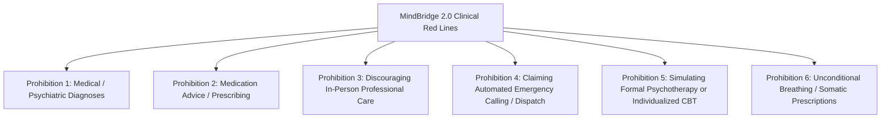
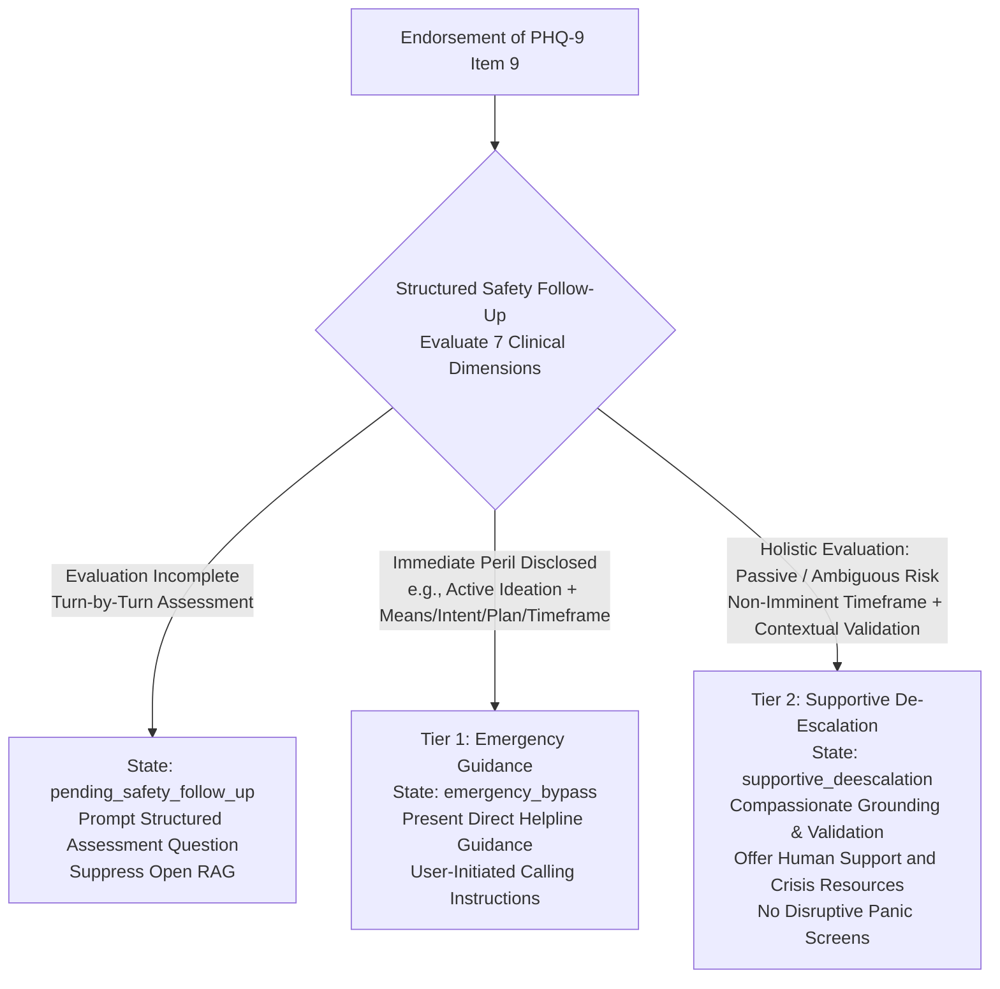
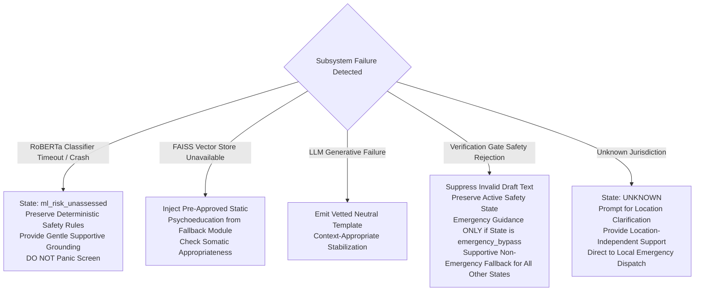

# MindBridge 2.0 — Safety Policy, Clinical Boundaries & Emergency Protocols

**Document Version:** 2.0.0  
**Status:** Approved Safety Policy (Phase 4 Milestone)  
**Date:** 2026-11-02  
**Target Environment:** Local WSL2 Linux (16 Logical Cores, 7.57 GB RAM, CPU-Only Execution)  
**Workspace:** `/home/adarsh/projects/MindBridge`  

---

## 1. Core Ethical & Safety Principles

MindBridge 2.0 is governed by six mandatory ethical and safety axioms:

1. **Primacy of Human Life & Non-Maleficence:** The prevention of acute harm and suicide takes absolute precedence over conversational fluency, task completion, or user engagement metrics.
2. **Deterministic Precedence over Probabilistic AI:** Machine learning classifiers and generative LLMs are inherently probabilistic. In all emergency and crisis scenarios, **deterministic safety rules, hardcoded keyword intercepts, and static verification checks supersede model outputs**.
3. **Strict Non-Diagnostic & Non-Prescriptive Boundaries:** The system operates strictly as an educational first-response tool. It is barred from diagnosing psychiatric disorders, offering medical advice, or evaluating pharmacological regimens.
4. **Transparent User-Initiated Emergency Guidance:** The system possesses no telecommunications infrastructure, 911/112 auto-dialing capabilities, or dispatch interfaces. All emergency guidance must provide verified telephone numbers and transparent instructions for the user or their caregiver to initiate contact directly. **Phrasing implying that the system automatically calls emergency services or dispatches responders is strictly prohibited.**
5. **Full Transparency of Operational Status & Authority:** All emergency contacts are designated with their true verification status (`uptime_verification: "unverified_operational_availability"`). The system shall never falsely represent that emergency telephone numbers have been independently tested for telecommunications uptime or live response availability, nor claim that all services are guaranteed 24/7 or confidential unless explicitly verified in source documents. Statutory governmental authorities are clearly distinguished from institutional NGO and charity services.
6. **Language & Modality Boundaries:** Automated NLP triage and generation are strictly English (`en`). While external phone hotlines (such as India Tele-MANAS) provide human support in 20+ regional languages, MindBridge's AI pipeline does not process Hindi, Telugu, Hinglish, or multilingual text in Phase 2.

---

## 2. Clinical Red Lines & Prohibited Behaviors

The system enforces zero-tolerance boundaries against the following prohibited behaviors:



* **Prohibition 1 (No Diagnoses):** The system shall never state or imply that a user has a psychiatric condition (e.g., Clinical Depression, GAD, PTSD, Bipolar Disorder). Screening rubrics (PHQ-9, GAD-7) must be presented strictly as conversational reflection tools.
* **Prohibition 2 (No Medication Advice):** The system shall never recommend, evaluate, validate, or adjust psychiatric medications (e.g., SSRIs, SNRIs, anxiolytics, sleep aids) or dosages.
* **Prohibition 3 (No Care Discouragement):** The system shall never suggest that AI interaction is an adequate substitute for in-person medical, psychological, or psychiatric evaluation.
* **Prohibition 4 (No Auto-Dispatch Claims):** The system shall never state or imply: *"I am dispatching an ambulance"*, *"Emergency services have been notified"*, or *"I am calling 911 for you"*.
* **Prohibition 5 (No Psychotherapy or CBT Simulation):** The system shall not simulate formal psychoanalysis, trauma processing, or clinical psychotherapeutic interventions. All cognitive reframing content is strictly educational psychoeducation.
* **Prohibition 6 (No Unconditional Breathing Prescriptions):** Static fallbacks and dialogue responses shall never prescribe breathing or somatic exercises unconditionally (e.g., *"Let's take a slow breath together"*). Somatic grounding may be offered only after checking contextual suitability (absence of acute panic, hyperventilation, respiratory distress, trauma triggers).

---

## 3. Research-Derived Labels vs Clinical Risk Reality

To prevent clinical misinterpretation of machine learning assets, MindBridge 2.0 establishes an uncompromised distinction between research annotations and clinical constructs:

1. **Nature of the Four Dataset Classes:**
   * The underlying dataset (`ihsansaad24/Mental-Health_Text-Classification_Dataset`, 48,456 cleaned records) contains four text classes: `Normal` (17,705), `Depression` (14,243), `Suicidal` (11,191), and `Anxiety` (5,317).
   * These labels represent natural language annotations derived from public social media posts. **They do not represent formal DSM-5 or ICD-11 psychiatric diagnoses.**
2. **Nature of the Binary Target:**
   * The binary mapping (Class 0: `Non-Crisis` [Normal, Depression, Anxiety] vs Class 1: `Crisis-Risk` [Suicidal]) is an **empirical NLP classification target** designed to isolate explicit crisis/suicidality text.
   * **Clinical Nuance:** In real-world psychiatric care, individuals experiencing depression or anxiety frequently suffer from acute distress, severe functional impairment, and self-harm vulnerability. Labelling them "Non-Crisis" is strictly a technical convention of the ML task.
   * Conversely, text categorized under `Suicidal` often reflects passive ideation, philosophical reflections, or historical recovery narratives without indicating imminent lethal peril.
3. **Decoupling from Deterministic Safety:**
   * Classifier confidence is an input signal, **never** an autonomous safety arbiter.
   * Explicit immediate-danger cues immediately trigger the emergency safety pathway **regardless of RoBERTa confidence**. A model probability $< \tau$ will never override deterministic emergency triggers.
   * **Elevated Classifier Risk Alone:** A positive RoBERTa signal ($p \ge \tau$) in the absence of explicit regex danger triggers the `elevated_classifier_signal` state. **An elevated RoBERTa signal alone must NEVER activate `emergency_node`.** It routes to structured safety follow-up (`pending_safety_follow_up`). Route to emergency guidance only when explicit immediate-danger disclosure or holistic safety assessment indicates immediate danger.
   * **Classifier Failure Protocol:** If the RoBERTa model times out or crashes, the system sets `overall_safety_route = "ml_risk_unassessed"`. The user is **neither assumed to be high-risk nor safe**. Deterministic regex rules remain fully active; if no danger is detected, a safe non-clinical fallback is emitted.
   * **Pre-Truncation Long-Message Safety:** Before any truncation or rejection occurs, the input processing pipeline evaluates the un-truncated raw text across a sliding window (256-token window with 64-token overlap, i.e., 192-token stride), ensuring the complete message is evaluated for safety across all chunks. Raw input is temporary input-boundary data never persisted in graph state, checkpoints, or logs; state persists only sanitized text and conversation history.

---

## 4. PHQ-9 Item 9 Seven-Dimensional Risk Stratification

The Patient Health Questionnaire (PHQ-9) Item 9 asks: *"Thoughts that you would be better off dead, or of hurting yourself in some way."*

MindBridge 2.0 strictly adheres to the protocol approved in [`docs/PHASE3_STEP4_1_CORRECTIONS.md`](file:///home/adarsh/projects/MindBridge/docs/PHASE3_STEP4_1_CORRECTIONS.md):
* **Non-Diagnostic & Standalone Assessment Bar:** The PHQ-9 is an informational depression screening rubric, **never a standalone suicide-risk assessment instrument**.
* **Mandatory Safety Follow-Up:** A positive endorsement of Item 9 **initiates structured safety follow-up; it does NOT automatically activate emergency bypass**.
* **Multi-Dimensional Stratification:** The system **does not automatically equate a positive response with imminent suicide risk**. Doing so causes alert fatigue and potential harm for individuals expressing passive distress. Instead, risk is evaluated across seven distinct clinical dimensions:

### 4.1 The Seven Documented Clinical Dimensions
1. **Passive Death Wishes:** Thoughts of wanting relief, wishing to not wake up, or escaping exhaustion without active desire to end one's life.
2. **Active Suicidal Ideation:** Explicit, recurring thoughts of taking action to end one's life.
3. **Intent:** Stated commitment or determination to carry out suicidal thoughts.
4. **Plan:** Formulation of a specific method, place, or sequence of actions.
5. **Means:** Knowledge of or possession of lethal mechanisms.
6. **Access:** Physical availability and immediate proximity to lethal means.
7. **Timeframe:** Specificity of timing (e.g., immediate/imminent vs non-specific/future).

### 4.2 Supplementary Contextual Considerations
* *Protective Factors:* Stated family, social, spiritual, or personal reasons for living.
* *Emotional Agitation:* Heightened physiological panic, severe impulsivity, or acute behavioral turbulence.
* *Role:* Protective factors and agitation are recorded as **supplementary contextual considerations** to inform conversational de-escalation tone, but **must not be presented as replacements or additional dimensions in the original seven-dimensional framework**.

### 4.3 Multi-Turn Assessment & Deterministic Safety Activation
* **Pending Safety Follow-Up State (`pending_safety_follow_up`):** Multi-dimensional clinical evaluation requires conversational turns. While assessment is underway, the graph state maintains `overall_safety_route = "pending_safety_follow_up"` and `phq9_followup_status = "in_progress"`, suppressing open-domain RAG retrieval and focusing dialogue on safety evaluation.
* **Multi-Turn Interruption & Failure Handling:** If structured follow-up dialogue is interrupted, encounters an exception, or is left incomplete:
  * The orchestrator sets `phq9_followup_status = "interrupted"` and records `phq9_risk_level = "unassessed"`.
  * The system shall **never** silently mark the assessment complete or classify the user as passive-risk.
  * It maintains safe continuity by offering an empathetic continuation prompt alongside accessible verified human-support options (e.g., standard crisis lifelines) without triggering disruptive emergency takeover screens.
* **Independent Danger Activation:** Immediate-danger disclosures (e.g., *"I have pills in my hand right now"*, *"I'm going to end it tonight"*) activate the safety pathway **independently of RoBERTa confidence and without requiring all seven dimensions to be present**.
* **Avoiding Simplistic Booleans:** Clinical risk is **never** evaluated via a naive Boolean formula (such as requiring `intent AND plan AND means AND timeframe`). Acute danger may present through disjoint indicators (e.g., active ideation with immediate means, even if a detailed long-term plan is not articulated). Any combination indicating immediate peril triggers the emergency safety escalation pathway.
* **Holistic Passive-versus-Imminent Routing:** Triage between passive/ambiguous risk and imminent danger is based on a holistic assessment across all seven clinical dimensions and supplementary context. Passive risk must **not** be defined merely as the mechanical absence of intent, plan, means, or access. The orchestrator explicitly evaluates stated timeframe, immediacy, and emotional turbulence, avoiding simplistic checklist rules.

### 4.4 Stratification Decision Tree & Routing


---

## 5. Screening Rubrics Non-Diagnostic Policy (GAD-7, PHQ-9, PSS-10)

1. **Framing Standard:** All discussions of Generalized Anxiety Disorder 7-item (GAD-7), Patient Health Questionnaire 9-item (PHQ-9), and Perceived Stress Scale 10-item (PSS-10) must present these tools strictly as **conversational reflection instruments**.
2. **Score Presentation:** Numerical totals (e.g., PHQ-9 score 14) must be communicated in terms of symptom frequency ranges (e.g., "indicates moderate symptom frequency over the past two weeks"), **never** as clinical diagnoses (e.g., "you have Moderate Clinical Depression").
3. **Mandatory Guardrail:** Every screening summary must conclude with a prominent reminder:
   > *"Screening questionnaires provide a structured reflection of your experiences over recent weeks. They are not medical or psychiatric evaluations. If these symptoms are impacting your daily life, sharing these results with a licensed healthcare provider can help you explore supportive options."*

---

## 6. Emergency Hotline Management & Operational Disclosures

MindBridge 2.0 manages an audited directory of 34 emergency and crisis resources ([`backend/safety/hotlines.json`](file:///home/adarsh/projects/MindBridge/backend/safety/hotlines.json)) classified across statutory and institutional authorities:

### 6.1 Hotline Directory Provenance & Taxonomy
* **Supported Jurisdictions:** `IN`, `US`, `UK`, `CA`, `AU`, `GL`, `UNKNOWN`.
* **Authority Classifications:**
  * *Statutory Governmental Authorities:* National emergency dispatch (`112` in India, `911` in US/Canada, `999` in UK), India Tele-MANAS (`14416`), KIRAN (`1800-599-0019`), US/Canada `988`, UK NHS `111` (Option 2; mental health triage in NHS England and parts of Wales; applicability must be verified for the relevant region; Scotland routes mental health triage via NHS 24 on 111 with distinct workflows, and Northern Ireland maintains regional health and social care trusts).
  * *Institutional NGO / Non-Profit Charities:* UK Samaritans (`116 123` - registered charity), UK Shout (`85258` - Mental Health Innovations charity), US Crisis Text Line (`741741` - 501(c)(3) non-profit), Canada Kids Help Phone (`686868`), Vandrevala Foundation India (`9999-666-555` - non-profit trust).
  * *Non-Substitution of Global Resources:* Global resources (`GL`, e.g., Befrienders Worldwide) must **never** be presented as substitutes for local emergency dispatch contacts.
* **Service Categories:**
  1. *Emergency Dispatch:* National emergency response numbers (India `112`, US/Canada `911`, UK `999`, Australia `000`).
  2. *Crisis Counseling, Urgent Care & Listening Services:* Mental health crisis support services (India Tele-MANAS `14416`/`1800-891-4416`, Vandrevala Foundation `9999-666-555`, US/Canada `988`), statutory urgent healthcare pathways (UK NHS `111` [Option 2]), and non-judgmental emotional listening services (UK Samaritans `116 123`).
  3. *Text-Based Support:* Country-specific crisis text services supported by source records: US Crisis Text Line (Text `HOME` to `741741`), UK Shout (Text `SHOUT` to `85258`), and Canada Crisis Text Line / Kids Help Phone (Text `686868` for youth or `741741` for adults).
  4. *Institutional Hospital Facilities:* Direct psychiatric casualty facilities (NIMHANS Bengaluru, AIIMS New Delhi).

### 6.2 Mandatory Operational Uptime Disclosure & Verification Tiers
* **Distinction of Verification Tiers:**
  * **Source / Authority Verification:** Confirms that contact details originate from official statutory or institutional directories (e.g., Ministry of Health and Family Welfare, NHS, SAMHSA).
  * **Operational Availability Verification:** Reflects operating hours and modalities stated in original source documentation. **The system shall not make sweeping claims that all crisis lines are 24/7 or confidential unless explicitly established in source records, nor invent operating hours or availability claims.**
  * **Live Dial-Testing:** Real-time telecommunications testing. **No physical dial-testing has been conducted by the engineering team.**
* **Operational Classification:** All 34 entries remain strictly marked as:
  ```json
  "uptime_verification": "unverified_operational_availability"
  ```
* **Disclosure Standard:** When presenting emergency hotlines, the UI must display:
  > *"Emergency contacts are compiled from official institutional directories. Operational availability and operating hours may vary. If an immediate response is required, dial local emergency dispatch services directly (112 in India, 911 in the US, 999 in the UK) or reach out to suicide and crisis support lifelines (such as 988 in the US and Canada, or Tele-MANAS 14416 in India)."*

---

## 7. Safe Fallback Behavior Matrix

When subsystem components encounter runtime errors, timeouts, or exceptions, the system executes predefined fail-safe procedures across the six operational safety states:



### 7.1 Classifier Failure Protocol (`ml_risk_unassessed`)
* If the RoBERTa model fails to execute within $200\text{ms}$ or raises an exception:
  * Deterministic regex/keyword rules continue to scan for explicit danger.
  * If no explicit danger is detected, **the system shall NOT mark the user as high-risk or safe**.
  * The safety state records `roberta_prob = None` and transitions to `overall_safety_route = "ml_risk_unassessed"`.
  * The system emits a gentle, neutral supportive non-clinical response with general help resources, strictly inheriting the safeguard that breathing or somatic exercises must not be prescribed unconditionally.

### 7.2 Verification Rejection & Static Grounding Fallbacks
* **Verification Rejection Protocol:** The verification gate suppresses unsafe generated draft responses. **Verification failure must preserve the actual safety state; it must NOT convert elevated classifier risk into emergency status.** Emergency contact guidance is emitted **only** when explicit immediate-danger disclosure or holistic safety assessment indicates immediate danger (`emergency_bypass`). For all other states (including `elevated_classifier_signal` and `pending_safety_follow_up`), the system emits a vetted supportive fallback that preserves the active safety state without escalating to emergency dispatch.
* **Neutral Supportive Language & Somatic Suitability Safeguard:** All static fallback templates across subsystems (classifier failure, planning failure, vector store failure, LLM generation crash, and verification rejection) must employ neutral supportive language:
  > *"I am here with you. I am ready to support you with information or resources whenever you are ready."*
  Unconditional breathing instructions (such as *"Let's take a slow breath together"*) are strictly prohibited across all fallbacks. Breathing or somatic grounding exercises may be offered **only after verifying contextual suitability**, ensuring the user is not experiencing acute panic, hyperventilation, respiratory distress, or trauma flashbacks where somatic focus is clinically counter-indicated.
* **Fallback Content Provenance:** Static fallbacks are version-controlled, clinically vetted strings maintained in a dedicated module ([`backend/safety/fallbacks.py`](file:///home/adarsh/projects/MindBridge/backend/safety/fallbacks.py)), never dynamically generated or retrieved from unconstrained model memory.
* **Catastrophic Service Disruption Fallback (Jurisdiction-Aware):** If the overall service experiences catastrophic state failure or unhandled exceptions, the application boundary intercepts the error and outputs a static, pre-rendered safety card:
  * **Known Jurisdiction:** If session metadata or user preference confirms the user's jurisdiction, the fallback presents *only* the verified emergency dispatch and crisis counseling contacts applicable to that specific region (e.g., India: National Emergency `112` and Tele-MANAS `14416`; US: Emergency Dispatch `911` and Suicide & Crisis Lifeline `988`; UK: Emergency Dispatch `999`, NHS Urgent Mental Health `111` [Option 2], and Samaritans Listening Service `116 123`; Canada: Emergency Dispatch `911` and Suicide Crisis Helpline `988`; Australia: Emergency Services `000` and Lifeline `13 11 14`).
  * **Unknown / Unresolved Jurisdiction (`UNKNOWN`):** If jurisdiction is unknown, unresolved, or global, the system does **not** silently substitute another country's directory. Global resources (`GL`, e.g., Befrienders Worldwide) must never be presented as substitutes for local emergency dispatch contacts. The system clearly and prominently directs users to contact their local emergency dispatch service (or public emergency operator) immediately, and to seek assistance from local healthcare facilities or established crisis resources in their area.
